<p align="center">
<picture>
  <source media="(max-width: 480px) and (prefers-color-scheme: dark)" srcset="docs/images/brand/hero-mobile-dark.svg">
  <source media="(max-width: 480px)" srcset="docs/images/brand/hero-mobile-light.svg">
  <source media="(prefers-color-scheme: dark)" srcset="docs/images/brand/hero-dark.svg">
  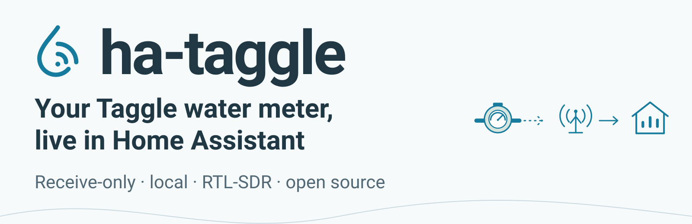
</picture>
</p>

<p align="center">
  <a href="https://ha-taggle.dancloud.au"></a>
  <a href="https://github.com/Spicynostalgia/ha-taggle/releases"></a>
  <a href="https://github.com/Spicynostalgia/ha-taggle/actions/workflows/ci.yml"></a>
  <a href="LICENSE"></a>
  <a href="#a-home-assistant-os--add-on"></a>
  <a href="#add-the-dashboard-card"></a>
  <a href="#where-it-works"></a>
</p>

<p align="center">
<a href="https://my.home-assistant.io/redirect/supervisor_add_addon_repository/?repository_url=https%3A%2F%2Fgithub.com%2FSpicynostalgia%2Fha-taggle">
  <picture>
    <source media="(prefers-color-scheme: dark)" srcset="docs/images/brand/button-install-addon-dark.svg">
    
  </picture>
</a>
<a href="https://my.home-assistant.io/redirect/hacs_repository/?owner=Spicynostalgia&amp;repository=ha-taggle&amp;category=plugin">
  <picture>
    <source media="(prefers-color-scheme: dark)" srcset="docs/images/brand/button-add-card-hacs-dark.svg">
    
  </picture>
</a>
<a href="https://github.com/Spicynostalgia/ha-taggle/wiki">
  <picture>
    <source media="(prefers-color-scheme: dark)" srcset="docs/images/brand/button-read-wiki-dark.svg">
    
  </picture>
</a>
<a href="https://github.com/Spicynostalgia/ha-taggle/issues/new?template=compatibility.yml">
  <picture>
    <source media="(prefers-color-scheme: dark)" srcset="docs/images/brand/button-report-council-dark.svg">
    
  </picture>
</a>
</p>

# ha-taggle: hourly water use in Home Assistant

ha-taggle brings hourly water-use updates from supported Taggle transmitters into Home Assistant. An RTL-SDR USB radio receiver listens to the transmitter; MQTT passes its messages to Home Assistant. Start with pulses, then enter manual dial readings to calibrate litres. It runs locally and only listens.

> [!IMPORTANT]
> **The transmitter does not send the reading on your dial.** It sends a pulse counter with an **unknown starting offset and unknown litres per pulse**. Guided calibration in **0.3.0** uses a **one-hour routine**: read just after a transmission → use **20–50 L** (reuse it) → read after the next transmission. Two aligned dial readings let it work out both. Follow **Calibration status** if it needs another reading. Until calibrated, usage is shown in pulses. Start with [Turn pulses into litres](#turn-pulses-into-litres) or the [wiki Calibration guide](https://github.com/Spicynostalgia/ha-taggle/wiki/Calibration). Check the estimated reading against your physical dial; this is experimental, not billing-grade measurement.

**Only one transmitter has been verified:** Gladstone, QLD, with an RTL-SDR Blog V4, on an owner-confirmed **Elster (Honeywell) V100**. Its readings match the **5 L/pulse** V100 PSM-T specification; **still calibrate yours**. Other models and areas are unverified. Check your meter before buying hardware. Automated tests use generated signals; they do not establish compatibility with another transmitter.

[Check your meter](#will-it-work-for-me) · [Install A/B](#install) · [Calibrate](#turn-pulses-into-litres) · [Add the card](#add-the-dashboard-card) · [Troubleshooting](#troubleshooting). The [wiki guides and references](https://github.com/Spicynostalgia/ha-taggle/wiki) are optional background or help with a specific step.

These instructions use receiver and card **0.3.1**. The [hardware test record](https://github.com/Spicynostalgia/ha-taggle/wiki/Tested-Hardware) used receiver **0.2.1**; it does not establish field verification of every 0.3.0 feature. Find your installed receiver version on the add-on's **Info** tab or the MQTT device's information panel; Docker also shows the image tag with `docker compose images taggle`. Update the receiver and card together using [the update steps](#back-up-and-update).

## How it works in 30 seconds

<picture>
  <source media="(max-width: 480px) and (prefers-color-scheme: dark)" srcset="docs/images/brand/how-it-works-mobile-dark.svg">
  <source media="(max-width: 480px)" srcset="docs/images/brand/how-it-works-mobile-light.svg">
  <source media="(prefers-color-scheme: dark)" srcset="docs/images/brand/how-it-works-dark.svg">
  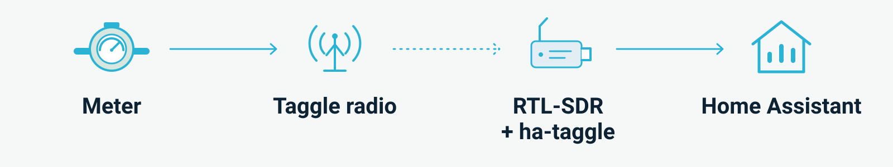
</picture>

- The **water meter** measures volume. Its **Taggle transmitter** sends a short radio message, usually once an hour.
- The message is a **pulse counter, not your dial reading**. Your two manual dial readings supply the litre scale and starting offset.
- Your **USB receiver** listens without connecting to or changing the meter. SDR means software-defined radio.
- **MQTT** lets programs exchange messages. A **broker**, such as Mosquitto, passes messages from ha-taggle to Home Assistant's MQTT integration.

Optional background: [How it works](https://github.com/Spicynostalgia/ha-taggle/wiki/How-It-Works) · [Glossary](https://github.com/Spicynostalgia/ha-taggle/wiki/Glossary).

## Screenshots

<table>
  <tr>
    <td valign="top" width="33%"><a href="docs/images/card-light.png">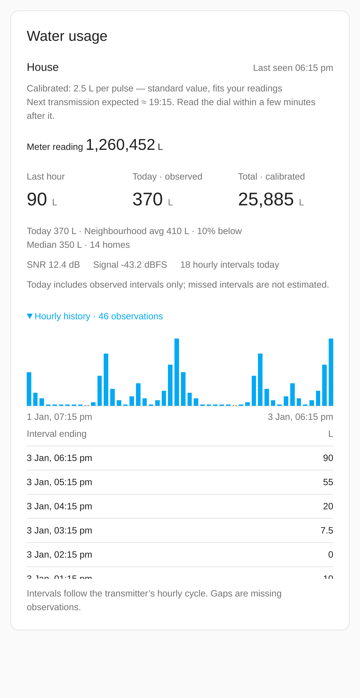</a><br><strong>Usage · light</strong><br>Fictional calibrated usage and recorded history.</td>
    <td valign="top" width="33%"><a href="docs/images/card-dark.png">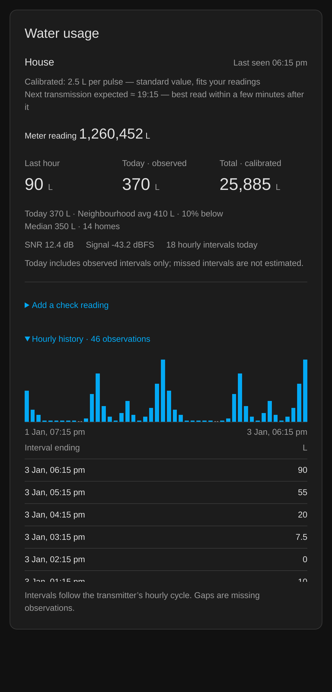</a><br><strong>Usage · dark</strong><br>The same fictional day in the dark theme.</td>
    <td valign="top" width="33%"><a href="docs/images/card-mobile.png">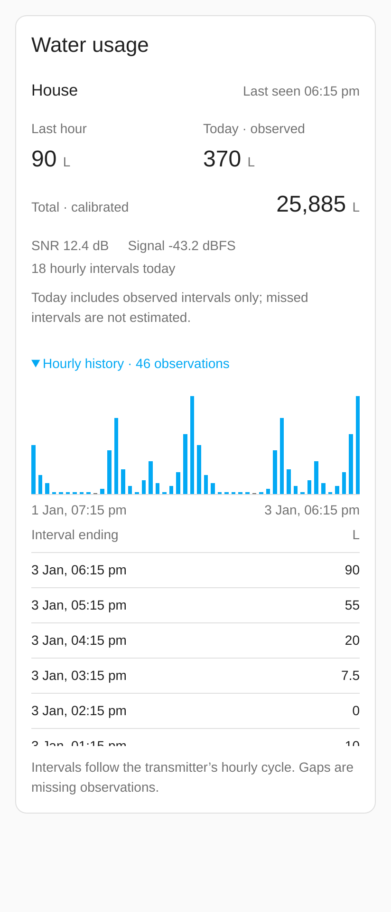</a><br><strong>Usage · mobile</strong><br>Fictional usage at a 360 px viewport.</td>
  </tr>
  <tr>
    <td valign="top" width="33%"><a href="docs/images/real-terminal.png">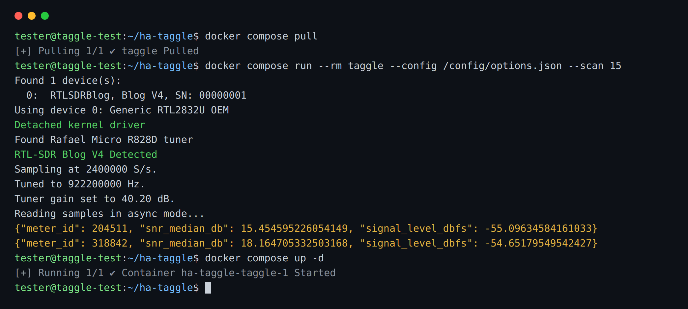</a><br><strong>Receiver terminal</strong><br>Historical 0.2.1 Docker test: USB detection, scan and startup.</td>
    <td valign="top" width="33%"><a href="docs/images/real-device.png">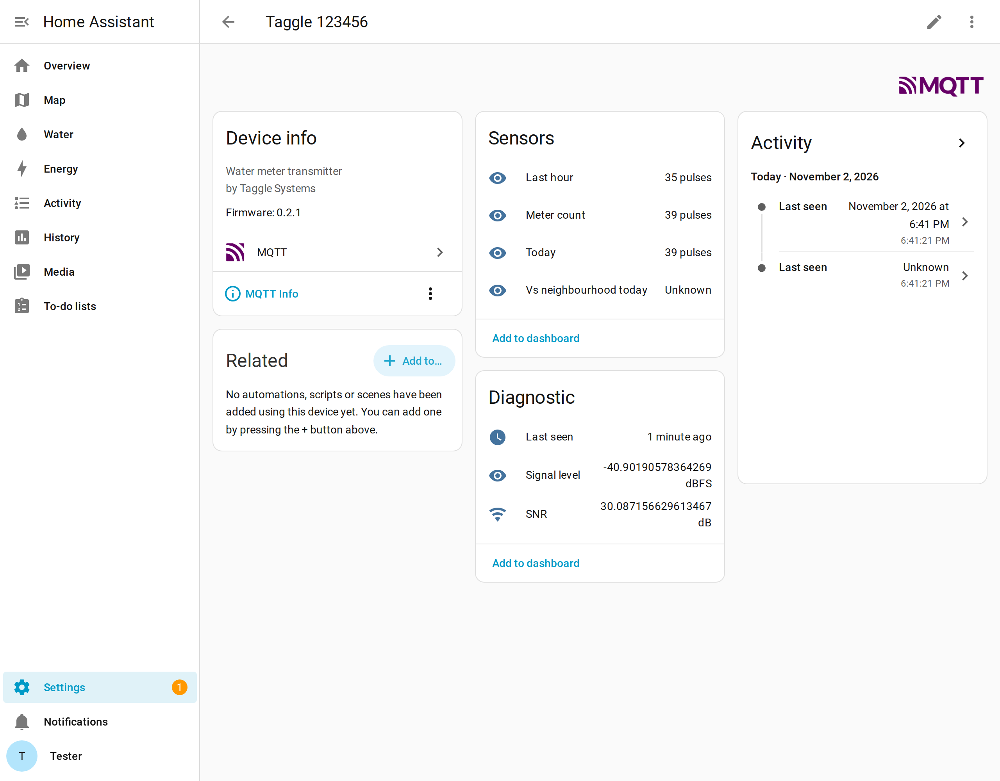</a><br><strong>MQTT device</strong><br>Real device data and reception diagnostics.</td>
    <td valign="top" width="33%"><a href="docs/images/card-multi.png">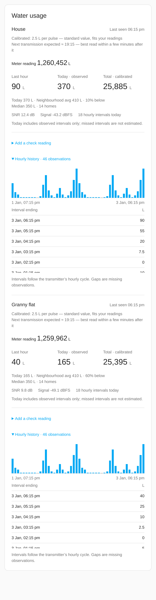</a><br><strong>Multiple meters</strong><br>Harness example: fictional House and Granny flat.</td>
  </tr>
  <tr>
    <td valign="top" width="33%"><a href="docs/images/card-calibration.png">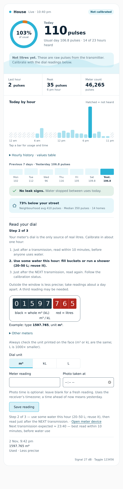</a><br><strong>Read your dial · light</strong><br>Harness example: dial guide, form and one entered reading.</td>
    <td valign="top" width="33%"><a href="docs/images/card-calibration-dark.png">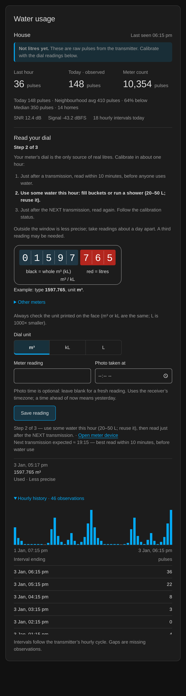</a><br><strong>Read your dial · dark</strong><br>The same fictional calibration panel in the dark theme.</td>
    <td valign="top" width="33%"><a href="docs/images/card-calibration-mobile.png">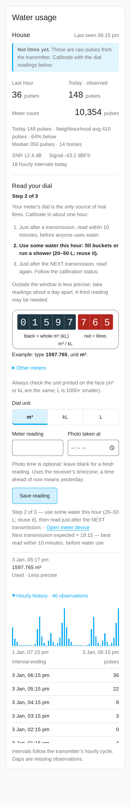</a><br><strong>Read your dial · mobile</strong><br>Fictional calibration panel at a 360 px viewport.</td>
  </tr>
</table>

Historical [0.2.1 card · light](docs/images/real-card-light.png) / [dark](docs/images/real-card-dark.png) show raw pulses before calibration. Real screenshots use fictionalised transmitter ID **123456**. The field setup was Debian 13, Docker 26 + Compose v2, HA 2026.10.4 Container, Mosquitto 2 and receiver 0.2.1 with a Blog V4 via USB passthrough. Current scan output includes UTC timestamps. Harness images use synthetic data and do not claim a new 0.3.0 field test. Select an image for full size.

## Will it work for me?

Before installing:

- Confirm that your utility uses Taggle **at your property**. A smart-meter portal alone does not confirm this.
- Check the transmitter label. **NB-IoT means cellular radio; ha-taggle cannot receive it.** Appearance alone does not establish compatibility.
- Read the [one tested setup](https://github.com/Spicynostalgia/ha-taggle/wiki/Tested-Hardware) before buying a receiver. A matching council or similar-looking transmitter is unverified.

After installing, test whether ha-taggle receives usable counts from your own transmitter. **Some councils/models use encrypted radio:** [Central Coast Council NSW](https://www.centralcoast.nsw.gov.au/mywater-smart-water-meters) describes an “encrypted radio signal” (search excerpt; the page returned HTTP 403 when fetched), and [Taggle’s Parakeet](https://taggle.com/telemetry-devices/) includes AES encryption. Supported encrypted messages provide **IDs and signal diagnostics only, no usage**; these sources do not establish local reception or compatibility. The default SDR centre is **922.2 MHz**; this receiver does not search every Taggle channel.

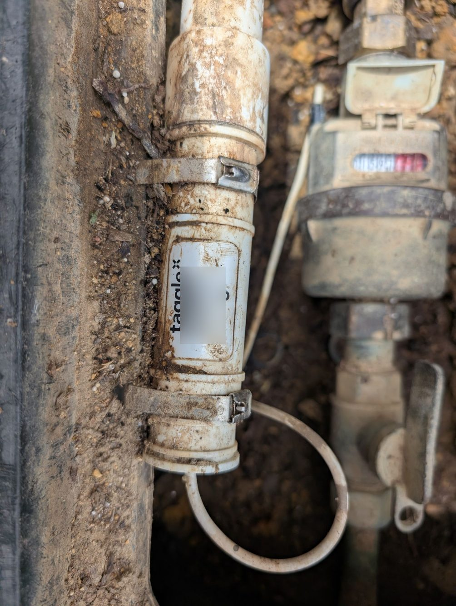

*The one verified transmitter, in Gladstone, QLD. It is attached to the owner-confirmed Elster V100. The transmitter’s exact model is unknown; identifying details are covered. Similar-looking units may work differently.*

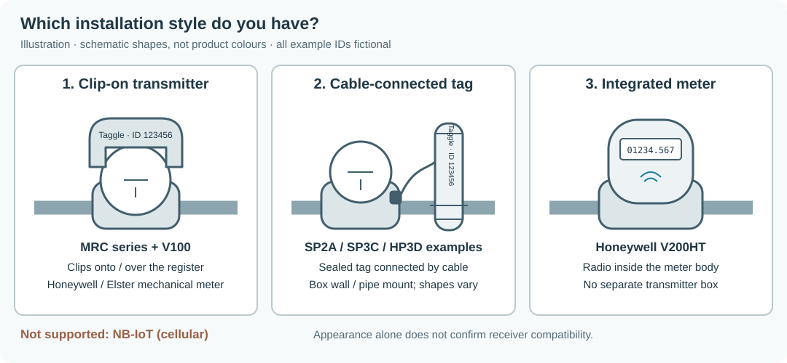

*Illustration only. These shapes do not establish compatibility.*

Check your deployment: [Is my area covered?](https://github.com/Spicynostalgia/ha-taggle/wiki/Is-My-Area-Covered).

## What you need

- An **RTL-SDR USB receiver**; the **Blog V4** is the tested choice. Other receivers are unverified with ha-taggle.
- A suitable **915–928 MHz antenna**; a bare receiver may not include one. A simple quarter-wave whip is about **8 cm** long. With the Blog dipole kit, fit the small arms and start vertically, with each side about **8 cm of total metal**: roughly **6 cm visible** plus the metal inside the base.
- A **USB extension cable** to move the receiver away from computer noise and towards a window facing the meter. Connect the antenna cable to the receiver.
- An always-on Pi, mini PC or NAS running Home Assistant OS or Docker on Linux, with USB access. Supported architectures are **amd64/aarch64**. A virtual machine needs USB passthrough.
- A running **Home Assistant** installation and an administrator account. The install steps below cover the MQTT broker and integration.

Hardware help: [Hardware and antennas](https://github.com/Spicynostalgia/ha-taggle/wiki/Hardware-and-Antennas).

## Find your meter ID

> **Look and photograph only.** Wear gloves and lift the lid gently. If the box looks unsafe, leave it closed and ask your utility for help. Leave the meter, transmitter and cables in place; do not open, unplug or move them. Replace the lid afterwards.

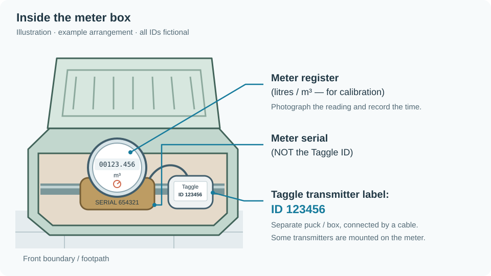

1. Photograph the **transmitter label**. Its decimal **transmitter ID**, entered in `meter_ids`, differs from the mechanical meter's serial number. Every example transmitter ID here is fictional: **123456**.
2. Photograph the **dial reading (register reading)** with units and the photo time visible. An older photo needs its original timestamp when entered later; taking a fresh reading is easier.
3. If the label is unreadable, continue installing with an **empty ID list**, then [scan](#scan-for-your-transmitter). Confirm a candidate using the label, repeated [water-use checks](#check-your-transmitter-id), or your utility before normal reception. Do not leave the example ID configured.

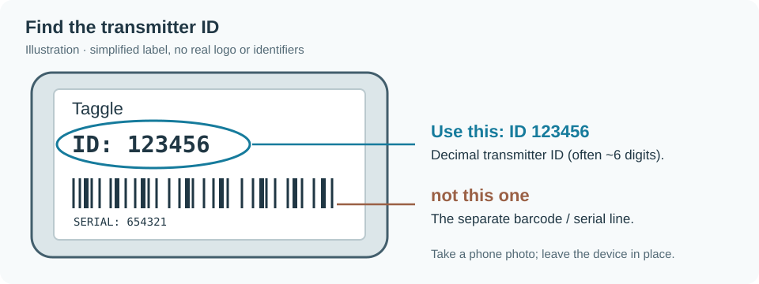

Identification and safety help: [Finding your meter](https://github.com/Spicynostalgia/ha-taggle/wiki/Finding-Your-Meter). Keep IDs, barcodes, private logs and configuration out of public posts.

## Install

| Your starting point | Next step |
| --- | --- |
| Home Assistant is not installed | Finish [Home Assistant installation and onboarding](https://www.home-assistant.io/installation/), then return here. Home Assistant OS is the beginner route. |
| Home Assistant OS | [Install the add-on](#a-home-assistant-os--add-on). An add-on is a program managed by HA OS; newer menus call it an app. |
| Home Assistant Container, or a separate Linux receiver computer | [Install with Docker](#b-docker--linux-computer). Docker runs the receiver in a separate software container. |
| Unsure | Check **Settings → System → Repairs → ⋮ → System information** for your installation type. |

Home Assistant OS and Container are the supported upstream installation methods. Existing Core/Supervised users can consult the [Python CLI](https://github.com/Spicynostalgia/ha-taggle/wiki/Python-CLI) or add-on route as applicable; [upstream support for those methods ended after 2025.12](https://www.home-assistant.io/blog/2025/05/22/deprecating-core-and-supervised-installation-methods-and-32-bit-systems/).

Open Home Assistant at `http://homeassistant.local:8123` (some new installs serve on **port 80**: omit `:8123`). Allow time for setup, a full hourly transmission opportunity, and the one-hour calibration routine. Home Assistant and MQTT may take extra time if they are new to you.

**Before the first Start:** [neighbourhood comparison](#neighbourhood-comparison) is on by default. It publishes group statistics, not individual neighbours' IDs or usage. To disable collection, set `neighbourhood: false` in add-on options or `"neighbourhood": false` in receiver JSON.

### A. Home Assistant OS → add-on

Add-on installation, automatic MQTT credentials and discovery were checked on HAOS 18.4 / HA 2026.10.4 without an SDR. Real radio reception was tested through Docker. No terminal is required for this route.

[](https://my.home-assistant.io/redirect/supervisor_add_addon_repository/?repository_url=https%3A%2F%2Fgithub.com%2FSpicynostalgia%2Fha-taggle)
[](https://my.home-assistant.io/redirect/supervisor_addon/?addon=core_mosquitto)

1. In **Settings → Apps (Add-ons) → Store** (or **Install app**), install **Mosquitto broker** if needed. Enable **Start on boot** and **Start** it. Under **Settings → Devices & services**, configure the discovered **MQTT** integration; if absent, choose **Add integration → MQTT** and follow the broker's Documentation tab.
2. Use the repository button above, or add `https://github.com/Spicynostalgia/ha-taggle` under the Store's **⋮ → Repositories**. Refresh the Store and install **Taggle water meter**. Connect the USB receiver and antenna.
3. Open its **Configuration** tab. In the form, add your transmitter ID to the `meter_ids` list. For YAML, use **⋮ → Edit in YAML** and change the existing entry to `meter_ids: [123456]`, substituting your ID. **Keep the other options**; do not replace them with Docker JSON or edit HA's `configuration.yaml`.
4. Set `timezone` to Home Assistant's named timezone, for example `Australia/Brisbane`, `Australia/Sydney`, `Australia/Adelaide` or `Australia/Perth`. Do not copy Brisbane just because you live in Australia. Leave `litres_per_count: []` for guided calibration. Supervisor supplies MQTT credentials automatically.
5. **Save**. If the ID is unknown, keep `meter_ids: []`, set `scan_minutes: 65`, Save, then follow [the scan steps](#scan-for-your-transmitter). Otherwise leave `scan_minutes: 0`, enable **Start on boot**, **Start**, and open **Log/Logs**. Continue with [the startup checks](#check-its-working).

Add-on reference: [addon/DOCS.md](addon/DOCS.md) · [Full add-on installation guide](https://github.com/Spicynostalgia/ha-taggle/wiki/Installing-the-Add-on).

### B. Docker → Linux computer

<details>
<summary>Docker setup: receiver, broker and Home Assistant MQTT</summary>

Run these commands in a terminal on the **receiver's Linux host**. They create a receiver project; keep your existing Home Assistant Container project.

**Already using Docker?** Run `docker --version` and `docker compose version`. If both work, keep that installation and skip to cloning. If Compose is missing, use [the Compose instructions for your existing Docker source](https://docs.docker.com/compose/install/linux/).

<details>
<summary>No Docker yet? Debian 13 package setup</summary>

These package commands are for **Debian 13**, where `docker-compose` supplies Compose v2. For Ubuntu or other releases, follow [Docker's installation selector](https://docs.docker.com/engine/install/); package names differ.

```sh
sudo apt update
sudo apt install -y docker.io docker-compose git nano
sudo usermod -aG docker "$USER"
```

Log out and back in, then check `docker --version` and `docker compose version` before continuing.

</details>

Install `git` and your preferred editor if absent (`sudo apt install git nano` on Debian). Then:

```sh
git clone https://github.com/Spicynostalgia/ha-taggle.git
cd ha-taggle
cp config.example.json config.json
mkdir -p data
chmod 700 data
chmod 600 config.json
```

If you have no broker, complete the recipe below first. Otherwise use your existing broker credentials.

<details>
<summary>No broker yet? Create an authenticated Mosquitto broker</summary>

Run from the cloned `ha-taggle` directory. This is a separate broker Compose file; it does not replace the receiver's `docker-compose.yml` or your HA configuration.

```sh
mkdir -p mosquitto/config
chmod 755 mosquitto mosquitto/config
docker run --rm -it --user "$(id -u):$(id -g)" \
  -v "$PWD/mosquitto/config:/mosquitto/config" \
  --entrypoint mosquitto_passwd eclipse-mosquitto:2 \
  -c /mosquitto/config/passwords taggle
sudo chown 1883:1883 mosquitto/config/passwords
sudo chmod 600 mosquitto/config/passwords
nano mosquitto/config/mosquitto.conf
```

The password command prompts twice without putting the password in shell history. `-c` creates a new password file: use it only for initial creation. The image's [broker user is UID/GID 1883](https://github.com/eclipse-mosquitto/mosquitto/blob/master/docker/generic/README.md), matching the ownership above.

Put this in `mosquitto/config/mosquitto.conf`, then save:

```text
listener 1883
allow_anonymous false
password_file /mosquitto/config/passwords
log_dest stdout
```

Create `mosquitto/compose.yaml` with:

```yaml
services:
  mosquitto:
    image: eclipse-mosquitto:2
    user: "1883:1883"
    restart: unless-stopped
    ports: ["1883:1883"]
    volumes:
      - ./config:/mosquitto/config:ro
```

Then:

```sh
chmod 644 mosquitto/config/mosquitto.conf
docker compose -f mosquitto/compose.yaml up -d
docker compose -f mosquitto/compose.yaml ps
docker compose -f mosquitto/compose.yaml logs --tail=30
```

Confirm the broker stays running and opens its port 1883 listener before continuing. If it cannot read the password file, check the ownership and permissions above. Use username **`taggle`** and the password you just chose in both the receiver JSON and HA's MQTT integration. Keep port 1883 on your trusted home network; do not forward it from the internet.

After editing broker configuration, use `docker compose -f mosquitto/compose.yaml restart mosquitto`. Broker command reference: [Mosquitto password files](https://mosquitto.org/man/mosquitto_passwd-1.html).

</details>

Find the broker computer's home-network address: `ip -br address` lists interfaces. For example, `enp1s0 UP 192.168.1.50/24` means use **`192.168.1.50`**, without `/24`. Choose active Ethernet/Wi-Fi, ignoring `lo`, `docker0` and `br-…`. Reserve the address in your router so it stays stable.

Run `nano config.json` (or your editor). Edit the copied file, keeping its braces and other settings:

- Replace the number in `"meter_ids": [123456]` with your transmitter ID, or use `"meter_ids": []` while scanning for an unknown ID.
- Set `"timezone"` to your local named timezone, matching Home Assistant. It controls “today”; Compose's `TZ: UTC` does not override it. Scan timestamps remain UTC.
- Leave `"data_dir": "/data"` and `"litres_per_count": {}` for guided calibration.
- In the existing `"mqtt": { ... }` block, change **`"host"`** to the broker's LAN address, plus **`"username"`** and **`"password"`** to its credentials. Do not add a literal `mqtt.host` key. JSON uses double quotes and no comments or trailing commas.

In nano, save with **Ctrl+O → Enter**, then exit with **Ctrl+X**. The copied host `mqtt` works only on a shared Compose network with that service name. **`localhost` inside the receiver container means that container**, even when HA and Mosquitto run on the same PC.

In Home Assistant, open **Settings → Devices & services → Add integration → MQTT**. Enter the same broker LAN address, port **1883**, username and password. Then, from the receiver repository:

```sh
docker compose pull
# Check JSON syntax without printing broker credentials:
docker compose run --rm --no-deps --entrypoint python3 taggle -m json.tool /config/options.json > /dev/null
# If the transmitter ID is unknown, follow the scan section before starting:
docker compose up -d taggle
docker compose ps
docker compose logs -f taggle
```

Confirm the receiver stays running, then [check startup and MQTT](#check-its-working). **Ctrl+C in `logs -f` only leaves the log viewer**; the detached receiver keeps running. The supplied Compose image is pinned to **`:0.3.1`**.

Installation reference: [Full Docker setup guide](https://github.com/Spicynostalgia/ha-taggle/wiki/Installing-with-Docker).

</details>

## Check it's working

1. Confirm the add-on/container stays running. In **Logs**, look for `RTL-SDR Blog V4 Detected` on V4 hardware and `Reading samples in async mode...`. Resolve startup errors now; waiting an hour cannot fix them.
2. In **normal mode**, confirm `MQTT connected` names your broker. Discovery creates configured Taggle devices before the first radio reading, plus the neighbourhood device when enabled. If devices are absent, check IDs, broker connection, HA's MQTT integration and scan mode.
3. Open **Settings → Devices & services → MQTT → devices → Taggle [your ID]**. **Last seen**, SNR and signal level may be under **Diagnostics**. Before reception, usage may be unknown/unavailable. Once startup is healthy, allow **65 minutes** for an hourly transmission opportunity; reception is not guaranteed.

Example normal-mode log lines (fictional ID/address; startup order can vary):

```text
2026-11-03T07:00:00+1000 INFO Listening on 922.2 MHz for meter(s): 1 configured; first reading can take up to an hour
2026-11-03T07:00:01+1000 INFO MQTT connected to 192.168.1.50:1883
2026-11-03T07:38:18+1000 INFO Meter 123456: +10 pulses last hour, SNR 30.1 dB
```

Receiver log lines start with an ISO local timestamp and UTC offset, using the process/container timezone (`TZ`; the supplied Compose file uses UTC). Scan JSON keeps its sample-derived UTC `time`.

A normal-mode listening summary appears every **15 minutes**, counting frames and distinct other meters without listing neighbour IDs. It proves the receiver runs, not that your own meter was heard. Scan mode has no MQTT or normal heartbeat; silence can mean no decoded frames yet.

## Turn pulses into litres

The tested meter is an **Elster (Honeywell) V100**, owner-confirmed. Elster’s [V100 PSM-T specification](https://cdn.shopify.com/s/files/1/0556/0283/9744/files/V100_PSM_T_SML001_SpecSheet.pdf) lists **5 L/pulse** for the **5 black + 3 red** counter and **0.5 L/pulse** for the **4×4** counter. The tested meter’s readings match **5 L/pulse**: Two utility meter readings 24 hours apart (3 November 2026) spanned **585 L over 116 radio pulses = 5.04 L/pulse**, i.e. 5 L within one pulse of rounding, and two dial photos taken in between agreed within a pulse. **Still calibrate yours**. The radio counter has an arbitrary starting offset, so multiplying it by 5 does not reconstruct your dial reading.

**Guided calibration is available in 0.3.0. Manual dial readings are the main path; no utility account, maths, configuration edit or receiver restart is needed.**

The dashboard card’s **Read your dial** panel has a dial picture, help for other meter types, and a form to save your unit, reading and optional photo time. It shows calibration progress and your last ten readings, then collapses to **Add a check reading** once calibrated; warnings reopen the guide.

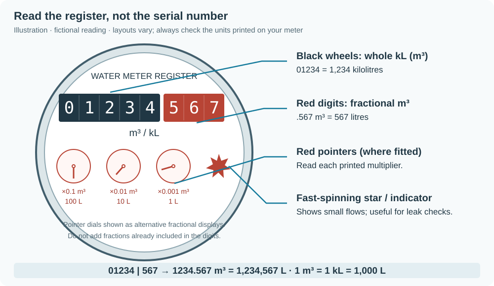

*In this illustration, black `01234` and red `567` mean **1234.567** with **m³ or kL** selected, or **1234567** with **L** selected. Your dial may differ: follow its printed units and multipliers. Do not add pointer fractions twice. The spinning star indicates flow, not the reading.*

1. **Just after a transmission**, read the dial within **10 minutes**, before anyone uses water. The card shows **Read now** with minutes remaining; **Read your dial now** (`binary_sensor.taggle_123456_read_dial_now`, displayed as **Good time to read the dial**) turns on. Choose **m³, kL or L** to match the face (1 m³ = 1 kL = 1,000 L), type the full reading, and save promptly.
2. **Use some water during the hour**, for example fill buckets or run a shower, about **20–50 L**. Reuse the water. This is practical guidance, not a minimum-usage gate.
3. **Just after the NEXT transmission** (normally about one hour later), read within 10 minutes again, before further water use. Save the second reading and follow **Calibration status**. When exactly one standard pulse size fits, calibration supplies litres automatically. If multiple sizes fit, status names them and asks for another reading.

The transmit minute can drift: the overnight hardware test moved about **13 seconds earlier per hour**. **Next transmission expected ≈ HH:MM** follows the observed timing; use that estimate and the actual **Good time to read the dial** window rather than assuming a fixed minute each hour.

Without the card, open **Settings → Devices & services → MQTT → devices → Taggle [your ID]**. Choose **Dial unit (m³ = kL, or L)**, then use the single **Dial reading (e.g. 1597.765 or 1597.765 18:00)** box and press Enter. Enter `1597.765` for a fresh reading, or `1597.765 18:00` for a photo.

### Which meter do I have?

| Meter / counter | Expected pulse size | What to do |
| --- | --- | --- |
| Elster (Honeywell) V100 PSM-T, 5 black + 3 red digits | **5 L/pulse** | Tested Gladstone meter; owner-confirmed; utility readings give 5.04 L/pulse over 116 pulses. Still calibrate yours. |
| V100, 4 black + 4 red digits (4×4) | **0.5 L/pulse** | Check the counter and output variant, then calibrate. |
| Other meter with a pulse unit or sensor | **1–1000 L/pulse**, depending on the output | Read its label/specification; do not copy another meter’s factor. |
| Honeywell V200HT, integrated radio / digital display | **Unknown here** | Confirm the radio and pulse format; ha-taggle compatibility is unverified. |

The V100 values come from the [Elster specification](https://cdn.shopify.com/s/files/1/0556/0283/9744/files/V100_PSM_T_SML001_SpecSheet.pdf); they describe the meter output, not guaranteed radio compatibility. [Meter types, illustrations and pulse-size research](https://github.com/Spicynostalgia/ha-taggle/wiki/Meter-Types-and-Pulse-Sizes).

<details>
<summary>Calibration reference: photo times, phone reminders, corrections and Energy</summary>

Outside the read-now window, readings are still accepted but are **less precise; a third reading may be needed**. For the next reading, return to the one-hour routine above. Readings may stay pending until a later frame supplies the counter bracket; `exact: true` requires a reading in the window with no pulses across its bracket. No pulses between two exact readings gives **“No water was used between your readings — use some water before the next transmission, then read again.”** Compare the estimated **Meter reading** against later dial readings.

Other accepted entries for the same **Dial reading** box: `1597,765`, `1597.765 1800`, `1597.765 at 6:00`, `1597.765@18:00`, or `1597.765 2026-11-02T18:00:00+10:00`. Clock times use the receiver’s timezone; a clock time ahead of now means yesterday. The card combines its friendly reading and optional **Photo taken at** fields into that same command. There is no separate saved photo time to affect your next reading. See [dial instructions and older photos](docs/CALIBRATION.md#reading-your-dial).

Optional phone reminder (fictional ID **123456**; replace the ID and phone action):

```yaml
triggers:
  - {trigger: state, entity_id: binary_sensor.taggle_123456_read_dial_now, to: "on"}
actions:
  - action: notify.mobile_app_your_phone
    data:
      message: "Read your dial now, before anyone uses water."
```

The sensor is on for ten minutes after each configured-meter frame, with `since`, `until`, and `next_transmission` attributes.

To correct a mistake, follow [correction instructions](docs/CALIBRATION.md#correct-or-reset-readings). **Delete all dial readings**, under the device’s **Configuration**, clears all entered readings and automatic calibration. It preserves the unit, observed usage totals and configuration pins.

**Already set `litres_per_count`?** That manual value pins litres per pulse; guided calibration checks it and cannot replace it. To allow automatic selection, remove any `meter_reading_offset` pin and clear `litres_per_count` (`[]` in add-on options, `{}` in Docker JSON), Save, and restart **the receiver** once. Guided submissions themselves need no restart.

[Guided calibration, photo times and correction](docs/CALIBRATION.md) · [Advanced manual maths and CSV](docs/CALIBRATION.md#manual-maths-and-csvcli).

### Track water in the Energy dashboard

After guided calibration, choose **Meter reading** (`sensor.taggle_123456_meter_reading`, using your actual entity ID) under **Settings → Dashboards → Energy → Water**. It estimates the absolute dial reading; Home Assistant records changes from its statistics baseline. This does not import lifetime water use or recreate earlier hourly history. Allow an hour or two for statistics, and check the estimate against your physical dial periodically.

| Sensor | What its total means |
| --- | --- |
| **Meter reading** | Estimated dial total from your readings and the unwrapped radio counter. Withheld when the absolute counter is ambiguous. |
| **Total litres** (`total_litres`) | Adds each newly recovered interval using the litres per pulse active when first processed. Earlier stored intervals are not recalculated; a later frame can still recover a recent earlier interval. |

The manual-factor-only route can use **Total litres** for Energy before an absolute reading exists. Choose **one source per water supply**, rather than counting both. Calibration corrections/reset can change or temporarily remove the absolute estimate; review Energy statistics when changing its source. [Sensor and Energy details](docs/CALIBRATION.md#energy-and-the-three-counters).

</details>

## Add the dashboard card

The custom card is **optional**; standard HA sensor cards already work. A fresh custom card says **“Waiting for first reading (can take up to an hour)”**. A previously seen meter that loses reception keeps its warning.

The ring compares Today with the mean of the previous seven complete local days’ recorded daily maxima. If fewer days have history, it uses those available; hover the usual-day line for the recorded-day count. The card caches this history for an hour and starts learning again when no history is available. Keep the `today_litres` (or uncalibrated `today`) sensor included in Home Assistant Recorder for this comparison and the seven-day strip. Missing days and hours are never filled with zero or estimated.

**Live** means the transmitter was heard within 75 minutes; otherwise the header shows **Last heard**. Tap, hover or focus an hourly bar for its value and local hour; the values table includes both today and recent transmitter intervals. Meter shows the absolute dial estimate in kL to two decimals. Before calibration, usage and meter count stay in pulses, with the dial-reading guide open.

<details>
<summary>Install through the browser on Home Assistant OS, without HACS</summary>

1. Install **File editor** from **Settings → Apps (Add-ons) → Store / Install app**, Start it, then **Open Web UI**. [Official file-access instructions](https://www.home-assistant.io/common-tasks/os/).
2. Use its folder browser to find the directory containing HA's `configuration.yaml` (shown as `/homeassistant` in some File editor versions; HA calls it `/config`). Use **New folder** to create `www` there if absent, then open `www`.
3. Open [dist/taggle-card.js](dist/taggle-card.js) on GitHub and choose **Download raw file**. Upload that file using File editor's **Upload file** control, or create `taggle-card.js`, paste the raw JavaScript and Save. Check the filename has no `.txt` or `.html` suffix.
4. When first creating `www`, restart **Home Assistant** from **Settings → System → ⋮ → Restart Home Assistant**. Then open `/local/taggle-card.js` on your HA instance: it should show JavaScript, not a 404 or GitHub HTML page.
5. Continue with resource registration below.

</details>

**Container manual route:** find the host directory mapped to Home Assistant's `/config`, containing `configuration.yaml`. Save the raw card file as `www/taggle-card.js` inside that directory, not inside the receiver repository. Restart HA after first creating `www`, check `/local/taggle-card.js`, then register the resource.

**Register a manual resource:** enable **Advanced Mode** in your HA user profile if Resources is hidden. Under **Settings → Dashboards → ⋮ → Resources**, add `/local/taggle-card.js?v=0.3.1` as a **JavaScript module**. Reload the browser.

**HACS alternative:** the Home Assistant Community Store installs custom cards and integrations; it is separate from the add-on Store. Follow its [prerequisites](https://hacs.dev/docs/use/download/prerequisites/), [download](https://hacs.dev/docs/use/download/download/) and [initial configuration](https://hacs.dev/docs/use/configuration/basic/) steps first. Then use the button below, or add this repository under **HACS → ⋮ → Custom repositories → Dashboard**. Download **ha-taggle** 0.3.1 and reload as prompted.

[](https://my.home-assistant.io/redirect/hacs_repository/?owner=Spicynostalgia&repository=ha-taggle&category=plugin)

On the MQTT device, open a sensor → settings → **Entity ID** to copy its actual ID. A friendly name such as “Last hour” is not the entity ID, and neither is transmitter number `123456`. Existing renames and collision suffixes are preserved.

Choose **Edit dashboard → Add card → Manual**, paste the YAML below, replace **every** fictional ID with your actual entity IDs, keep indentation, and **Save**:

```yaml
type: custom:taggle-card
title: Water usage
entities:
  last_hour: sensor.taggle_123456_last_hour
  today: sensor.taggle_123456_today
  meter_count: sensor.taggle_123456_meter_count
  last_seen: sensor.taggle_123456_last_seen
  snr: sensor.taggle_123456_snr
  signal_level: sensor.taggle_123456_signal_level
  calibration_status: sensor.taggle_123456_calibration_status
  meter_reading: sensor.taggle_123456_meter_reading
  possible_leak: binary_sensor.taggle_123456_possible_leak
```

<details>
<summary>Card reference: explicit litre mappings, multiple meters and device discovery</summary>

Default pulse mappings acquire the calibration and litre entities automatically in 0.3.0, including renamed entities when the registry identifies the same device. If you use custom IDs without registry lookup, map `last_hour_litres`, `today_litres`, `total_litres`, `meter_reading` and `calibration_status` explicitly. For example, after calibration:

```yaml
type: custom:taggle-card
entities:
  last_hour_litres: sensor.taggle_123456_last_hour_litres
  today_litres: sensor.taggle_123456_today_litres
  total_litres: sensor.taggle_123456_total_litres
  meter_reading: sensor.taggle_123456_meter_reading
  calibration_status: sensor.taggle_123456_calibration_status
  last_seen: sensor.taggle_123456_last_seen
  snr: sensor.taggle_123456_snr
  signal_level: sensor.taggle_123456_signal_level
  possible_leak: binary_sensor.taggle_123456_possible_leak
```

Alternatively, use `device:` with the HA device registry ID from the end of that device page's `/config/devices/device/…` URL. This long ID is **not** transmitter number `123456`; device mode discovers the calibration and leak entities automatically.

Card reference: [Dashboard card](https://github.com/Spicynostalgia/ha-taggle/wiki/Dashboard-Card) (multiple meters, mobile views and renamed entities). The card follows HA's theme/timezone and locale for number/date formatting; built-in labels are English.

</details>

<details>
<summary>Receiver reference: scanning and confirming your transmitter ID</summary>

### Scan for your transmitter

Only one program can use the USB receiver. **Stop normal reception before scanning.** Scans print heard IDs privately and create no MQTT discovery, usage state or JSONL files.

**Add-on:** in Configuration, set `scan_minutes: 65` (an empty `meter_ids: []` is allowed), **Save**, then **Start/Restart Taggle water meter**. Watch Logs. After it finishes, set only your confirmed ID, restore `scan_minutes: 0`, Save, and Start the add-on in normal mode.

**Docker:** from the receiver repository:

```sh
docker compose stop taggle
docker compose run --rm taggle --config /config/options.json --scan 65
# After the scan, edit config.json so meter_ids contains only your confirmed ID.
docker compose up -d taggle
```

**Ctrl+C in the one-off scan stops that scan**. `scan_minutes` is add-on-only; never add it to standalone JSON. For Python, stop the existing receiver process/service first and use `--scan 65`; return to `taggle-rx --config config.json` without `--scan`.

Each scan line includes sample-derived UTC frame time, not decoding completion time, and one-decimal signal measurements. Fictional unconfigured example:

```json
{"time":"2026-01-01T12:15:00+00:00","meter_id":123456,"snr_median_db":30.1,"signal_level_dbfs":-40.9}
```

Only configured clear meters also include `"counts": [120, 110, 104]`. Missing counts for an unconfigured ID do not establish encryption. Supported clear formats are 18 or 21 bytes; only 18-byte frames have field confirmation. Encrypted 24-byte frames expose diagnostics only. Neither normal logs nor scans print exact frame length: report **unknown** if you do not already know it. [Exact scan schema](docs/PROTOCOL.md#scan-output).

### Check your transmitter ID

Use a **water-tap test**, meaning your household tap; never knock or touch utility equipment. Just after a fresh reading, note the time, stop other water use, and measure **2 × 10 L** into a bucket. Reuse the water. Look for corresponding pulses in the next interval, checking the following update if the draw crossed an interval boundary.

This is evidence, not proof of ownership or litre calibration. With an unknown pulse size, 20 L may produce no clear change; the usage need not exceed the previous hour. Repeat uncertain identification during normal use at another time, or ask your utility. Do not waste more water to force a result or keep an unconfirmed ID configured. Encrypted meters cannot support this usage check. [Water-use check guide](https://github.com/Spicynostalgia/ha-taggle/wiki/First-Scan-and-Tap-Test).

</details>

## Neighbourhood comparison

**Today uses the local date of each interval’s end.** An interval crossing midnight, such as **23:39–00:39**, counts towards the **new day** in both your meter’s total and neighbourhood totals. At midnight the neighbourhood’s today values normally return to unknown for several hours while enough new-day observations arrive.

<details>
<summary>Group statistics, calibration assumptions and privacy</summary>

This is **on by default**. It publishes averages, a median and group counts from nearby meters once enough qualify. Your configured meters are excluded; individual neighbours' IDs and usage never reach MQTT.

Values stay **unknown until at least three meters qualify for that cohort**. Today's values need **at least six observed intervals per neighbour** and **75% coverage of elapsed local clock hours**; hearing three IDs alone is not enough. After local midnight, today's average, median, counted meters and your comparison percentage stay **unknown until at least three neighbours qualify again**. This can take roughly **five hours** (00:00–05:05 in the overnight hardware test), depending on transmission times and reception. This daily wait is expected.

**Neighbours' litres per pulse are unknown.** Unless separately configured, the comparison uses your first configured meter's calibrated litres per pulse, or raw pulses if it is uncalibrated. Applying your calibration to neighbours is an assumption, not a calibration of their meters. Reception gaps can bias this rough comparison; it is not a ranking of household efficiency.

The card hides percentages when displayed units differ. **Current receiver limitation:** if the first meter is uncalibrated and a later configured meter is calibrated, MQTT can still publish a raw-pulse `vs_neighbourhood_today` percentage for that later meter. Do not interpret it as a litres comparison.

To stop collection, set `neighbourhood: false` in add-on options or `"neighbourhood": false` in JSON, then restart **the receiver**. Hiding the card row changes only display. With default logging, neighbour IDs are absent from normal logs, state and JSONL; state uses installation-specific opaque keys. Scans print heard IDs, and enabling **both** `log_all_meters` and `jsonl_logging` writes IDs into private JSONL summaries. Keep those outputs private.

Reference: [Neighbourhood comparison](https://github.com/Spicynostalgia/ha-taggle/wiki/Neighbourhood-Comparison).

</details>

### Possible leak alert

Configured meters also get a **Possible leak** hint in 0.3.0, enabled by default, from continuous hourly flow or local night flow. It needs no litre calibration and never evaluates neighbours. The card badge shows its reason when the binary sensor is ON. The night rule decides after the window completes; with at least three observations, all must meet the pulse threshold to activate that reason, and any below it clears that reason. Fewer observations leave it unchanged.

**This is a hint, not an alarm or a confirmed leak.** Hourly totals cannot detect a dripping tap below one pulse per hour. Irrigation and normal overnight use can trigger it. Check the physical meter and household usage. Adjust `leak_night_start` / `leak_night_end` in your local timezone, or disable with `leak_detection: false` (JSON: `"leak_detection": false`) and restart the receiver. [Full rules, options and MQTT attributes](docs/LEAK-DETECTION.md).

## Back up and update

<details>
<summary>Preserve private readings and state; update receiver and card together</summary>

Guided readings and their solution live in **private receiver state**, not just configuration. Before updating, include the **Taggle add-on's data** in an HA OS backup, or stop the Docker receiver with `docker compose stop taggle` and back up its **`data` directory and `config.json`** before starting it again. Keep these backups private. Keep the same persistent data mount; restarts preserve it, deleting it loses the baseline and does not repair reception.

For HA OS, update **Taggle water meter** from its Info page. For Docker, keep your config/data and update the Compose image tag deliberately; the supplied file uses **0.3.1**. Run `docker compose pull` followed by `docker compose up -d taggle` to recreate with the chosen image. Update the card to the same version via HACS or by replacing `www/taggle-card.js`, changing its resource cache suffix and reloading the browser. A cache suffix alone does not update the JavaScript.

| What changed | Apply it |
| --- | --- |
| Add-on receiver option | Save, then Restart **Taggle water meter**. |
| Existing Docker receiver JSON | From its repository, `docker compose restart taggle`. |
| Return from Docker scan | End the one-off scan, then `docker compose up -d taggle`. |
| Broker configuration | `docker compose -f mosquitto/compose.yaml restart mosquitto`. |
| First creation of HA `www` | Restart **Home Assistant**. |
| Card JavaScript | Update resource/cache as above, then reload the browser. |
| Guided dial reading | Submit and check Calibration status; no receiver restart. |

</details>

## Where it works


Share your setup through the [compatibility issue form](https://github.com/Spicynostalgia/ha-taggle/issues/new?template=compatibility.yml) to help others check their area.

<!-- compat:start -->
| Council/LGA | State | Transmitter style | Frames (18/21/24) | Usage worked? | SDR | Version | Report |
| --- | --- | --- | --- | --- | --- | --- | --- |
| Gladstone Regional Council | QLD | cable-connected tube | 18 | Usage worked | RTL-SDR Blog V4 | 0.2.1 | maintainer test (1 report) |

Confirmed reports describe individual setups; council-wide compatibility is not guaranteed.
<!-- compat:end -->

## Troubleshooting

| What you see | What to check |
| --- | --- |
| Startup fails or exits | Fix the logged error immediately. On HA OS check the app's USB access, power and cabling. On Linux check container/VM USB access. Waiting for radio traffic will not fix startup. |
| No frames after a healthy 65-minute listen | Check antenna, window placement and host noise; try a USB extension. After receiver option changes, Save/Restart the add-on or restart the Docker receiver. Compare reception over another 65 minutes. Another channel or unsupported meter is possible. |
| “Device busy” / cannot open SDR | Stop competing receiver/scan programs first. Check USB passthrough, power and cabling. Linux hosts may have a DVB TV driver conflict; the tested image detached it automatically. Debian driver commands are not HA OS setup steps. |
| No MQTT devices | Confirm configured IDs, normal mode, `MQTT connected`, the same broker in HA, and discovery enabled. Devices do not need to wait for a radio frame. |
| ID heard but usage unavailable | Only configured clear IDs expose scan counts. Return to normal mode using the steps above. Encryption or a counter/sequence discontinuity can suppress usage while diagnostics update; unavailable alone does not prove encryption. Confirmed encrypted messages provide ID/signal only. |
| Previously working entities unavailable | Check radio/USB/MQTT logs. A meter expires after three hours without a valid frame. Add-on: `scan_minutes: 0`, Save/Start; Docker: stop the one-off scan and `docker compose up -d taggle`. |
| Usage too high or low | Check dial units, calibration status, timestamps, ID and coverage. Today's total is partial observed usage. A later frame can recover one missed transmission; only unrecovered intervals remain omitted. |

Problem-solving guides: [Troubleshooting](https://github.com/Spicynostalgia/ha-taggle/wiki/Troubleshooting) · [FAQ](https://github.com/Spicynostalgia/ha-taggle/wiki/FAQ).

## Related projects

[davidjb’s Home Assistant MQTT configuration](https://gist.github.com/davidjb/faffe4a8ce14dea58b9b9b3cee862aae) bridges the **official Taggle cloud MQTT service** for account holders with access credentials. It needs **no radio** and converts the example payload’s **pulses ×5 = litres**. That factor applies to its example installation; still calibrate yours. It is a different route to the same dashboard goal and does not establish over-the-air compatibility. No other public over-the-air Taggle decoder was found in the research, so the “reported by other projects” compatibility list remains empty.

## Learn more

Setup is complete. These references are optional background or help with a particular setting.

| Topic | Guide |
| --- | --- |
| Project overview | [ha-taggle.dancloud.au](https://ha-taggle.dancloud.au) — what it does, the card, and councils with Taggle meters |
| Radio and decoding | [How it works](https://github.com/Spicynostalgia/ha-taggle/wiki/How-It-Works) · [local protocol specification](docs/PROTOCOL.md) |
| Sensors and MQTT topics | [Entities reference](https://github.com/Spicynostalgia/ha-taggle/wiki/Entities-Reference) |
| All settings and defaults | [Configuration reference](https://github.com/Spicynostalgia/ha-taggle/wiki/Configuration-Reference) · [example JSON](config.example.json) |
| Guided calibration and advanced CSV | [Calibration guide](docs/CALIBRATION.md) · [wiki Calibration](https://github.com/Spicynostalgia/ha-taggle/wiki/Calibration) |
| Identify the meter and pulse output | [Meter types and pulse sizes](https://github.com/Spicynostalgia/ha-taggle/wiki/Meter-Types-and-Pulse-Sizes) |
| Data, privacy and local laws | [Privacy and legal](https://github.com/Spicynostalgia/ha-taggle/wiki/Privacy-and-Legal) |
| Contributing and releasing | [Repo guide](CONTRIBUTING.md) · [Changelog](CHANGELOG.md) |
| Unfamiliar words | [Glossary](https://github.com/Spicynostalgia/ha-taggle/wiki/Glossary) |
| AI methods and estimates | [AI disclosure](https://github.com/Spicynostalgia/ha-taggle/wiki/AI-Disclosure) |

## Help and reporting

Working or stuck? [Report your result](https://github.com/Spicynostalgia/ha-taggle/issues/new/choose). Include your ha-taggle version, installation method, council/utility, USB receiver model and what you saw: usage, ID without usage, or nothing heard. Frame length and signal details are optional; **unknown is fine**. Normal logs and scan output do not show exact frame length; do not enable broad logging just to find it.

Replace IDs in quoted output with fictional **123456**, cover IDs/barcodes in photos, and omit passwords, private configuration, radio captures and recorded frames. [Full sharing checklist](https://github.com/Spicynostalgia/ha-taggle/wiki/Reporting-Compatibility).

The following authorship and resource-use disclosure is optional background. For practical validation, compare calibrated readings with the physical dial.

<details>
<summary>AI disclosure: authorship, costs and estimated resource use</summary>

## AI disclosure

This repository — the radio reverse engineering, the receiver, the add-on, the card, the tests, the diagrams and this documentation — was produced mostly by AI coding agents: **Anthropic Claude (Claude Code, Opus)** for planning, live probing, review and docs, and **OpenAI Codex** for most of the code and signal analysis. A human chose the goals, captured and confirmed the signal from their own meter, checked the results against the physical register and approved every change. Treat it like any other experimental code: read it before you trust it.

### What it cost (as of 2 November 2026)

| | Model calls | Tokens processed | of which cached re-reads | Output tokens |
| --- | ---: | ---: | ---: | ---: |
| Claude (incl. sub-agents) | ~380 | ~57.5 M | ~56.5 M | ~0.21 M |
| Codex | ~685 | ~61.8 M | ~59.7 M | ~0.55 M (incl. ~0.18 M reasoning) |
| **Total** | **~1,065** | **~119 M** | **~116 M (97%)** | **~0.76 M** |

Counted from the local agent session logs for the Taggle research and this repository. Most "tokens" are the agents re-reading their own context on every step (prompt cache hits), which costs far less compute than generating new text. Earlier unrelated Home Assistant work is excluded; a little unrelated chat in the same sessions may be included.

### Estimated water use

Nobody publishes a water figure for long agentic coding sessions, so this is a bracket, not a measurement:

- **Floor, about 0.3 L:** ~1,065 model calls × 0.26–0.32 mL, the per-prompt figures published by [Google for a median Gemini prompt](https://arxiv.org/abs/2508.15734) and [OpenAI's CEO for an average ChatGPT query](https://blog.samaltman.com/the-gentle-singularity). This certainly undercounts: each agent call carried roughly 100,000 tokens of context, far more than a typical chat prompt.
- **Ceiling, about 85 L:** ~0.76 M output tokens at [Mistral's figure](https://mistral.ai/news/our-contribution-to-a-global-environmental-standard-for-ai) of 45 mL for the marginal impact of one 400-token response, from its life-cycle analysis. It is far higher than the other published figures, which is why it's the ceiling.

So somewhere between **a water bottle and roughly ten minutes under a 9 L/min shower**, most plausibly in the tens of litres. Fittingly, once calibrated, this receiver would show a household using that much water within a single hour's reading.

### Estimated energy use

Same caveat: a bracket built from published per-query figures, not a meter reading.

- **Floor, about 0.3 kWh:** ~1,065 calls × 0.24–0.34 Wh, the [Google median Gemini prompt](https://arxiv.org/abs/2508.15734) and [average ChatGPT query](https://blog.samaltman.com/the-gentle-singularity) figures. Again an undercount for 100,000-token agent calls.
- **Ceiling, about 40 kWh:** ~1,065 calls × ~40 Wh, [Epoch AI's estimate](https://epoch.ai/gradient-updates/how-much-energy-does-chatgpt-use) for a query with ~100,000 input tokens. This overcounts: it assumes the whole context is recomputed every time, while ~97% of these tokens were prompt-cache hits that skip most of that work.

So somewhere between **boiling a 2 kW kettle for ten minutes and running a 2 kW heater for about 20 hours**, most plausibly a few kilowatt-hours. For carbon, Mistral's figure of 1.14 g CO₂e per 400-token response gives roughly **2 kg CO₂e** for ~0.76 M output tokens; the real figure depends heavily on each data centre's electricity mix.

</details>

## Licence and disclaimer

The application and card are MIT licensed; see [LICENSE](LICENSE). Container dependencies, including the separately executed GPL-licensed RTL-SDR Blog driver, retain their own licences. The driver's source revision and licence are preserved by the Docker builds. [Release provenance](RELEASE-CHECK.md) explains the application licence decision.

Unofficial; not affiliated with Taggle Systems or any utility. Receive-only, for reading your own meter. Respect local radio and privacy laws. Encrypted payloads are not and will not be attacked.

More detail: [Privacy and legal](https://github.com/Spicynostalgia/ha-taggle/wiki/Privacy-and-Legal).
