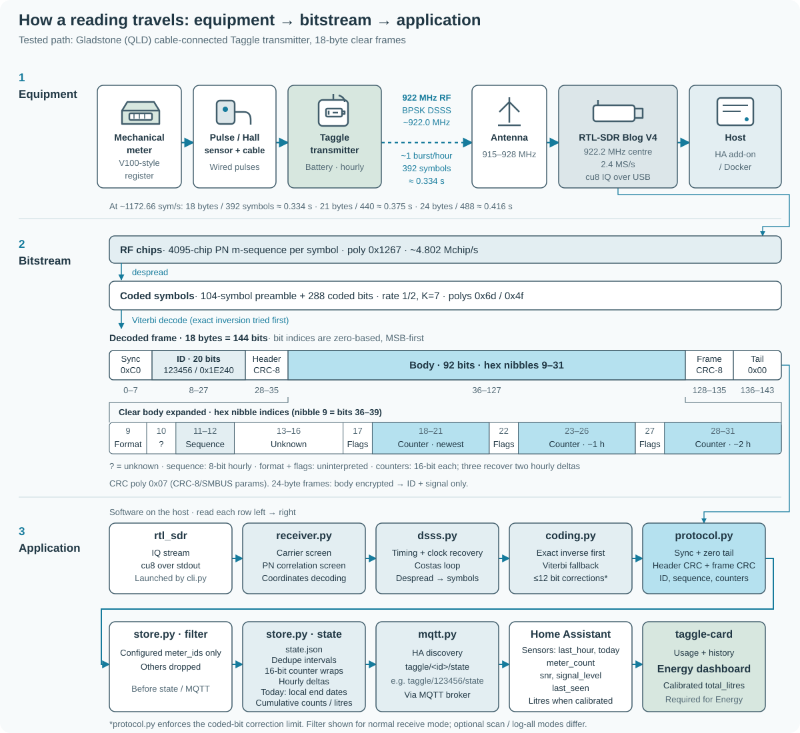

# Taggle water meter → Home Assistant

Receive your own Taggle-equipped water meter with an RTL-SDR. This project decodes supported hourly transmissions and publishes water usage and signal diagnostics through Home Assistant MQTT discovery. It runs as a Home Assistant add-on, a standalone Docker container, or a Python CLI.

[Wiki](https://github.com/Spicynostalgia/ha-taggle/wiki) — beginner guides live here too.

**0.2.0 is experimental. Only one transmitter has been verified so far**, in Gladstone, QLD; see [Tested hardware](#tested-hardware). The automated tests use generated signals, not recordings. A fresh installation still needs confirmation against your transmitter and meter register. This is hourly usage, not an instantaneous flow or leak alarm.


*Dashboard preview using synthetic data and fictional meter IDs. The example calibration is not a recommended scale for your meter.*

**What you get**

- Hourly usage in raw pulses for supported clear-format transmitters, plus signal diagnostics.
- Litres and a water total for Home Assistant Energy after you calibrate against the register.
- A dashboard card with 48-hour history, visible gaps, light/dark themes and multiple meters.
- Home Assistant add-on, Docker and Python installation options; reception stays local.

**Install:** the receiver add-on needs **Home Assistant OS or Supervised**. Home Assistant **Container/Core** users should use [Standalone Docker](#standalone-docker). An **MQTT broker** and HA's MQTT integration are prerequisites; use Mosquitto below if you need a broker. Open the add-on repository, then **Install → set `meter_ids` → Start**. The HACS button opens the optional dashboard card repository (HACS must already be installed); download the card there.

[](https://my.home-assistant.io/redirect/supervisor_add_addon_repository/?repository_url=https%3A%2F%2Fgithub.com%2FSpicynostalgia%2Fha-taggle)
[](https://my.home-assistant.io/redirect/hacs_repository/?owner=Spicynostalgia&repository=ha-taggle&category=plugin)

MQTT broker (Mosquitto):

[](https://my.home-assistant.io/redirect/supervisor_addon/?addon=core_mosquitto)

## Tested hardware

**Verified on exactly one transmitter: Gladstone Regional Council, QLD, using an RTL-SDR Blog V4.** This is one field report, not confirmation of every meter in Gladstone or any other deployment.

- Cylindrical, cable-connected Taggle pulse transmitter: a white “baton” tube hose-clamped to the supply pipe, with a thin cable to a pulse/Hall sensor on a V100-style mechanical meter.
- The meter has a flip lid, black whole-kL digits and red litre digits. The transmitter label shows only plain “taggle” text, a barcode and the ID; **no model number is printed**.
- It is likely from Taggle's pulse-transmitter family (for example SP-series / ADC-1), but **the exact model is unconfirmed**.
- Observed frames: **18-byte clear format, hourly**, with the SDR centre set to **922.2 MHz** (the default receiver setting).


*The tested transmitter in Gladstone (ID blurred).*

Please [open an issue](https://github.com/Spicynostalgia/ha-taggle/issues) for other models/councils: include your council, whether reception/usage worked, a label photo **with the ID and identifying barcode blurred**, frame length and SNR. A PR updating the working reports is welcome. Do not post your real meter ID, private logs or configuration.

## Getting started (beginner guide)

An SDR (software-defined radio) is a USB radio receiver. It listens to your meter; it does not connect to or modify the meter. MQTT carries the decoded readings from the receiver to Home Assistant.


*Illustration: the receive-only setup. The MQTT broker can run on the same host. Energy needs calibrated litres.*

### 1. Check you have a Taggle meter

- [ ] Ask your council/water utility, or search its website for **smart water meter**, **Taggle** or **digital meter**. [Several Australian councils and utilities use Taggle](https://taggle.com/case-studies/), and it is also used elsewhere; a digital meter alone does not confirm compatibility.
- [ ] Look in your meter box for a Taggle transmitter or label. This experimental receiver targets a known channel near 922 MHz; it does not support every smart meter or every Taggle deployment. See [transmitter support](#hardware-and-transmitter-support) before buying hardware.

#### Is my area covered?

**A Taggle deployment does not guarantee this receiver will work.** So far, only the [single Gladstone meter](#tested-hardware) has been confirmed at the default **922.2 MHz SDR centre**. Other deployments may use different channels, generations or encrypted formats. Taggle's [V200HT datasheet](https://taggle.com/wp-content/uploads/2023/05/Datasheet-Honeywell-V200HT-V4.pdf) permits **915–928 MHz or 928–933 MHz**; this receiver does not cover all those channels or decrypt usage.

Taggle has cited [over 45 councils/utilities](https://taggle.com/case-studies/) in older material and [75 in its 2025 announcement](https://taggle.com/taggle-announces-plan-to-expand-to-new-zealand/), but publishes no full list. The public announcements below are **not exhaustive**. Some describe pilots, partial rollouts or older plans; rollouts change. Check your council's website or call them about **your property**.

<details>
<summary>Publicly announced deployments and leads (QLD, NSW, VIC, NT and NZ)</summary>

| Council / utility | State | Public source |
| --- | --- | --- |
| Gladstone Regional Council | QLD | [Inside Water: staged rollout](https://insidewater.com.au/smart-water-metering-gladstone-taggle/) |
| Mackay Regional Council (meters since 2013) | QLD | [Taggle case studies](https://taggle.com/category/case-studies/) |
| Logan City Council / Logan Water (select areas, including Bannockburn) | QLD | [Taggle: Bannockburn and Logan announcements](https://taggle.com/category/case-studies/) |
| Southern Downs Regional Council (Warwick, Stanthorpe) | QLD | [Taggle: staged installations](https://taggle.com/smart-water-meters-saving-dollars-and-drops-in-southern-downs/) |
| Douglas Shire Council | QLD | [Council Magazine: rollout announcement](https://councilmagazine.com.au/douglas-shire-council-makes-the-switch-to-smart-water-metering/) |
| Longreach Regional Council | QLD | [Taggle: community rollout](https://taggle.com/community-embraces-water-security-in-longreach/) |
| Central Highlands Regional Council (pilot reported 2024; Taggle involvement unverified) | QLD | [Council: Capella installation, April 2024](https://chrc.qld.gov.au/council/news/capella-set-to-welcome-smart-water-meter-technology/) confirms smart meters but does not name Taggle; the [supplied Inside Water overview](https://insidewater.com.au/saving-gigalitres-of-water-with-smart-water/) does not identify this pilot. Confirmation needed. |
| Cassowary Coast Regional Council (reported installing) | QLD | [Inside Water: Queensland councils, 2022](https://insidewater.com.au/queensland-councils-saving-water-with-smart-meters/) |
| Flinders Shire Council (reported installing) | QLD | [Inside Water: Queensland councils, 2022](https://insidewater.com.au/queensland-councils-saving-water-with-smart-meters/) |
| Richmond Shire Council (reported installing) | QLD | [Inside Water: Queensland councils, 2022](https://insidewater.com.au/queensland-councils-saving-water-with-smart-meters/) |
| Tamworth Regional Council (about 23,000 meters; completed 2024; includes satellite installations) | NSW | [Taggle: completed project](https://taggle.com/tamworth-embraces-saving-water-with-taggle/) |
| Dubbo Regional Council | NSW | [Daily Liberal: 2020 tender](https://www.dailyliberal.com.au/story/6597478/dubbo-council-awards-tender-for-compulsory-rollout-of-smart-meters/); [Council: Taggle update, December 2025](https://www.dubbo.nsw.gov.au/news-and-media/news-and-resources/council-news/2025/outcomes-from-the-december-2025-ordinary-council-meeting) |
| Armidale Regional Council | NSW | [Taggle: rollout decision](https://taggle.com/armidale-regional-council-to-roll-out-smart-water-meters/) |
| Queanbeyan-Palerang Regional Council | NSW | [Taggle: rollout announcement](https://taggle.com/securing-water-for-growing-population-in-queanbeyan-palerang-regional-council/) |
| Narromine Shire Council | NSW | [Taggle: smart metering and district monitoring](https://taggle.com/transforming-regional-water-management-with-dmas/) |
| Narrabri Shire Council | NSW | [Taggle case studies](https://taggle.com/category/case-studies/) |
| Lithgow City Council | NSW | [Taggle case studies](https://taggle.com/category/case-studies/) |
| Mid-Western Regional Council | NSW | [Taggle case studies](https://taggle.com/category/case-studies/) |
| Gunnedah Shire Council | NSW | [Taggle case studies](https://taggle.com/category/case-studies/) |
| Leeton Shire Council | NSW | [Council: Taggle project](https://www.leeton.nsw.gov.au/Council-Services/Water-and-Wastewater/Smart-Water-Meters); [Utility Magazine: rollout and portal](https://utilitymagazine.com.au/smart-water-meters-and-customer-portals-provide-council-community-and-environmental-benefits/) |
| GWMWater (Grampians Wimmera Mallee Water) | VIC | [Taggle: rural metering replacement program](https://taggle.com/gwmwater-are-preparing-for-round-two/) |
| Nhulunbuy Corporation | NT | [Corporation: 2022 rollout and FAQ](https://ncl.net.au/our-community/news/2022/roll-out-taggle-systems-smart-metering-solution-and-faq) |
| New Zealand expansion (no named council in the announcement) | NZ | [Taggle: expansion plans, 2025](https://taggle.com/taggle-announces-plan-to-expand-to-new-zealand/) |

</details>

**Reported working:** Gladstone Regional Council, QLD — exactly one transmitter; see [Tested hardware](#tested-hardware). Report your council and whether it worked through an [issue](https://github.com/Spicynostalgia/ha-taggle/issues) or [PR](https://github.com/Spicynostalgia/ha-taggle/pulls).

**Tip:** bills or portals mentioning “digital meter”, “smart meter”, hourly usage or leak alerts (for example “MyWater”) are useful clues. They do not distinguish Taggle radio from cellular or other vendors.

### 2. Open your meter box safely

- [ ] Find the usually in-ground rectangular box near the front boundary or footpath. Wear gloves. Lift the lid carefully with a screwdriver at the lifting slot; don't stand on the lid or force it open.
- [ ] In Australia, check for spiders (including redbacks), snakes, ants and wasps. If you cannot inspect it safely, close it and ask the utility for help.
- [ ] **Do NOT remove, open, unplug or move the transmitter or meter. It belongs to the utility.** Just look and photograph, then replace the box lid.

### 3. Identify the transmitter and its ID


*Illustration: three installation styles, with schematic shapes and plain text labels. Appearance does not establish a model or compatibility.*

**Which one do I have?**

- [ ] **Clip-on:** an MRC-series transmitter sits on/over the register body of a Honeywell/Elster **V100** mechanical meter, a very common Australian domestic meter. See [Taggle's MRC description](https://taggle.com/telemetry-devices/).
- [ ] **Separate tag:** a small sealed battery transmitter is fixed in the box, on its wall or on the pipe, with a **cable to the meter's pulse output**. Examples include **SP2A (A-cell), SP3C (C-cell) and HP3D (D-cell)**; shapes vary. The [SP3C datasheet](https://taggle.com/wp-content/uploads/2025/12/Datasheet-SP3C-002.pdf) specifies encryption, so these examples are identification clues, not a list of working models.
- [ ] **Integrated:** a Honeywell **V200HT** has the radio inside the meter body, with no separate tag. These product families are described in [Taggle's product list](https://taggle.com/products/).

Look for “Taggle” text and an **ID** on the label, a cable to a sealed tag, or a wireless/antenna symbol on a newer meter. A symbol alone is not proof. A plain old meter with no attachment may be manual-read; a pulse logger from another vendor is not a Taggle transmitter. **NB-IoT-labelled devices are cellular and cannot be received by this project**, including the NB-IoT **Q400, EDMI WP20 and NB3D** variants in Taggle's product list.

Metal lids can block radio. Some installations have a small external antenna on/through the lid; others use RF-friendly plastic boxes. [Taggle describes an external antenna for metal-lid installations](https://taggle.com/telemetry-devices/). Leave all utility equipment in place.


*What a cable-connected Taggle looks like in real life: the tested transmitter in Gladstone (ID blurred). Its exact model is unconfirmed.*


*Illustration: a typical arrangement, not a photo. Your box and transmitter may look different.*


*Illustration: simplified label with fictional numbers; no real product logo is reproduced.*

- [ ] Take a phone photo of the **transmitter label**. Its decimal **ID** (often about six digits, e.g. fictional `123456`) is different from the mechanical meter's serial number or a separate barcode serial.
- [ ] Photograph the **register reading**, including its units (litres or m³), and keep the timestamp. This is useful later for calibration; it is not the radio counter.
- [ ] If the label is unreadable, use the scan and tap test in [step 6](#6-confirm-youre-receiving-your-meter). Ask the utility if you still cannot identify it confidently.

### 4. Get the hardware

- [ ] **RTL-SDR USB receiver:** the RTL-SDR Blog V4 is a recommended, driver-supported choice if you own one or find genuine remaining stock. Budget roughly **AUD 60** for a dongle as a starting estimate; kits, shipping and stock vary. [V4 production has ended](https://www.rtl-sdr.com/rtl-sdr-blog-v4-end-of-line/); use the [manufacturer's reseller list](https://www.rtl-sdr.com/buy-rtl-sdr-dvb-t-dongles/) to check availability. The Blog V3 is another option.
- [ ] **915–928 MHz antenna:** a quarter-wave whip is about **8 cm** at 922 MHz. With the stock telescopic dipole kit, use the short elements at about **8 cm per side**. See the [manufacturer's antenna guide](https://www.rtl-sdr.com/using-our-new-dipole-antenna-kit/).
- [ ] **USB extension cable:** move the dongle away from computer noise and closer to a window facing the meter.
- [ ] **Host:** a Pi 4/5, mini PC, or NAS with Docker and SDR USB access. Use the machine running HA if suitable; this project provides amd64/aarch64 container images. A VM needs USB passthrough.

### 5. Install

For **Home Assistant OS or Supervised**, use the add-on (called an *app* in newer HA menus). **Home Assistant Container/Core** users: follow [Standalone Docker](#standalone-docker), then return to step 6. On Docker/Linux, a DVB TV kernel driver can claim the dongle; release/blacklist that driver on the host if it causes “device busy”.

Use these shortcuts to open the receiver repository, the optional HACS dashboard card repository, or the Mosquitto broker. HACS must already be installed for its shortcut. You need a running MQTT broker and HA's MQTT integration before starting the receiver. After adding the receiver repository: **Install → set `meter_ids` → Start**; the checklist below covers the details.

[](https://my.home-assistant.io/redirect/supervisor_add_addon_repository/?repository_url=https%3A%2F%2Fgithub.com%2FSpicynostalgia%2Fha-taggle)
[](https://my.home-assistant.io/redirect/hacs_repository/?owner=Spicynostalgia&repository=ha-taggle&category=plugin)

MQTT broker (Mosquitto):

[](https://my.home-assistant.io/redirect/supervisor_addon/?addon=core_mosquitto)

1. [ ] In **Settings → Apps (Add-ons) → Store**, install and start **Mosquitto broker**, unless you already have a Supervisor-discoverable MQTT broker. Under **Settings → Devices & services**, configure the discovered **MQTT** integration. See [HA's MQTT setup](https://www.home-assistant.io/integrations/mqtt/).
2. [ ] In the Store's **⋮ → Repositories**, add `https://github.com/Spicynostalgia/ha-taggle` and click **Add**. See [HA's app repository instructions](https://www.home-assistant.io/common-tasks/os/#installing-a-third-party-app-repository) if your menu differs.
3. [ ] Refresh the Store, open **Taggle water meter**, and click **Install**. Connect the SDR and antenna.
4. [ ] Open the add-on's **Configuration** tab. Set `meter_ids` to your own decimal transmitter ID, leave `litres_per_count: []`, and set your timezone (for example `Australia/Brisbane`). Save. The add-on gets MQTT credentials from Supervisor; you do not paste them into these options.
5. [ ] Click **Start**, then open **Logs**. After a supported frame arrives, look under **Settings → Devices & services → MQTT** for the meter device. If you need to find the ID first, leave `meter_ids: []` and run the scan below.

### 6. Confirm you're receiving your meter

- [ ] Set **`scan_minutes: 65`**, save and restart the add-on. Watch **Logs** and wait the full 65 minutes: a transmitter may send only **once per hour**. Docker/CLI users can use [the scan commands](#find-your-meter-id). Scan mode publishes no MQTT entities and saves no usage state.
- [ ] Look for lines like this **synthetic example** (all numbers are fictional):

```json
{"meter_id": 123456, "snr_median_db": 12.4, "signal_level_dbfs": -43.2}
```

`snr_median_db` is a **despread correlation SNR estimate**, not the raw antenna SNR. Higher is better when comparing antenna positions, but there is **no field-validated “good” cutoff** in this release. The [synthetic receiver tests](tests/test_receiver.py) check that decoded test frames exceed 5 dB; this is a test assertion, not a required reception threshold. Repeated valid hourly frames are the useful check. Scan output includes `counts` only for IDs already in `meter_ids` and only for clear-format frames; missing counts in an unconfigured scan do not establish encryption.

- [ ] For the **tap test**, configure your ID (or a plausible candidate from an unreadable label), set `scan_minutes: 0`, save and restart. Wait for a normal reading and note the time and `last_hour`. With nothing else using water, fill a **10 L bucket twice**, note the time, then check that `last_hour` increases at the next transmission. Counts are still pulses, so do not expect the number `20`. Radio interval boundaries can split the draw; check the following update too if needed. Reuse the water.
- [ ] If identifying a candidate, repeat the timed test to confirm its response matches your own meter. A strong signal alone does not identify your meter; do not keep someone else's ID configured. Encrypted transmitters cannot support a usage tap test; ask the utility to confirm the ID instead.
- [ ] If nothing appears, move the antenna closer to the meter or a facing window, try a higher position and a USB extension, then try `gain: 40` → `49`. Higher gain can overload the receiver; lower it again if reception worsens. Wait another full scan after each change. This receiver does not search every Taggle channel.
- [ ] Finish by setting **`scan_minutes: 0`**, configuring only your meter ID(s), saving and restarting for normal MQTT operation.

### 7. Add the dashboard card

1. [ ] If needed, [install HACS](https://www.hacs.dev/docs/use/download/download/) (the community store, separate from the add-on Store).
2. [ ] Open **HACS → ⋮ → Custom repositories**, enter `https://github.com/Spicynostalgia/ha-taggle`, select **Dashboard**, and add it. Search for **ha-taggle**, open it and **Download**. Reload your browser when prompted. See [HACS custom repositories](https://www.hacs.dev/docs/faq/custom_repositories/).
3. [ ] In your HA dashboard, choose **Edit dashboard → Add card → Manual** and paste the example below. Replace the fictional ID with yours; check the actual entity IDs under the MQTT device if HA renamed them. Save.

```yaml
type: custom:taggle-card
title: Water usage
entities:
  last_hour: sensor.taggle_123456_last_hour
  today: sensor.taggle_123456_today
  meter_count: sensor.taggle_123456_meter_count
  last_seen: sensor.taggle_123456_last_seen
  snr: sensor.taggle_123456_snr
  signal_level: sensor.taggle_123456_signal_level
```

<p>
  
  
</p>

*Synthetic dashboard previews: dark theme and mobile width. The card starts in raw pulses until calibrated; these previews show litres.*

For manual resource installation, calibrated entity mappings and device selection, see [Dashboard card reference](#dashboard-card). Multiple meters can share one card:


*Synthetic dashboard preview: two fictional meters. No real meter data is shown.*

The card automatically adds a [neighbourhood comparison](#neighbourhood-comparison) row once the aggregate entities exist; it waits for enough qualifying homes before showing values.

### 8. Calibrate to litres


*Illustration: fictional `01234 | 567` means **1234.567 m³ = 1,234,567 L** on this layout. Register layouts vary; check the units printed on the face. **1 m³ = 1 kL = 1,000 L**.*

Black wheels commonly show whole kL (m³). Red digits and/or red pointer dials show fractions: **×0.1 m³ = 100 L**, **×0.01 m³ = 10 L**, **×0.001 m³ = 1 L**. Do not add pointer fractions again if they repeat the red digits. The small fast-spinning star/leak indicator shows small flows; it is not the cumulative register. See [Reading your dial](docs/CALIBRATION.md#reading-your-dial).

1. [ ] Wait for a fresh transmission (`last_seen` just updated). Record its time and the **`meter_count`** value. If reception was delayed or the frame is old, wait for the next fresh update.
2. [ ] Go straight to the box and photograph the **register**, including its units. Keep the phone photo timestamp as the physical reading time, separately from the radio timestamp. Best: do not use water between the transmission and photo, so the values represent the same endpoint.
3. [ ] Use water normally for **a day or more**, then repeat steps 1–2. Aim to observe at least **1,000 L of normal use** to reduce rounding error; wait longer if necessary rather than wasting water. Use only a period with **no missing receiver hours** or reset.
4. [ ] Calculate `litres_per_count = (reading2_L − reading1_L) / (meter_count2 − meter_count1)`. Fictional example: **1234.567 → 1235.892 m³** is **1,325 L**; `meter_count` **10,000 → 10,530** is **530 counts**, giving **2.5 L/count**. Measure your own factor; do not copy this one. For **three or more aligned readings**, use the [`taggle-calibrate` CSV route](docs/CALIBRATION.md#calculate-and-validate-the-scale) to fit the scale and report residuals.
5. [ ] Sanity-check it: immediately after a transmission, with no other water use, fill a known volume (for example **2 × 10 L**). At the next hourly update, `last_hour × factor` should be approximately **20 L**, allowing for pulse resolution and interval boundaries. This is a coarse bucket check; **do not calibrate from it alone**. Reuse the water.

Watch for gaps, counter resets, confusing the meter serial with the register, mixing m³ with litres, or multiple 16-bit counter wraps between recovered slots. `meter_count` is the receiver's observed cumulative count, not the physical register. Follow the [calibration guide](docs/CALIBRATION.md) for alignment, validation and configuration.

- [ ] Set the verified `litres_per_count` for your ID and restart. Add `last_hour_litres`, `today_litres` and `total_litres` entity mappings to the card's `entities` block, using `sensor.taggle_123456_<key>` with your own ID. In **Settings → Dashboards → Energy**, select the calibrated **total litres** sensor for water. Only future observed usage is added to that total; calibration does not backfill past Energy usage.

### 9. Troubleshooting

| What you see | What to check |
| --- | --- |
| No frames after 65 minutes | SDR USB access, antenna connection/position and host noise. Try a window, higher position, USB extension and gain changes as above. A different channel or unsupported deployment is possible. |
| ID heard but counts unavailable | First configure the ID and leave scan mode. A **24-byte encrypted format** provides identity and diagnostics only: this receiver cannot report that meter's usage over the air or decrypt it. |
| “Device busy” / cannot open SDR | On Docker/Linux, check the DVB kernel driver; also stop other SDR apps or containers holding the dongle. A VM must pass the USB device through to the receiver host. |
| Entities unavailable after 3 hours | No valid frame for three hours makes the meter unavailable. Check receiver logs, antenna, USB and MQTT connection; confirm `scan_minutes: 0`. |
| Usage too high or low | Pulses are not litres until calibrated. Check your scale, register units (m³ × 1000 = litres), aligned timestamps and reception gaps. Daily totals include observed intervals only. |

- [ ] If still stuck, collect the software version and error text. Redact your actual ID and private configuration before sharing anything publicly.

## Reference

The sections below cover configuration, supported formats and operating limits in more detail.

## Hardware and transmitter support



The meter sends pulses to its battery-powered Taggle transmitter, which broadcasts an hourly radio burst. The antenna and RTL-SDR feed that signal to the receiver software, which recovers and checks the frame before routing your configured meter's readings into saved usage state. Other heard meters take the optional anonymous neighbourhood path: install-specific keys keep local counter tracking separate, and only aggregates from large enough groups reach MQTT. Home Assistant discovers your meter sensors and the “Taggle neighbourhood” device; the dashboard card shows usage and comparisons, while Energy needs calibrated litres. See [Protocol details](docs/PROTOCOL.md) for the radio format and decoding steps.

- An RTL-SDR with USB access. The container builds include the **RTL-SDR Blog driver**, including Blog V4 support.
- An antenna suitable for **915–928 MHz**, positioned to receive your meter.
- Home Assistant with its MQTT integration and an MQTT broker.

**Tested hardware:** exactly [one Gladstone transmitter with a Blog V4](#tested-hardware). Its model is unconfirmed. Protocol handling in generated tests does not establish field compatibility with other models/councils.

| Format / radio | Available information | Validation |
| --- | --- | --- |
| 18 bytes, clear format | Meter ID, three raw counter slots, hourly usage, SNR and signal level | One Gladstone transmitter at 922.2 MHz SDR centre, plus generated tests |
| 21 bytes, clear format | Meter ID, three raw counter slots, hourly usage, SNR and signal level | Generated tests only; no field confirmation |
| 24 bytes, encrypted format | Meter ID, SNR, signal level and last seen only | Generated tests only; usage cannot be decrypted |
| NB-IoT / cellular | Not receivable by this project | Unsupported |

The default SDR centre frequency is **922.2 MHz**, at **2.4 MS/s**. Reception currently targets the known channel near 922 MHz; this is not a whole-band receiver for every Taggle deployment. Encrypted payloads are not and will not be attacked.

## Find your meter ID

Look for the transmitter label **`ID:xxxxxx`**, usually separate from the mechanical meter's register serial number. All example IDs here are fictional.

If you need to check reception, scan for at least 65 minutes: a transmitter can send only once per hour.

```sh
# With config.json prepared as below; launches rtl_sdr automatically.
taggle-rx --config config.json --scan 65

# Docker, after configuring the image owner (see Publishing):
docker compose run --rm taggle --config /config/options.json --scan 65
```

Scan prints one JSON object per valid frame with the ID, SNR and signal level. It prints counts **only for explicitly configured IDs**, writes no state or logs, and makes no MQTT connection. An empty meter list is allowed while scanning. Verify your own label before configuring an ID; reception does not establish ownership.

## Home Assistant add-on

Requires **Home Assistant OS or Supervised**; Container/Core users should use [Standalone Docker](#standalone-docker). A running MQTT broker and the Home Assistant MQTT integration are required.

Add `https://github.com/Spicynostalgia/ha-taggle` under **Settings → Apps (Add-ons) → Store → Repositories**. Install **Taggle water meter**. Home Assistant pulls the versioned amd64 or aarch64 image from GHCR, substituting `{arch}` in the add-on image name.

1. Install an MQTT broker app and configure the Home Assistant MQTT integration.
2. Connect the SDR and set `meter_ids` to your transmitter's decimal ID.
3. Leave `litres_per_count` empty until calibrated. Set `timezone` to match Home Assistant.
4. Start the add-on. A device appears in MQTT for each configured meter.

Example add-on options:

```yaml
meter_ids: [123456]
log_all_meters: false
frequency: 922200000
gain: 40
device: "0"
timezone: UTC
litres_per_count: []
jsonl_logging: false
scan_minutes: 0
```

MQTT credentials come from Supervisor service discovery. To scan, set `scan_minutes: 65`; once finished, set it back to `0` and restart. See [add-on documentation](addon/DOCS.md).

## Standalone Docker

Compose uses `ghcr.io/spicynostalgia/ha-taggle:latest` (amd64/aarch64); use a version such as `:0.2.0` to pin a release. A commented `build` block in [docker-compose.yml](docker-compose.yml) enables local builds.

```sh
cp config.example.json config.json
# Edit config.json: your meter ID, MQTT broker, timezone and SDR options.
# Keep data_dir as /data inside the container.
mkdir -p data
chmod 700 data
chmod 600 config.json
docker compose pull
docker compose up -d
docker compose logs -f
```

The example connects to an **existing** broker. Set `mqtt.host` to a hostname reachable from the container; `localhost` means the container itself. USB mapping is for a Linux host. `device` can be an RTL index or its USB serial. A kernel DVB driver or another SDR application must not hold the device. No transmit software is included.

The receiver restarts the SDR process after disconnects and reanchors incoming samples to wall time. Memory queues are bounded. SDR input backpressure can still cause sample loss, which raw unsigned IQ cannot measure.

## Python and file input

Python **3.11–3.13** on Linux, plus `rtl_sdr`, is supported. NumPy, SciPy, Paho MQTT and timezone data are pinned in [requirements.txt](addon/requirements.txt).

```sh
python3 -m venv .venv
. .venv/bin/activate
pip install .
cp config.example.json config.json
# For a host installation, change data_dir to ./data and mqtt.host to your broker.
taggle-rx --config config.json

# Pipe interleaved unsigned 8-bit I/Q from rtl_sdr:
rtl_sdr -f 922200000 -s 2400000 -g 40 - | taggle-rx --config config.json --input -

# Replay your own cu8 recording; the first sample needs an explicit timestamp:
taggle-rx --config config.json --input own-meter.cu8 --start-utc 2026-01-01T00:00:00Z
```

The package source lives under `addon/taggle_rx` so Home Assistant can build from the add-on directory alone. Root `pyproject.toml` installs that same package.

## Configuration and privacy

[config.example.json](config.example.json) lists the standalone configuration keys. `meter_ids` is required unless `log_all_meters` is explicitly enabled or scan mode is used. Anonymous neighbourhood comparison is **on by default**. Other meters are tracked only under install-specific HMAC keys; their IDs never enter normal logs, JSONL, state or MQTT. Only aggregate neighbourhood entities are created. Explicit `log_all_meters: true` still permits JSONL logging of other heard IDs when `jsonl_logging` is enabled; keep it disabled for ordinary use. Scan output is unchanged and still prints heard IDs.

`jsonl_logging` defaults to false. When enabled, decoded summaries go to daily JSONL files under `data_dir`; raw radio frames and encrypted bodies are never written. Logs have no automatic rotation: manage their retention yourself. Persistent `state.json` contains your meter IDs and usage; keep it private and backed up. Configuration and local data are git-ignored. MQTT payloads contain your configured meter IDs and usage, plus anonymous neighbourhood aggregates, so use a trusted broker and network.

## Neighbourhood comparison

Enabled by default with `neighbourhood: true`, this compares your configured meter(s) with every **other clear-format Taggle** the receiver hears. Your configured meters are always excluded. No per-neighbour entities exist. Encrypted 24-byte meters contribute to the heard count only, never usage.

Neighbour IDs are replaced immediately for tracking by HMAC-SHA256 of the decimal ID with a random 32-byte installation salt, truncated to 16 hex characters. `state.json` stores neighbour entries under those opaque keys only. The salt lives in `data_dir/neighbourhood.salt` with mode `0600`, is never published, and differs across installs. Entries not heard for more than seven days are pruned at startup and during operation. Neighbour IDs are absent from normal logs, JSONL, MQTT topics/payloads/attributes and Home Assistant; the existing explicit `log_all_meters` and scan behaviours are the exceptions described above. Keep state and salt private; opaque tracking keys are not public identifiers.

Set `neighbourhood: false` and restart to turn it off. Startup deletes the neighbour state and salt; MQTT reconnect removes neighbourhood discovery and retained aggregate state. Configured meter state is preserved.

A neighbour qualifies for **today** only after at least **six observed hourly intervals ending on the current local date**, with the number observed also at least **75% of elapsed local clock hours** (including fractional hours). At 08:00, six intervals qualify; at 08:01 they need another observation. No missing usage is estimated or scaled: partial days stay partial, even after qualification. The receiver uses the same counter wraps, overlap deduplication, gap handling and local interval-end date as your meter, and recomputes every minute. At midnight the daily cohort resets and may remain unknown until enough intervals arrive.

`neighbourhood_min_meters` defaults to **3**; lower values are clamped to 3. Each aggregate uses that privacy floor for its own cohort: heard in the last 24 hours; qualifying for today; or clear neighbours with a recent interval for last hour. Values below their cohort's floor are **unknown**, including the heard/counted count itself. Today’s average, median and counted count share one cohort. Last hour averages each clear neighbour’s most recent interval ending within the last two hours, independently of today’s coverage rule. MQTT discovery is retained under `homeassistant/sensor/`, with a **Taggle neighbourhood** device and default topic `taggle/neighbourhood/state`.

Neighbours' litres per count is **unknown**. `neighbourhood_litres_per_count` sets an explicit assumed factor; when unset, the receiver uses the **first configured meter's factor if calibrated**, otherwise raw pulses. The first meter means the first ID in your `meter_ids` list. Same council and meter model usually means the same pulse value, but that assumption is **unverified**. Calibrating your meter therefore also changes the default neighbourhood display to assumed litres. An explicit factor overrides that fallback; it does not calibrate any individual neighbour. Comparison percentages require matching units and a nonzero neighbourhood average.

Reception favours strong nearby signals: these are **heard meters, not a representative survey of the neighbourhood**. Coverage and partial days can bias the comparison. A leaking neighbour can raise the average; the median is more robust, so the card shows both. These are experimental comparisons, not billing or leak detection.

Default suggested entities (HA may rename them):

| Entity | Unit | Meaning |
| --- | --- | --- |
| `sensor.taggle_neighbourhood_meters_heard` | meters | Distinct other meters heard in the last 24 h, including encrypted |
| `sensor.taggle_neighbourhood_meters_counted` | meters | Clear neighbours qualifying for today |
| `sensor.taggle_neighbourhood_average_today` | L or pulses | Mean observed daily usage of qualifying neighbours |
| `sensor.taggle_neighbourhood_median_today` | L or pulses | Median of the same daily totals |
| `sensor.taggle_neighbourhood_average_last_hour` | L or pulses | Mean of each clear neighbour's most recent interval within 2 h |
| `sensor.taggle_<id>_vs_neighbourhood_today` | % | Your observed today / neighbourhood average today × 100; 100% means equal |

Averages and median use the `measurement` state class, never `total_increasing`; they are not Energy cumulative totals. An uncalibrated configured meter cannot be compared with an aggregate expressed in assumed litres, so its percentage is unknown.

## MQTT entities

Each configured meter has one device, with stable entity unique IDs. Default suggested entity IDs are `sensor.taggle_123456_<key>`; Home Assistant may rename them.

| Entity key | Unit | Meaning |
| --- | --- | --- |
| `last_hour` | pulses | Difference between the newest two 16-bit slots |
| `today` | pulses | Observed hourly intervals ending on the local date; partial coverage |
| `meter_count` | pulses | Persisted sum of distinct observed intervals, `total_increasing` |
| `snr` | dB | Median despread correlation SNR estimate |
| `signal_level` | dBFS | Noise-subtracted signal level in the sampled band |
| `last_seen` | timestamp | Time of the last validated radio frame |
| `last_hour_litres` | L | Last hour multiplied by this meter's configured scale |
| `today_litres` | L | Observed daily total multiplied by that scale |
| `total_litres` | L | Persistent calibrated increments, `total_increasing`; select this for Energy |

Litre entities exist only when calibrated and carry `device_class: water`. The count entities require a clear frame; encrypted meters expose diagnostics while usage entities remain unavailable. `meter_count` is an **observed cumulative total**, not the meter register reading. It starts at the sum of the two recoverable intervals, deduplicates overlaps across restarts, handles 16-bit count and 8-bit sequence wraps, and skips unknown gaps. The most recent raw 16-bit slot is included as `raw_count` in attributes.

Calibration changes apply to **future** additions to `total_litres`; they do not revalue past Energy consumption. Daily and hourly litre displays use the current factor. Deleting `state.json` loses the cumulative baseline.

Default topics are `taggle/<id>/state`, `/attributes`, `/available`, `/counts_available` and `taggle/status`, with retained discovery under `homeassistant/sensor/`. A last will marks the receiver offline. Meters become unavailable after three hours without a valid frame. Discovery and cached state are republished on broker reconnect and Home Assistant's MQTT birth message. Use different topic prefixes for separate receiver instances. If you remove a meter or change prefixes, remove its old MQTT device/discovery topics manually.

The receiver recomputes today's observed total once a minute, including at local midnight, without changing `last_seen`. Three slots provide **two** hourly differences; timestamps are approximate transmitter interval endpoints, not utility clock-hour buckets. Missing hours stay missing.

## Dashboard card

Add `https://github.com/Spicynostalgia/ha-taggle` as a **custom Dashboard repository** in HACS, or copy [dist/taggle-card.js](dist/taggle-card.js) to Home Assistant's `www/taggle-card.js`. Add a JavaScript module resource `/local/taggle-card.js?v=0.2.0` for manual installation. HACS installs the committed `dist` file; no frontend build or dependencies are needed. Publishing a GitHub release makes versioned installation available.

Configure entity IDs explicitly (including renamed entities):

```yaml
type: custom:taggle-card
title: Water usage
entities:
  last_hour: sensor.taggle_123456_last_hour
  today: sensor.taggle_123456_today
  meter_count: sensor.taggle_123456_meter_count
  last_seen: sensor.taggle_123456_last_seen
  snr: sensor.taggle_123456_snr
  signal_level: sensor.taggle_123456_signal_level
```

Add `last_hour_litres`, `today_litres` and `total_litres` to use litres automatically. An `entities` list also works for default suggested entity names. Alternatively use the Home Assistant **device registry ID**, not the transmitter number:

```yaml
type: custom:taggle-card
device: your-home-assistant-device-registry-id
```

For several meters, set `meters` to a list of objects, each containing `name` and `entities` or `device`. The card follows your Home Assistant theme, language and timezone, shows missing/unavailable readings explicitly, and provides a 48-hour chart with an accessible values table. It reads only authenticated Home Assistant states and its entity registry.

The comparison row automatically finds `sensor.taggle_neighbourhood_average_today`, `median_today` and `meters_counted`. To map renamed entities, add this at card level (or inside each meter):

```yaml
neighbourhood:
  average_today: sensor.my_neighbourhood_average
  median_today: sensor.my_neighbourhood_median
  meters_counted: sensor.my_neighbourhood_count
```

You can also use `neighbourhood: {device: your-neighbourhood-device-registry-id}`. Registry unique IDs resolve renamed neighbourhood sensors. Set `neighbourhood: false` on the card to hide the row; disabling collection requires the receiver option too. The row shows today's observed value, neighbourhood average, median, qualifying homes and percentage above/below when units match. The history chart remains your meter's observed intervals.

## Calibration

No litres-per-count value is assumed. Use two or more **aligned** physical register readings or an export from your utility, together with the radio's cumulative observed `meter_count`. Do not fit across reception gaps. See [the calibration guide](docs/CALIBRATION.md).

```sh
taggle-calibrate readings.csv --register-unit m3
```

The helper prints a proposed scale and residual; it never modifies configuration. A combined CSV has `time,register_reading,meter_count` columns. Alternatively pass a register CSV (`time,register_reading`) and `--counts counts.csv` (`time,meter_count`) with exact matching timestamps.

## Protocol and limitations

The radio uses BPSK with a 4095-chip m-sequence per coded bit, approximately 4.8 Mchip/s. Its forward polynomial is **x^12+x^9+x^6+x^5+x^2+x+1** (`0x1267`). A 104-symbol constant preamble precedes a rate-1/2, K=7 convolutional code (`0x6d`, `0x4f`). Decoded frames start with `c0`, have a nibble-aligned 20-bit ID and header CRC, and end in CRC-8 (`0x07`) plus a zero tail byte. Clear frames contain a three-slot counter history. [Protocol details](docs/PROTOCOL.md) describe exact offsets, recurrence and CRC boundaries.

This implementation receives only part of the wideband spread signal. Antenna quality, noise, collisions, USB loss, radio clock drift and host CPU performance affect reception. Daily totals can be incomplete, counter resets are ambiguous, flag meanings remain unknown, and modulo counter differences cannot distinguish multiple wraps. It does not provide billing-grade accuracy. Test coverage validates synthetic signals, not compatibility with every transmitter.

## Development

Regenerate the README screenshots with Python's standard library and an installed Chromium:

```sh
CHROME=/absolute/path/to/chromium python3 scripts/screenshots.py
```

The script serves the repository over loopback HTTP and writes four 2× PNGs into `docs/images/`. The [screenshot harness](docs/screenshots/harness.html) accepts `theme=light|dark`, `width=NNN` (card width in CSS pixels) and `scenario=calibrated|raw|multi`. It fixes the clock and uses only fictional IDs and synthetic 48-hour history, with missing and zero-use hours. Preview it through an HTTP server, not `file://`. Use the same Chromium version and fonts for repeatable pixels, and commit the generated PNGs after inspecting them.

```sh
pip install -e '.[dev]'
ruff check .
pytest -q
node --test tests/card.test.cjs
python scripts/check_release.py
```

Tests generate fake frames and filtered PN-modulated IQ from the project's own encoder; no captures, real frames or private analysis artifacts are included. CI tests Python 3.11/3.13 and builds both container variants for amd64/aarch64 without pushing images. See [CONTRIBUTING.md](CONTRIBUTING.md), [CHANGELOG.md](CHANGELOG.md) and [RELEASE-CHECK.md](RELEASE-CHECK.md).

## Publishing

**Forking?** Before your first release, run `python scripts/set_owner.py your-github-name` with the GitHub user or organization hosting your fork (this repository is already set to `spicynostalgia`). It replaces the literal `GITHUB_OWNER` placeholder everywhere in the distributable files with the lowercase owner; commit the result once. In particular, `addon/config.yaml` must contain `image: ghcr.io/GITHUB_OWNER/ha-taggle-addon-{arch}` with your owner substituted. Keep `{arch}` literal: Home Assistant substitutes `amd64` or `aarch64`, and uses the add-on version as the image tag. The script also configures Compose and updates documentation.

Keep `addon/config.yaml`, root `pyproject.toml` and `addon/pyproject.toml` versions equal, and add the matching `## <version>` section to `CHANGELOG.md` (also update `addon/CHANGELOG.md`). A pushed tag such as `v0.2.0` triggers [release.yml](.github/workflows/release.yml); it rejects version mismatches or missing release notes before publishing. You can validate locally with:

```sh
python scripts/prepare_release.py v0.2.0 --notes /tmp/taggle-release-notes.md
```

The workflow uses only the built-in `GITHUB_TOKEN`, with `packages: write` and `contents: write`. It publishes `ghcr.io/<owner>/ha-taggle-addon-amd64:<version>` and `ha-taggle-addon-aarch64:<version>`, plus the standalone `ghcr.io/<owner>/ha-taggle:<version>` and `:latest` manifest for `linux/amd64` and `linux/arm64` using Buildx/QEMU. Tags omit the leading `v`. After all images succeed, it creates a GitHub Release using that version's changelog section.

After the first publication, make all three GHCR packages public in their package settings so Home Assistant and Compose can pull without credentials. Ensure organization policy permits Actions package publishing. Pull-request CI remains build-only and never logs in or pushes images. See [RELEASE-CHECK.md](RELEASE-CHECK.md) for validation limits.

## License and disclaimer

The application and card are MIT licensed; see [LICENSE](LICENSE). Container dependencies, including the separately executed GPL-licensed RTL-SDR Blog driver, retain their own licenses. The driver's source revision and license are preserved by the Docker builds. [Release provenance](RELEASE-CHECK.md) explains the application license decision.

Unofficial; not affiliated with Taggle Systems or any utility. Receive-only, for reading your own meter. Respect local radio and privacy laws. Encrypted payloads are not and will not be attacked.
