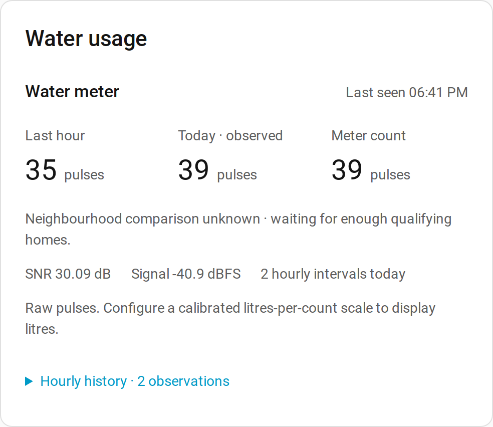
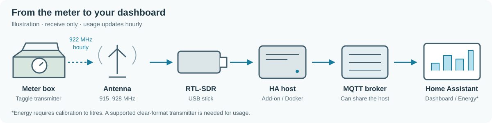
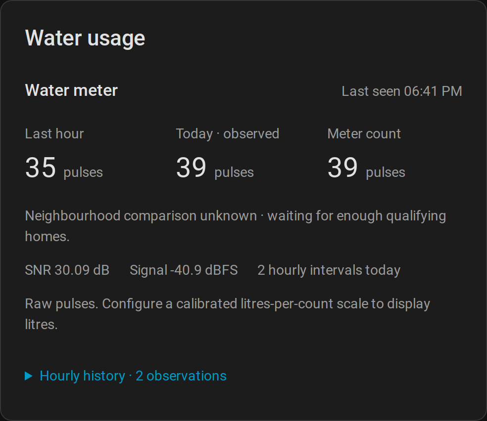

# Taggle water meter → Home Assistant

See your own water meter's hourly usage in Home Assistant. A USB radio receiver, called an SDR (software-defined radio), listens to supported Taggle transmitters and sends readings to your dashboard. Start with raw pulses; measure your meter's scale later to show litres.

[Open the wiki](https://github.com/Spicynostalgia/ha-taggle/wiki) for step-by-step guides and technical references.

**0.2.1 is experimental: only one transmitter has been verified**, in Gladstone, QLD, with an RTL-SDR Blog V4. Other models and areas are unverified. Automated tests use generated signals. Check readings against your physical meter; this is not billing-grade measurement, live flow monitoring or a leak alarm.



*From the tested meter: real data, ID changed to 123456.*

More detail: [Tested hardware](https://github.com/Spicynostalgia/ha-taggle/wiki/Tested-Hardware).

## How it works in 30 seconds



- Your meter's transmitter sends a short radio message, usually once an hour.
- An **SDR (software-defined radio)** is a USB radio receiver. It listens without connecting to or changing the meter.
- **MQTT** is a way for programs to exchange messages. A **broker**, such as Mosquitto, passes readings from this receiver to Home Assistant's MQTT integration. Reception stays local.

More detail: [How it works](https://github.com/Spicynostalgia/ha-taggle/wiki/How-It-Works) · [Glossary](https://github.com/Spicynostalgia/ha-taggle/wiki/Glossary).

## Will it work for me?

- [ ] Does your council or water utility use Taggle **at your property**? A “smart meter” or a portal alone does not confirm this. Check the [area guide](https://github.com/Spicynostalgia/ha-taggle/wiki/Is-My-Area-Covered).
- [ ] Is there a Taggle clip-on or cable-connected transmitter? Appearance is only a clue. **NB-IoT means cellular radio; those models cannot be received by this project.**
- [ ] Can it receive clear (unencrypted) **18- or 21-byte messages**, also called frames? Only 18-byte frames have field confirmation. **24-byte encrypted frames provide identity and signal diagnostics only, never water usage.** A scan can help; missing counts for an unconfigured ID alone do not prove encryption.


*The one verified transmitter; its exact model is unknown. ID and barcode blurred.*


*Illustration only. These shapes do not establish compatibility.*

The default radio setting is **922.2 MHz**. This receiver does not search every Taggle channel. A Taggle rollout in your area is no guarantee of reception.

More detail: [Is my area covered?](https://github.com/Spicynostalgia/ha-taggle/wiki/Is-My-Area-Covered) · [Tested hardware](https://github.com/Spicynostalgia/ha-taggle/wiki/Tested-Hardware).

## What you need

- [ ] An **RTL-SDR USB receiver**; the Blog V4 was used in the hardware test.
- [ ] A **915–928 MHz antenna**: a simple whip is about **8 cm** long. For a telescopic dipole kit, use about **8 cm per side**.
- [ ] A **USB extension cable**, to move the receiver away from computer noise and towards a window facing the meter.
- [ ] An always-on Pi, mini PC or NAS running Home Assistant OS or Docker on Linux, with access to the USB receiver. A virtual machine needs USB passthrough (giving it access to the dongle). Check [supported computer types](https://github.com/Spicynostalgia/ha-taggle/wiki/Hardware-and-Antennas) (amd64/aarch64).
- [ ] **Home Assistant**, an **MQTT broker** and Home Assistant's **MQTT integration**. The install steps below cover the broker and integration.

More detail: [Hardware and antennas](https://github.com/Spicynostalgia/ha-taggle/wiki/Hardware-and-Antennas).

## Find your meter ID

> **Open the box safely.** Wear gloves and lift the lid gently; do not stand on it or force it. Watch for spiders (including redbacks), snakes, ants and wasps. If unsafe, close it and ask the utility for help. **Do not remove, open, unplug or move the meter or transmitter. It belongs to the utility.** Replace the lid when finished.


- [ ] Photograph the **transmitter label**. Its decimal ID differs from the mechanical meter's serial number. All example transmitter IDs here are fictional: **123456**.


- [ ] Photograph the **register** (the physical reading), including its units and timestamp, for later calibration.
- [ ] If the label is unreadable, follow [Check it's working](#check-its-working) and the wiki's scan and tap test. Signal strength alone does not prove ownership. **Do not post your real meter ID**, barcode, private logs or configuration.

More detail: [Finding your meter](https://github.com/Spicynostalgia/ha-taggle/wiki/Finding-Your-Meter).

## Install

Choose **A for Home Assistant OS** (recommended), or **B for Home Assistant Container/Core or a separate Linux computer**. An **add-on** is a program managed by Home Assistant OS; newer menus call it an *app*. More detail: [Getting started](https://github.com/Spicynostalgia/ha-taggle/wiki/Getting-Started) · [Python CLI](https://github.com/Spicynostalgia/ha-taggle/wiki/Python-CLI) (command-line installation).

### A. Home Assistant OS → add-on

This path also supports Supervised installations. It was not re-tested in the November 2026 Docker hardware run.

[](https://my.home-assistant.io/redirect/supervisor_add_addon_repository/?repository_url=https%3A%2F%2Fgithub.com%2FSpicynostalgia%2Fha-taggle)
[](https://my.home-assistant.io/redirect/supervisor_addon/?addon=core_mosquitto)

1. [ ] In **Settings → Apps (Add-ons) → Store**, install and start **Mosquitto broker** if needed. In **Settings → Devices & services**, configure the discovered **MQTT** integration.
2. [ ] Use the repository button above, or add `https://github.com/Spicynostalgia/ha-taggle` under the Store's **⋮ → Repositories**.
3. [ ] Refresh the Store. Install **Taggle water meter** and connect the SDR and antenna.
4. [ ] In **Configuration**, set `meter_ids` to your own transmitter ID, your `timezone` (for example `Australia/Brisbane`), and leave `litres_per_count: []`. Supervisor supplies MQTT credentials automatically.
5. [ ] Save, **Start**, then open **Logs**. Continue with [Check it's working](#check-its-working).

More detail: [Installing the add-on](https://github.com/Spicynostalgia/ha-taggle/wiki/Installing-the-Add-on).

### B. Docker → Linux computer

Tested on **Debian 13**, Docker 26 + Compose v2, Home Assistant **2026.10.4 Container**, Mosquitto 2 and the public **0.2.1** receiver image, with a Blog V4 over USB passthrough. No image login was needed. These commands use Debian/Ubuntu packages; the tested `docker-compose` package supplies **Compose v2**, run as `docker compose`.

```sh
sudo apt update && sudo apt install -y docker.io docker-compose git
sudo usermod -aG docker $USER
```

**Log out and back in** so your Docker group membership takes effect. Then:

```sh
git clone https://github.com/Spicynostalgia/ha-taggle.git
cd ha-taggle
cp config.example.json config.json
mkdir -p data && chmod 700 data && chmod 600 config.json
nano config.json
```

Set `meter_ids` to your ID, `timezone` to your local timezone, and **`mqtt.host` to your broker computer's LAN IP**, for example `192.168.1.50`. Leave `data_dir` as `/data` and `litres_per_count` as `{}` until calibrated. Enter the broker username/password if required. In nano, save with **Ctrl+O → Enter**, then exit with **Ctrl+X**.

The default host `mqtt` only works with a service named `mqtt` on the same Compose network. **Do not use `localhost`: inside Docker it means the receiver container itself.**

<details>
<summary>No broker yet? Start Mosquitto first</summary>

From the cloned repository, run `mkdir -p mosquitto`. Create `mosquitto/mosquitto.conf` containing:

```text
listener 1883
allow_anonymous true
```

This anonymous setup is **for a trusted LAN-only test**. Do not expose port 1883 to the internet. Add a broker password for real use and put the credentials in both the receiver and Home Assistant.

Create `mosquitto/compose.yaml` containing:

```yaml
services:
  mosquitto:
    image: eclipse-mosquitto:2
    restart: unless-stopped
    ports: ["1883:1883"]
    volumes: ["./mosquitto.conf:/mosquitto/config/mosquitto.conf:ro"]
```

Start it with `docker compose -f mosquitto/compose.yaml up -d`. Use this computer's LAN IP as `mqtt.host`. More detail: [Docker broker setup](https://github.com/Spicynostalgia/ha-taggle/wiki/Installing-with-Docker).

</details>

In Home Assistant: **Settings → Devices & services → Add integration → MQTT**. Enter the **broker computer's LAN IP**, port **1883**, and credentials if set. Both programs must use the same broker. Then, from the cloned repository:

```sh
docker compose pull
docker compose run --rm taggle --config /config/options.json --scan 65  # optional; Ctrl-C stops early
docker compose up -d
docker compose logs -f
```


*The tested install: real output, meter IDs replaced with fictional ones. Current scan JSON also includes UTC frame timestamps, as shown below.*

The optional scan can show nearby meters before your own transmits. Stop it before starting normal reception. Do not run two receivers against one dongle. Compose pulls `latest`; change its image tag to `:0.2.1` to pin the tested release.

More detail: [Installing with Docker](https://github.com/Spicynostalgia/ha-taggle/wiki/Installing-with-Docker).

## Check it's working

- [ ] Look for `RTL-SDR Blog V4 Detected` (V4 hardware) and `Reading samples in async mode...` in the log. Normal reception logs the listening frequency and configured meter count, MQTT connections/disconnections with broker host:port, and each configured meter's frame. A heartbeat every 15 minutes reports only how many frames and distinct other meters were heard; it never lists neighbour IDs. **Your first reading can take up to an hour.** The card shows a neutral **“Waiting for first reading (can take up to an hour)”** until a frame arrives.
- [ ] To see other heard meters as they arrive, use Docker's scan command above, or set add-on `scan_minutes: 65`, save and restart. Wait the full 65 minutes if needed. Scans print IDs but create no MQTT entities or usage state. **Keep scan output private.** Afterwards set `scan_minutes: 0`, configure only your ID and restart.
- [ ] After a supported frame arrives, open **Settings → Devices & services → MQTT → Taggle [your ID]**. Look for last seen, hourly pulses and signal diagnostics.

Each scan JSON line includes the frame time in ISO-8601 UTC and signal measurements rounded to one decimal place. For example, with fictional unconfigured ID `123456`:

```json
{"time": "2026-01-01T12:15:00+00:00", "meter_id": 123456, "snr_median_db": 30.1, "signal_level_dbfs": -40.9}
```

For a configured clear meter, the object also includes `"counts": [120, 110, 104]`; unconfigured IDs and encrypted frames never include counts in scan output. See [scan output details](docs/PROTOCOL.md#scan-output).


*Home Assistant device page — real data, ID changed to 123456.*

- [ ] **Tap test:** just after a fresh reading, with nothing else using water, fill a 10 L bucket twice. Note the time. Check for increased pulses at the next hourly transmission; the number need not be 20. If the draw crosses a radio interval, check the following update too. Reuse the water. Repeat to confirm an uncertain ID; never keep a neighbour's ID configured. Encrypted meters cannot support this usage test.

More detail: [First scan and tap test](https://github.com/Spicynostalgia/ha-taggle/wiki/First-Scan-and-Tap-Test).

## Add the dashboard card

**HACS route:** HACS is the Home Assistant Community Store, separate from the add-on Store. With [HACS installed](https://www.hacs.dev/docs/use/download/download/), open the button below, or add `https://github.com/Spicynostalgia/ha-taggle` under **HACS → ⋮ → Custom repositories → Dashboard**. Download **ha-taggle** and reload your browser.

[](https://my.home-assistant.io/redirect/hacs_repository/?owner=Spicynostalgia&repository=ha-taggle&category=plugin)

**Manual route:** create `www` inside Home Assistant's configuration folder (`config/www` for a typical Container mount). Copy [dist/taggle-card.js](dist/taggle-card.js) to `www/taggle-card.js`. **Restart Home Assistant after creating `www`; `/local/` can return 404 until the folder exists and HA restarts.** In **Settings → Dashboards → ⋮ → Resources** (enable Advanced Mode in your profile if hidden), add `/local/taggle-card.js?v=0.2.1` as a **JavaScript module**. Reload your browser.

In your dashboard choose **Edit dashboard → Add card → Manual**. Paste this, replace fictional `123456` with your ID, and check the actual entity IDs on your MQTT device (existing names and renames are preserved):

```yaml
type: custom:taggle-card
title: Water usage
entities:
  last_hour: sensor.taggle_123456_last_hour
  today: sensor.taggle_123456_today
  meter_count: sensor.taggle_123456_meter_count
  last_seen: sensor.taggle_123456_last_seen
  snr: sensor.taggle_123456_snr
  signal_level: sensor.taggle_123456_signal_level
```



*Dark theme — real data, ID changed to 123456.*


*Synthetic preview: two fictional meters with calibrated litres; no real meter data.*

More detail: [Dashboard card](https://github.com/Spicynostalgia/ha-taggle/wiki/Dashboard-Card) (multiple meters, mobile views and renamed entities).

## Turn pulses into litres


- [ ] Record a fresh radio `meter_count` and photograph the physical register, with no water use between them. Keep both timestamps. **1 m³ = 1 kL = 1,000 L**; read the units on your dial.
- [ ] Repeat after a day or more of normal use, ideally at least 1,000 L. Do not waste water to reach that amount. Reject periods with missing hours or resets.
- [ ] Calculate **litres per count = change in register litres ÷ change in `meter_count`**. Validate over independent days; a bucket check alone is insufficient. `meter_count` is an observed total, not the register reading.
- [ ] Set your measured factor using the correct format below and restart. **2.5 is only an example; measure your own scale.**

**Add-on options** use a list:

```yaml
litres_per_count:
  - meter_id: 123456
    value: 2.5
```

**Docker `config.json`** uses a map (an ID paired with a value): `"litres_per_count": {"123456": 2.5}`.

Add `last_hour_litres`, `today_litres` and `total_litres` mappings to the card, using `sensor.taggle_123456_<key>` with your ID. For **Settings → Dashboards → Energy → Water**, choose `sensor.taggle_123456_total_litres`. Only future observed usage enters this total; past usage is not backfilled.

More detail: [Calibration](https://github.com/Spicynostalgia/ha-taggle/wiki/Calibration) · [local calibration guide](docs/CALIBRATION.md) · [Energy dashboard](https://github.com/Spicynostalgia/ha-taggle/wiki/Energy-Dashboard).

## Neighbourhood comparison

This is **on by default**. Other meters are tracked anonymously with keys unique to your installation. Only averages, a median and group counts reach Home Assistant, never individual neighbours' IDs or usage. Your own configured meters are excluded.

Values stay **unknown until at least three homes qualify**. Today's values also need enough received hours; hearing three meters is not enough. Neighbours' litre scales are assumptions, and reception gaps can bias comparisons. To stop collection, set `neighbourhood: false` in the receiver and restart; hiding the card row alone does not stop collection. Scans and explicit `log_all_meters` mode can expose IDs; keep those outputs private.

More detail: [Neighbourhood comparison](https://github.com/Spicynostalgia/ha-taggle/wiki/Neighbourhood-Comparison).

## Troubleshooting

| What you see | What to check |
| --- | --- |
| No frames after 65 minutes | USB access, antenna connection, window placement and host noise. Try a USB extension. A different channel or unsupported meter is possible. |
| ID heard but counts unavailable | Configure your own ID and leave scan mode. “Waiting for first reading” can last an hour. Encrypted 24-byte frames cannot provide usage. |
| “Device busy” / cannot open SDR | Stop other SDR programs; check VM USB passthrough and the Linux DVB TV driver. The tested image detached that driver automatically; no blacklist was needed in that test. |
| Entities unavailable after 3 hours | Check logs, antenna, USB and MQTT; set `scan_minutes: 0`. Three hours without a valid frame marks a meter unavailable. |
| Usage too high or low | Pulses need calibration. Check units, scale, aligned timestamps and gaps. Daily totals contain observed intervals only. |

More detail: [Troubleshooting](https://github.com/Spicynostalgia/ha-taggle/wiki/Troubleshooting) · [FAQ](https://github.com/Spicynostalgia/ha-taggle/wiki/FAQ).

## Learn more

More detail: choose a wiki guide below.

| Topic | Guide |
| --- | --- |
| Radio and decoding | [How it works](https://github.com/Spicynostalgia/ha-taggle/wiki/How-It-Works) · [Protocol](https://github.com/Spicynostalgia/ha-taggle/wiki/Protocol) · [local protocol specification](docs/PROTOCOL.md) |
| Sensors and MQTT topics | [Entities reference](https://github.com/Spicynostalgia/ha-taggle/wiki/Entities-Reference) |
| All settings and defaults | [Configuration reference](https://github.com/Spicynostalgia/ha-taggle/wiki/Configuration-Reference) · [example JSON](config.example.json) |
| Data, privacy and local laws | [Privacy and legal](https://github.com/Spicynostalgia/ha-taggle/wiki/Privacy-and-Legal) |
| Contributing and releasing | [Contributing](https://github.com/Spicynostalgia/ha-taggle/wiki/Contributing) · [repo guide](CONTRIBUTING.md) · [Changelog](CHANGELOG.md) |
| Unfamiliar words | [Glossary](https://github.com/Spicynostalgia/ha-taggle/wiki/Glossary) |
| AI methods and estimates | [AI disclosure](https://github.com/Spicynostalgia/ha-taggle/wiki/AI-Disclosure) |

## Help and reporting

[Open an issue](https://github.com/Spicynostalgia/ha-taggle/issues) with the software version, council, transmitter description, whether usage worked, frame length and signal-to-noise ratio (SNR), if known. **Do not post your real meter ID.** Blur the ID and identifying barcode in photos; remove IDs, credentials and private settings from logs. Do not upload radio captures or recorded frames.

More detail: [Reporting compatibility](https://github.com/Spicynostalgia/ha-taggle/wiki/Reporting-Compatibility). The following disclosure is also covered in [AI disclosure](https://github.com/Spicynostalgia/ha-taggle/wiki/AI-Disclosure).

## AI disclosure

This repository — the radio reverse engineering, the receiver, the add-on, the card, the tests, the diagrams and this documentation — was produced mostly by AI coding agents: **Anthropic Claude (Claude Code, Opus)** for planning, live probing, review and docs, and **OpenAI Codex** for most of the code and signal analysis. A human chose the goals, captured and confirmed the signal from their own meter, checked the results against the physical register and approved every change. Treat it like any other experimental code: read it before you trust it.

### What it cost (as of 2 November 2026)

| | Model calls | Tokens processed | of which cached re-reads | Output tokens |
| --- | ---: | ---: | ---: | ---: |
| Claude (incl. sub-agents) | ~380 | ~57.5 M | ~56.5 M | ~0.21 M |
| Codex | ~685 | ~61.8 M | ~59.7 M | ~0.55 M (incl. ~0.18 M reasoning) |
| **Total** | **~1,065** | **~119 M** | **~116 M (97%)** | **~0.76 M** |

Counted from the local agent session logs for the Taggle research and this repository. Most "tokens" are the agents re-reading their own context on every step (prompt cache hits), which costs far less compute than generating new text. Earlier unrelated Home Assistant work is excluded; a little unrelated chat in the same sessions may be included.

### Estimated water use

Nobody publishes a water figure for long agentic coding sessions, so this is a bracket, not a measurement:

- **Floor, about 0.3 L:** ~1,065 model calls × 0.26–0.32 mL, the per-prompt figures published by [Google for a median Gemini prompt](https://arxiv.org/abs/2508.15734) and [OpenAI's CEO for an average ChatGPT query](https://blog.samaltman.com/the-gentle-singularity). This certainly undercounts: each agent call carried roughly 100,000 tokens of context, far more than a typical chat prompt.
- **Ceiling, about 85 L:** ~0.76 M output tokens at [Mistral's figure](https://mistral.ai/news/our-contribution-to-a-global-environmental-standard-for-ai) of 45 mL for the marginal impact of one 400-token response, from its life-cycle analysis. It is far higher than the other published figures, which is why it's the ceiling.

So somewhere between **a water bottle and roughly ten minutes under a 9 L/min shower**, most plausibly in the tens of litres. Fittingly, once calibrated, this receiver would show a household using that much water within a single hour's reading.

### Estimated energy use

Same caveat: a bracket built from published per-query figures, not a meter reading.

- **Floor, about 0.3 kWh:** ~1,065 calls × 0.24–0.34 Wh, the [Google median Gemini prompt](https://arxiv.org/abs/2508.15734) and [average ChatGPT query](https://blog.samaltman.com/the-gentle-singularity) figures. Again an undercount for 100,000-token agent calls.
- **Ceiling, about 40 kWh:** ~1,065 calls × ~40 Wh, [Epoch AI's estimate](https://epoch.ai/gradient-updates/how-much-energy-does-chatgpt-use) for a query with ~100,000 input tokens. This overcounts: it assumes the whole context is recomputed every time, while ~97% of these tokens were prompt-cache hits that skip most of that work.

So somewhere between **boiling a 2 kW kettle for ten minutes and running a 2 kW heater for about 20 hours**, most plausibly a few kilowatt-hours. For carbon, Mistral's figure of 1.14 g CO₂e per 400-token response gives roughly **2 kg CO₂e** for ~0.76 M output tokens; the real figure depends heavily on each data centre's electricity mix.

## License and disclaimer

The application and card are MIT licensed; see [LICENSE](LICENSE). Container dependencies, including the separately executed GPL-licensed RTL-SDR Blog driver, retain their own licenses. The driver's source revision and license are preserved by the Docker builds. [Release provenance](RELEASE-CHECK.md) explains the application license decision.

Unofficial; not affiliated with Taggle Systems or any utility. Receive-only, for reading your own meter. Respect local radio and privacy laws. Encrypted payloads are not and will not be attacked.

More detail: [Privacy and legal](https://github.com/Spicynostalgia/ha-taggle/wiki/Privacy-and-Legal).
