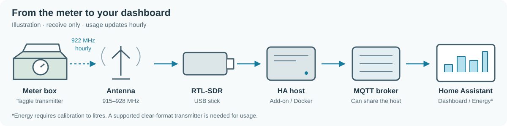
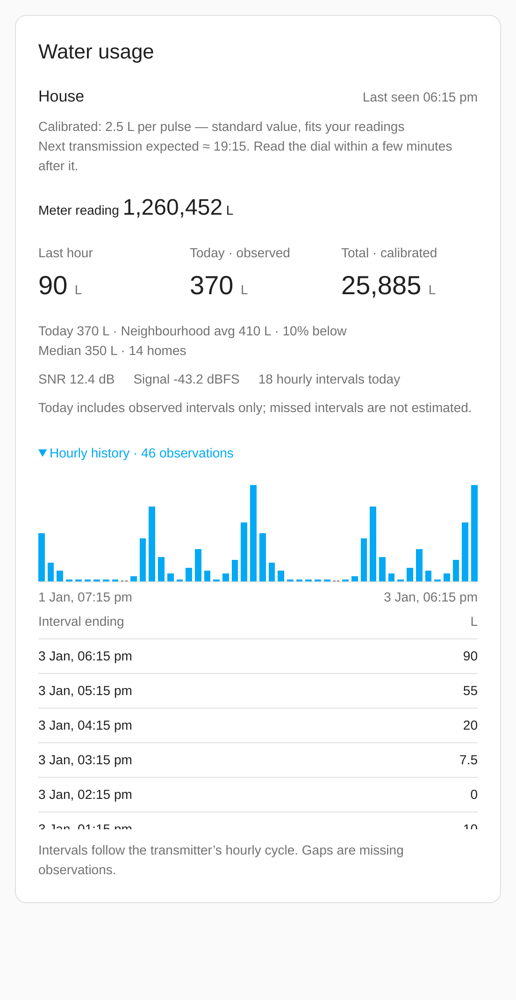

# Taggle water meter add-on

Requires an RTL-SDR, an antenna for 915–928 MHz, and the Home Assistant MQTT integration with a Supervisor-discoverable MQTT broker. Supports amd64 and aarch64. The build includes the RTL-SDR Blog driver for Blog V4 support.

New to SDR? Follow the [beginner walkthrough](https://github.com/Spicynostalgia/ha-taggle#getting-started-beginner-guide) for hardware, safe meter identification, reception checks, dashboard setup and calibration.

*Illustration: the receiver setup. The broker can share the HA host; Energy requires calibration.*

*Dashboard preview with synthetic data and fictional IDs; no default calibration is assumed.*

## Setup

Enter your own decimal transmitter ID in `meter_ids`. The transmitter label is usually marked `ID:xxxxxx`. Do not substitute the mechanical register serial. Every sample ID in this project is fictional.

Start with `litres_per_count: []`: counts have no assumed water-volume unit. Set your IANA timezone to match Home Assistant so daily totals use the intended local date. `device` accepts an RTL index or serial, `frequency` defaults to 922200000 Hz, and `gain` defaults to 40 dB. The sample rate is fixed at 2400000.

Supervisor supplies MQTT host, port, username and password automatically via the `mqtt:need` service. The startup script reads `/data/options.json`, writes a private runtime configuration under `/run`, and executes the receiver. It never prints broker credentials. USB plug-and-play access is requested with `usb: true`; another driver or SDR app must not hold the receiver.

## Scan

Set `scan_minutes` to 65 and start. Watch the log for IDs and SNR. A scan allows an empty meter list, prints counts only for configured IDs, and writes no usage state/logs or MQTT messages. It exits when the duration elapses. Set `scan_minutes` back to zero, configure your ID and restart for normal operation.

## Entities and data

One MQTT device is created per configured meter. Supported clear frames expose hourly usage, today's partial observed total and a cumulative observed count, plus SNR, signal level and last seen. Encrypted frames expose diagnostics only. Adding `litres_per_count` entries (`meter_id` and positive `value`) enables litre entities, including a persistent `total_increasing` water entity for Energy.

`log_all_meters` defaults to false. Other IDs are dropped before logging or publishing. Explicitly enabling it allows other IDs to enter JSONL logs, if logging is also enabled; MQTT discovery remains restricted to configured meters.

State is stored under `/data/receiver` and survives add-on restarts and upgrades. Include app data in backups. `jsonl_logging` is optional and defaults to false. Enabled daily JSONL logs require your own retention management. Do not publish your options, logs or state.

The standalone Python package and root README contain the full protocol, calibration, card configuration and troubleshooting guidance. The add-on's package files are the same source installed by the root Python project.

## Troubleshooting

- No frames: confirm a suitable antenna, wait over an hour, verify SDR USB access and reduce strong-signal overload by lowering gain.
- USB errors: stop competing SDR software, check power/cabling and whether the host DVB driver has claimed the device. The receiver retries a disconnected producer after two seconds.
- No entities: confirm Home Assistant's MQTT integration uses the same broker and scan mode is off. Discovery is retained and resent when Home Assistant announces it is online.
- Usage unavailable: 24-byte encrypted transmitters provide no counts, and meters expire after three hours without a valid frame.
- Partial totals: only recovered hourly intervals count. This receiver cannot reconstruct arbitrarily long gaps.

Unofficial; not affiliated with Taggle Systems or any utility. Receive-only, for your own meter. Respect local radio and privacy laws. Encrypted payloads are not and will not be attacked.
