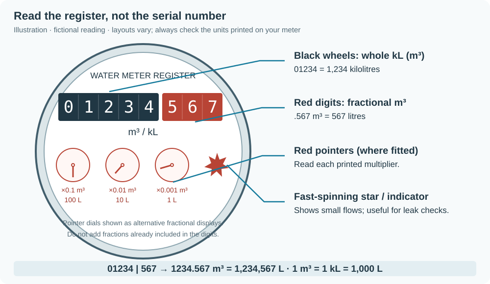

# Calibration from dial readings

The Taggle sends a 16-bit pulse counter, **not your meter’s dial reading**. Both its start value and litres per pulse are unknown. Guided calibration finds the factor and offset:

```text
meter_reading_litres = offset + litres_per_pulse × unwrapped_counter
```

## Guided calibration (recommended)

No utility account or automation is needed. On **Settings → Devices & services → MQTT → Taggle [your ID]**:

1. Read or photograph the dial. Once a frame has arrived, **Calibration status** and the card show **“Next transmission expected ≈ HH:MM”** in local time, using the observed transmission minute and hourly interval. Read within a few minutes after it, ideally with nobody using water. The time is an estimate; reception can be missed.
2. Set **Dial unit** to **m³** (default), **kL** or **L**, exactly matching the dial.
3. Type the complete reading into **Enter meter reading**. Blank **Reading time** means now. For a photo typed later, set **Reading time** first: `18:00` means **today local**, while `2026-11-02T18:00:00+10:00` selects that exact date/time. ISO times need a UTC offset. The time clears after the next accepted entry. An explicit JSON time takes precedence. A reading may stay pending until the next frame arrives.
4. Repeat about a day later after normal use: at least **200 L or 40 pulses**. Do not waste water to reach the threshold. Calibration applies automatically when exactly one standard pulse size fits. If the status asks for more use or a better reading, repeat after more normal use.

Litres sensors appear automatically, along with **Meter reading**, the absolute litres reading matching your dial. Use `sensor.taggle_123456_meter_reading` for Energy water (substitute your ID). Display precision is whole litres. `total_litres` is a separate total of observed usage: previous values are never revalued after calibration. Missing hours are not estimated.

Every later dial reading checks the calibration. Up to 200 readings are kept; delete an older one if that limit is reached. Status attributes include each reading’s ID, time, original value/unit, litres, source, counter interval, used/excluded flag, reason and residual in litres, plus factor bounds, chosen factor, method, offset, uncertainty and the next expected transmission. With three or more readings, interval midpoints receive a weighted least-squares fit (weight `1 / max(1, interval_width)²`), while a standard or pinned factor stays fixed. Exact intervals receive finite weight rather than dividing by zero.

### Reading your dial



*Illustration, not a photo. Layouts vary; follow the units and multipliers printed on your meter.*

Black wheels commonly show whole m³ or kL; red digits or pointer dials show fractions. **1 m³ = 1 kL = 1,000 L**. For m³/kL dials, ×0.1 = 100 L, ×0.01 = 10 L and ×0.001 = 1 L. Do not add pointer fractions a second time if red digits already show them. The spinning star shows flow, not cumulative volume. A serial number is not a reading or transmitter ID.

Example: `01234 | 567` means **1234.567 m³**, or **1,234,567 L**. Photograph the full face with units and decimal positions visible.

### How alignment and the solver work

The receiver retains 90 days of counter checkpoints using the same sequence and slot identities as usage accounting. Each frame includes the current and two earlier counter slots, so a later frame can fill missed transmissions. A dial reading at time `t` is bracketed by the last checkpoint before it and first after it. If their unwrapped counters agree, the reading is exact; otherwise its true counter remains an interval. An explicit photo time brackets against stored history. If there is no older checkpoint, take a new reading; the receiver does not invent one.

For two readings, `ΔR` litres and counter intervals `[a,b]`, `[c,d]` give factor bounds `[ΔR/(d−a), ΔR/(c−b)]`; overlapping intervals may leave the upper bound open. Plausible factors are **0.05–1000 L/pulse**. The standard sizes are **0.1, 0.25, 0.5, 1, 2.5, 5, 10, 25, 50, 100 L**. Exactly one standard value inside the bounds applies automatically, even with wide bounds. Several standard values mean more readings/use are needed. With no standard inside, a fit applies only when full relative bounds width is at most **2%** (`calibration_max_uncertainty`). The offset uses the narrowest interval for two readings and a weighted fit for three or more.

Missing-slot gaps may conceal extra 65,536-count wraps. The solver checks wrap counts against the register changes and plausible factor bounds. A uniquely supported standard factor applies even when the exact wrap placement is unresolved; the absolute reading is withheld if its counter/offset is still ambiguous. Ambiguous factors ask for more evidence. Each wrap search is limited to 4,096 combinations; standard factors are also checked separately to narrow that search. Searches that remain too large stay ambiguous rather than guessing. If a new gap after calibration could conceal wraps, the receiver withholds the absolute reading and asks for a fresh dial reading to resolve it. Observed `meter_count` and historical `total_litres` keep their original accounting.

The fictionalised **2 November 2026** hardware example uses ID `123456`: **1,597,361 L at 02:43 +10:00**, counter static at **46,218**; then **1,597,765 L at 18:00 +10:00**, bracketed by **17:41 / 46,283** and **18:41 / 46,318**. The bounds are **4.04–6.22 L/pulse**. Only **5 L** fits, and the exact first reading fixes the offset to **1,366,271 L**. The counter did not match the dial modulo 65,536 at any common pulse size: its start is arbitrary.

### Correct or reset readings

Negative use, implausible pulse sizes, and dial/prediction differences larger than the counter interval plus **0.5% of measured use** (at least 0.5 L for rounding) flag a suspect reading. Suspect readings remain stored, excluded and visible. A reading about **1000×** off suggests switching **Dial unit**; it is never silently converted. Check all digits, decimal places, units, photo time, timezone and your transmitter ID.

To delete a mistake, find its `id` in the **Calibration status** attributes. In **Developer tools → Actions → MQTT: Publish**, send `{"delete": 3}` to `taggle/123456/reading/set` (your ID, correct reading ID), with **retain off**. The remaining readings are solved again. To start again, first confirm you want to clear all entered readings and automatic calibration, then press **Reset calibration** on the device page. This preserves radio history and observed usage totals. Pinned configuration factors remain pinned. Counter sequence resets require fresh readings and a calibration reset.

Never retain command messages: replaying an entry would duplicate it. The receiver ignores retained commands. MQTT discovery and subscriptions return after broker reconnect or Home Assistant birth; readings, selected unit, unused photo time and solution persist privately in versioned `state.json` (0600). INFO logs mention configured meters only.

### Options and manual pins

Defaults: `dial_unit: m3`, `calibration_max_uncertainty: 0.02`, `calibration_min_litres: 200`. The selector’s saved choice takes precedence over the default. `litres_per_count` pins a factor; guided readings then validate/report and find the absolute offset, never replace that factor. Optional `meter_reading_offset` pins the offset in litres too (a mapping in JSON, a list of `meter_id` / `value` in add-on options, like `litres_per_count`). It requires a pinned factor. With a pin but no dial reading/offset, usage litres are available but an absolute meter reading is not yet possible. The neighbourhood scale follows the first configured meter’s calibrated factor unless separately pinned; neighbours may have different pulse sizes.

## Manual maths and CSV/CLI

The manual route requires correctly aligned radio/dial pairs. Most people should use the guided flow above.

### Record aligned readings

1. Confirm the transmitter ID from your own label and record reliable reception.
2. Wait for a **fresh transmission** (`last_seen` just updated). Note that timestamp and the receiver's cumulative **`meter_count`**. Go straight to the meter box and photograph the register; retain the phone photo timestamp as the actual physical reading time. Avoid all water use between the radio endpoint and the photo so they represent the same reading. If the frame was delayed/old or water was used in between, take another aligned pair.
3. Use water normally for **a day or more**, aiming for **at least 1,000 L of normal use** so register rounding matters less. Wait longer if necessary; do not run water just to reach the target. Repeat the fresh-transmission/photo procedure.
4. Check there are **no missing receiver hours or counter resets** across the whole period. A utility export can supply equivalent register readings if its timestamps and units are known. Radio intervals need not end on a clock hour; do not align an export by rounding its time to a nearby radio endpoint.

Keep both original timestamps. Only assign the register reading to the radio endpoint in the calibration CSV when no intervening use means the readings really align; the helper cannot correct a delay or estimate water used between them.

### Calculate and validate the scale

For two aligned readings, first convert the physical register values to litres:

```text
litres_per_count = (reading2_L - reading1_L) / (meter_count2 - meter_count1)
```

Fictional worked example: **1234.567 → 1235.892 m³** gives **1,325 L**. Receiver `meter_count` **10,000 → 10,530** gives **530 counts**. The scale is **1,325 / 530 = 2.5 L/count**. This is an example, not a default for your meter.

For **three or more aligned readings**, prepare a CSV with offset-aware ISO timestamps and decimal register units:

```csv
time,register_reading,meter_count
2026-01-01T12:15:00Z,1234.567,10000
2026-01-02T12:15:00Z,1235.892,10530
2026-01-03T12:15:00Z,1237.217,11060
```

```sh
taggle-calibrate readings.csv --register-unit m3
```

This fictional example gives **2.5 L/count**. With only two readings, the calculation is `(register_end - register_start) / (counts_end - counts_start)`, converting m³ to litres first. For more readings the helper fits changes from the first reading using least squares through zero, and reports RMSE in litres. Duplicate/naive timestamps, nonfinite values, nonincreasing usable ranges and backwards readings are rejected.

A register-only CSV can have `time,register_reading` columns; supply a second `time,meter_count` file with `--counts counts.csv`. Only exactly matching timestamps participate. The CLI never scrapes a portal, uses credentials or writes a scale to your configuration.

A small residual alone does not prove the scale. Validate it over several independent days, including low and high usage, and compare totals. An exact fit from two observations has no independent validation. For exports of interval litres rather than cumulative register readings, first form aligned cumulative values over complete intervals; the helper does not infer sub-hour use.

**Quick bucket sanity check:** just after a transmission, with nothing else using water, fill a known volume (for example **2 × 10 L**). At the next hourly update, `last_hour × factor` should be approximately **20 L**. Pulse resolution and interval boundaries make this coarse; repeat or check the following interval if necessary. Reuse the water. **Do not calibrate from the bucket check alone.**

**Pitfalls:** missing hours make observed counts incomplete; a counter reset invalidates the comparison; a serial number is not a volume; m³ and litres differ by 1,000. The CLI cannot infer unobserved multiple wraps; guided calibration uses register readings to resolve missing-slot wraps when only one solution fits. Its cumulative `meter_count` is an observed total, not the physical register. Reject suspect intervals rather than fitting across these problems.

### Apply the verified factor

Set the verified factor in standalone JSON:

```json
"litres_per_count": {"123456": 2.5}
```

Or in add-on options:

```yaml
litres_per_count:
  - meter_id: 123456
    value: 2.5
```

Restart and select `sensor.taggle_123456_total_litres` in Home Assistant's Energy water configuration. Calibration creates litre entities with the water device class. The cumulative litre entity adds newly observed intervals at the factor active when they arrive, preserving its baseline through factor changes. It does not retroactively add pre-calibration usage. Hourly and daily displays use the currently configured factor.

## Advanced: utility-portal automation

This is optional. A utility reading must be a **cumulative register value**, with known units and its **actual measurement time**, not the portal update time or an interval-use total. Keep credentials in the portal integration. This receiver never logs in to your utility.

Publish plain numbers to `taggle/<id>/reading/set` in the selector’s unit, or JSON with exactly one of `litres`, `m3`, `kl`, plus optional ISO `time` and `source`. For example:

```json
{"litres":1597765,"time":"2026-11-02T18:00:00+10:00","source":"utility portal"}
```

Example Home Assistant automation; replace the fictional sensor, attribute names, unit and transmitter ID with your integration’s actual values. The source must supply an offset-aware `read_at`. Send each physical observation once; do not replay old observations whenever an unrelated attribute changes.

```yaml
alias: Taggle calibration from utility register
triggers:
  - trigger: state
    entity_id: sensor.utility_register_litres
conditions:
  - condition: template
    value_template: >-
      {{ trigger.to_state is not none and trigger.from_state is not none
         and is_number(trigger.to_state.state)
         and trigger.to_state.attributes.get('read_at') is not none
         and trigger.to_state.attributes.get('read_at') != trigger.from_state.attributes.get('read_at') }}
actions:
  - action: mqtt.publish
    data:
      topic: taggle/123456/reading/set
      retain: false
      qos: 1
      payload: >-
        {{ {'litres': trigger.to_state.state | float,
            'time': trigger.to_state.attributes.read_at,
            'source': 'utility portal'} | to_json }}
```

Backfilled observations use stored checkpoints, just like phone photos. A portal reading outside retained history cannot be aligned. More manual photos can still calibrate and validate the meter without any utility automation.
