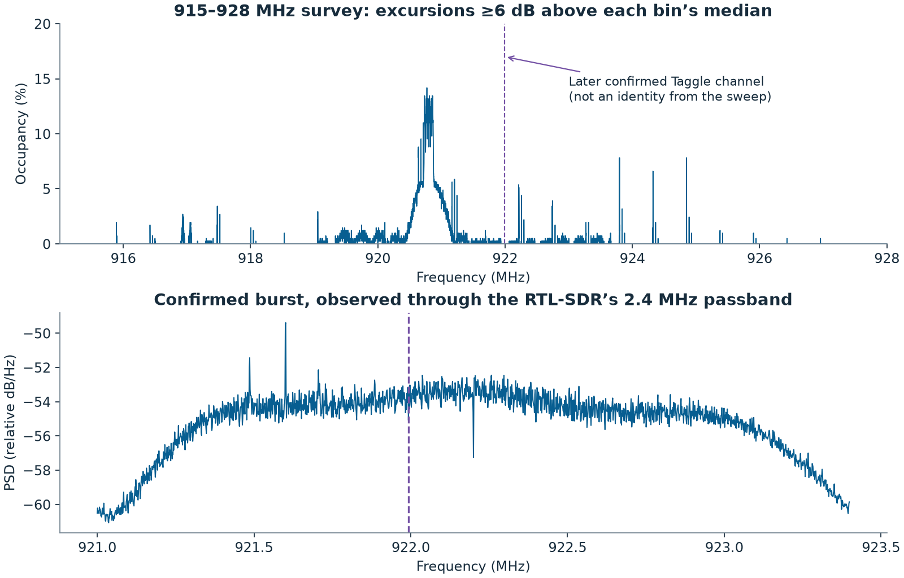
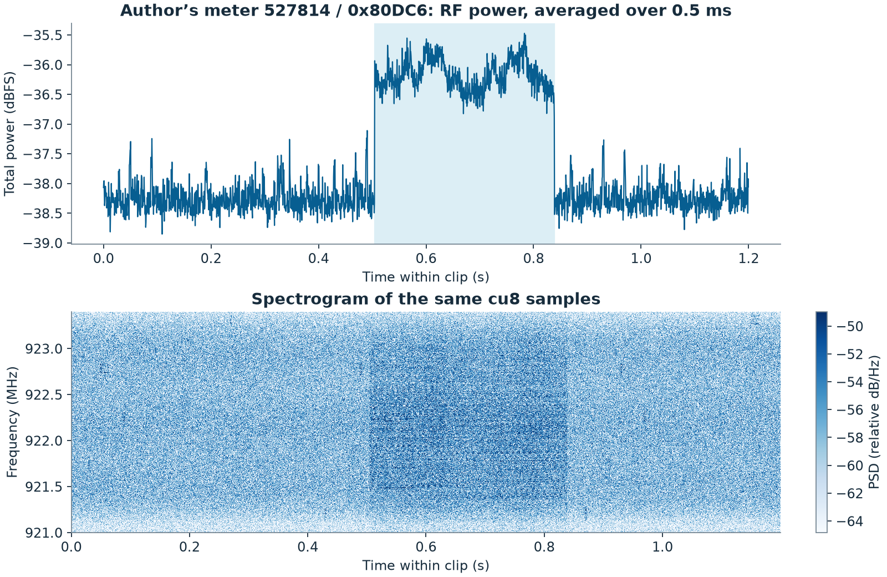
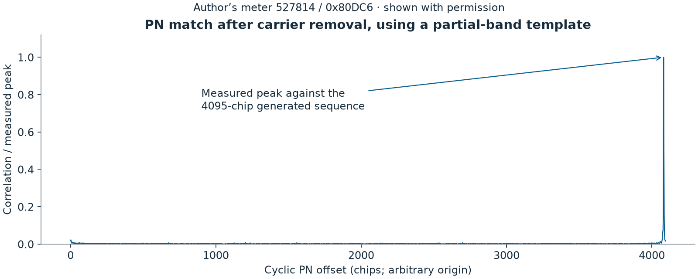
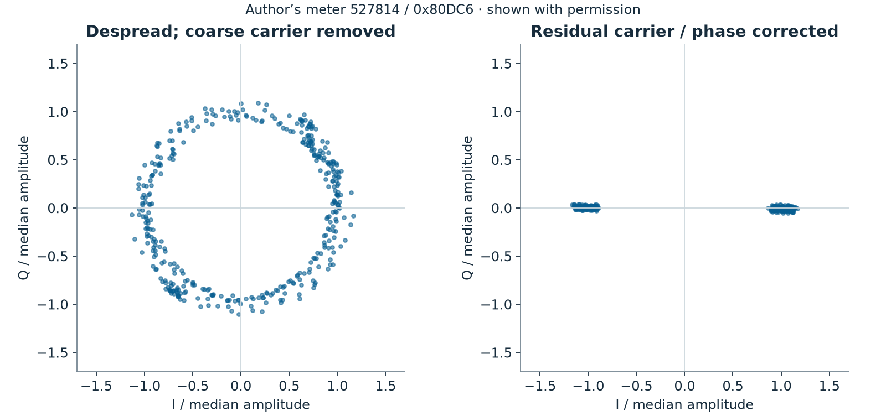
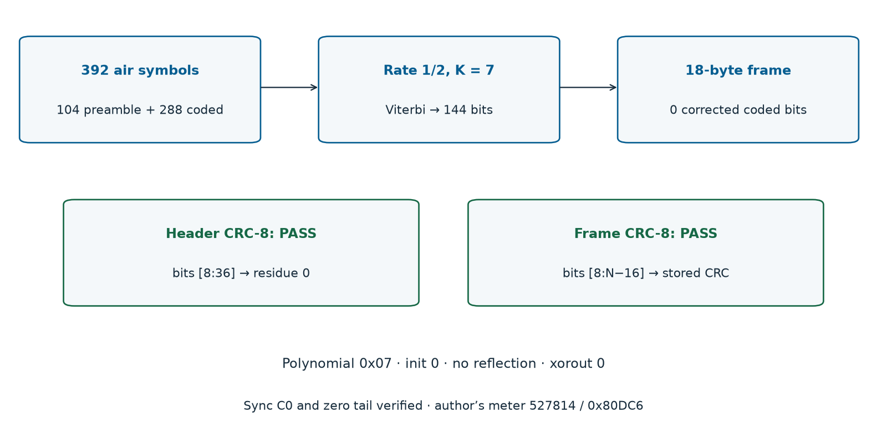
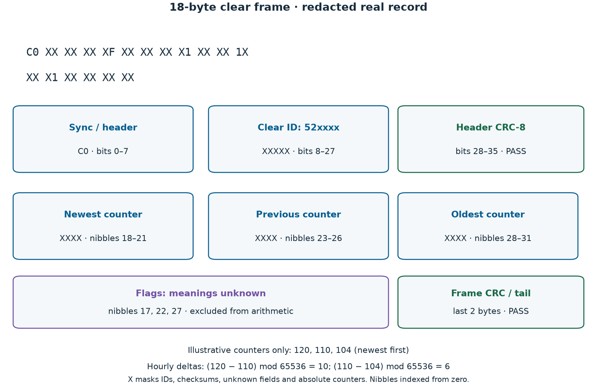
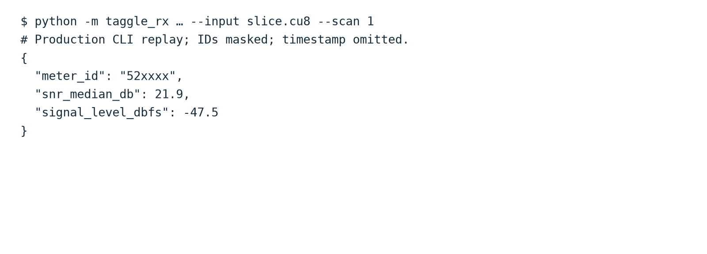
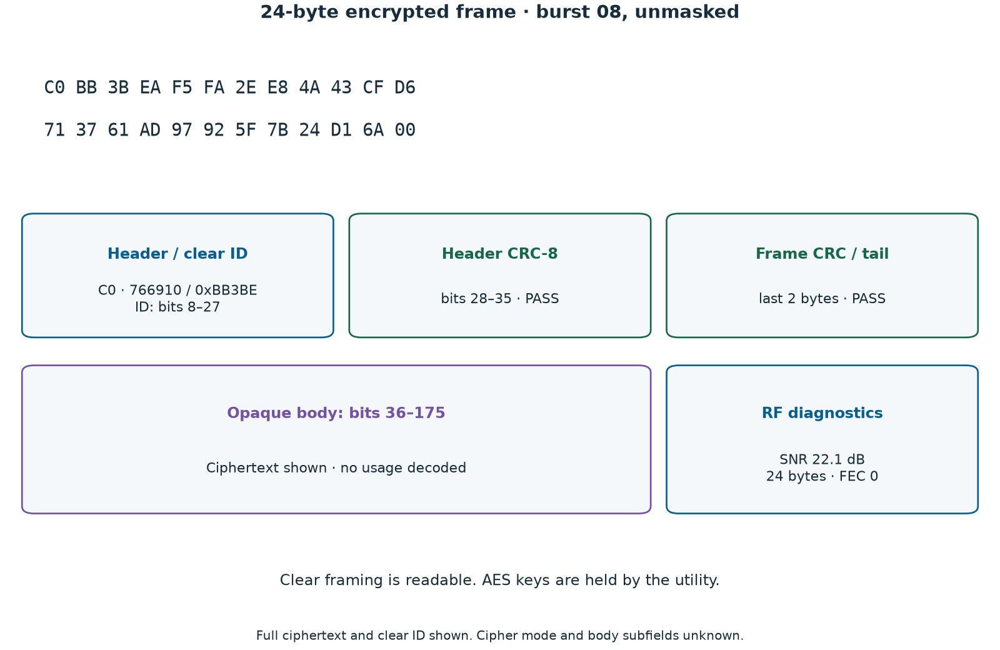

# Decoding Taggle water meters at 922 MHz with an RTL-SDR

We used an RTL-SDR Blog V4 to get hourly water readings from our own meter in Gladstone, QLD, without a cloud portal. We built [ha-taggle](https://github.com/Spicynostalgia/ha-taggle), an MIT-licensed, receive-only decoder that sends supported clear readings over MQTT to Home Assistant. We also received encrypted frames whose usage we cannot read.

We have field-tested one transmitter, producing 18-byte frames. Yours may differ. The owner confirmed an Elster (Honeywell) V100 mechanical meter; the transmitter model is unknown. This does not establish compatibility across Taggle installations, councils or current transmitters. We mask every identifier and withhold absolute usage counters.

## Finding the right burst

We found our signal near 922 MHz after surveying 915–928 MHz. Several signals shared timing. Overload, sidelobes or unrelated transmitters could explain clusters; the strongest peak did not identify our meter.

*Figure 1. The top shows how often each bin exceeded its temporal median by at least 6 dB during the available 13.6-minute survey prefix; below is the confirmed burst's spectrum. We hopped frequencies, so this is not simultaneous 13 MHz IQ or a meter census.*

We recorded unsigned 8-bit interleaved IQ at 2.4 MS/s, centred on 922.2 MHz. The decoder searches near 921.995 MHz, about −205 kHz in this recording. Bursts have small carrier and clock differences; acquisition searches around that offset, not the whole band.

The [SP3C datasheet](https://taggle.com/wp-content/uploads/2025/12/Datasheet-SP3C-002.pdf), pages 1–2, describes Byron radio, one-way DSSS and generally hourly reporting. It covers a product family, not our unidentified transmitter. The signal uses DSSS/BPSK, not LoRa or LoRaWAN.

*Figure 2. Look for the burst within this 1.2-second slice, including quiet padding; power is averaged over half a millisecond in uncalibrated ADC units, not dBm. The spectrogram covers only the receiver passband.*

<!-- SCREENSHOT: inspectrum waterfall, clear burst -->

The archive holds 20 decoded frames: twelve 18-byte clear, one 21-byte clear and seven 24-byte classified as encrypted. These are observations, not twenty validated installations. The production 21-byte and encrypted paths have only generated tests as deployment evidence.

## Recovering a 4095-chip sequence from a partial band

We recover the noise-like signal by matching it to a repeating pattern. Each coded BPSK symbol uses a 4095-chip spreading sequence. Bursts last about 0.33–0.42 seconds, depending on frame length. The fitted symbol period is near 2046.625 ADC samples: about 1172.66 coded symbols/s and 4.802 Mchip/s on the nominal sample clock.

At 2.4 MS/s, we capture about half a complex sample per chip, not two. We match a predicted in-band waveform to the filtered recording. Interpolation cannot restore missing RF bandwidth or turn ADC samples into recovered chips.

We first learned repeating templates without payload bits, then recovered a degree-12 maximal-length sequence. The receiver's forward polynomial is `x^12 + x^9 + x^6 + x^5 + x^2 + x + 1`, packed as `0x1267`. From register state 1, output the least significant bit, shift right, and insert the parity of `state & 0x267` at bit 11. Binary one maps to minus one; cyclic phase and overall BPSK polarity are arbitrary.

The winning primitive polynomial matched the research template at 0.9752 correlation; the runner-up reached 0.3605. These are search diagnostics, not sensitivity measurements.

*Figure 3. The peak shows the real capture matching a regenerated, filtered PN prediction that accounts for the sample clock. It is normalised to one, not full-band PN autocorrelation or evidence of sampling every chip.*

The production receiver generates this sequence algebraically, without measured chip files or per-meter captured bits. It screens for a squared-BPSK carrier line, checks cyclic PN projections, then refines fractional timing and each burst's period before projecting symbols against disjoint templates.

## From despread BPSK to a checked frame

We straighten the recovered symbols, decode the bits, and check the frame. After coarse carrier removal and despreading, residual frequency and phase still rotate the projections. A second-order BPSK Costas loop aligns them with the real axis. The first symbol selects polarity; framing and checksums validate it.

*Figure 4. Both panels use the same amplitude scale and real measurements: “before” includes coarse carrier removal and despreading. “After” adds residual frequency and phase tracking.*

<!-- SCREENSHOT: URH bit view, clear burst -->

Bursts contain 104 constant preamble symbols, then 288, 336 or 384 coded bits. Rate-1/2 decoding gives complete 18-, 21- or 24-byte frames, including sync, checksums and a zero tail byte. The shortest has 392 air symbols and 144 decoded bits.

The constraint-length-seven convolutional encoder shifts left, puts the newest input at bit zero, and emits parity through masks `0x6d`, then `0x4f`. Research used reciprocal masks and differing sync boundaries; the [protocol notes](https://github.com/Spicynostalgia/ha-taggle/blob/main/docs/PROTOCOL.md) define the maintained complete-frame convention.

*Figure 5. We reran Viterbi on the captured bits: zero corrections, both CRC-8 checks passing. Production tries exact inversion first, then Viterbi when needed; both require framing and both CRCs.*

Both CRC-8 checks use polynomial `0x07`, zero initial value, no reflection and zero xorout. In zero-based decoded-bit indices, header residue over `[8:36]` must be zero. Frame CRC covers `[8:N−16]`, excluding sync, its checksum and tail. The receiver requires sync `C0`, a zero final byte and at most twelve corrected coded bits. A winning trellis path alone cannot pass; CRCs detect errors; they do not authenticate transmitters.

*Figure 6. Private nibbles are `X`, and byte-aligned IDs are `XX`; crossing byte boundaries requires nibble and bit annotations. The three example counters replace measurements.*

Transmitter ID occupies bits 8–27, followed by eight header-CRC bits. Clear frames hold three 16-bit counters at hex nibbles 18–21, 23–26 and 28–31, newest first. Nibbles 17, 22 and 27 are separate, unknown flags; exclude them from arithmetic.

Example counters `120, 110, 104` give hourly pulse deltas `(120 − 110) mod 65536 = 10` and `(110 − 104) mod 65536 = 6`. Three counters preserve two intervals, bridging a missed reception when sequence and elapsed time agree. The hourly sequence wraps modulo 256; counters wrap modulo 65536. Longer gaps or inconsistent sequences need a new baseline.

Dial observations establish litres per pulse and starting offset. Hourly pulses cannot give instantaneous flow or immediate leak alarms. Flag and extension meanings remain unknown; datasheet capabilities do not identify battery, tamper or backflow fields.

*Figure 7. This light-background CLI replay shows signal diagnostics from the same slice, with ID masked and timestamp omitted. With no configured meters, scan mode emitted no counters, connected to no MQTT broker and wrote no persistent state.*

## Where decoding stops: encrypted frames

We can check encrypted frames' outer structure, but cannot read their usage. This real 24-byte record passes framing checks and exposes a clear transmitter ID and RF diagnostics. Its body stays opaque.

*Figure 8. The header and outer checks are readable; `X` blocks hide ciphertext and private header details. RF diagnostics come from reception, not decrypted fields.*

<!-- SCREENSHOT: inspectrum waterfall, encrypted burst -->
<!-- SCREENSHOT: URH bit view, encrypted burst -->

The [SP3C](https://taggle.com/wp-content/uploads/2025/12/Datasheet-SP3C-002.pdf) and [Cockatoo](https://myriota.lbcdn.io/uploads/Datasheet-Cockatoo-002.pdf) sheets specify AES-128 for Byron telemetry; the [V200HT sheet](https://taggle.com/wp-content/uploads/2023/05/Datasheet-Honeywell-V200HT-V4.pdf) describes encrypted meter data. We retain the archive's encrypted classification. Length and an opaque body do not prove cipher mode, key handling or transmitter model; we have not reverse-engineered the cryptography.

AES-128 has `2^128`, approximately `3.4 × 10^38`, possible keys. Even `10^18` complete trials/s would take about `1.1 × 10^13` years to exhaust them, averaging `5.4 × 10^12` years for a uniformly random key. This hypothetical ignores overhead; it is not feasible hardware.

Likely meter fields give no known-plaintext shortcut to an AES key. A passive receiver has no request interface to choose messages from a one-way transmitter. The utility and its authorised infrastructure hold the keys; we have neither keys nor evidence of a weakness.

These frames belong to other households. **The project does not attempt decryption or key search, and will not accept contributions that do.** We stop at clear framing and RF diagnostics. Production output logs no ciphertext.

## Reproducing the figures

We rendered all eight figures with matplotlib from the read-only research archive and decoder code. [The generator](https://github.com/Spicynostalgia/ha-taggle/blob/main/docs/blog/make_figures.py) takes capture, analysis and decoder paths. It reads a bounded 1.2-second slice from the multi-gigabyte IQ recording, replays the production CLI and checks the frame against the archive. Occupancy uses measured survey-bin summaries; the encrypted diagram separately verifies the archived 24-byte frame's framing.

The source IQ and full archive contain other transmitters and household data, so remain private. Reproduction needs authorised local recordings and matching analysis inputs. We supply scripts and redacted figures, redact before rendering and publish no raw bit dumps. Masking covers hexadecimal ID nibbles, cumulative counters and checksums that could constrain hidden fields. Example arithmetic stays separate from captured usage.

## Fork it for your own meter

Start with the MIT-licensed [repository](https://github.com/Spicynostalgia/ha-taggle) and wiki [Quick start / Getting started](https://github.com/Spicynostalgia/ha-taggle/wiki/Getting-Started). Set `meter_ids` privately. Set `frequency` to an SDR centre retaining the supported channel, within the implementation's centre-frequency range and acquisition target; do not copy another region's channel plan.

Calibrate `litres_per_count` against your dial. Configure `mqtt` for your broker and Home Assistant discovery or another MQTT consumer; that choice does not extend RF compatibility. Keep 2.4 MS/s, allow an hourly transmission opportunity and confirm ownership before using readings.

Receive only your own meter. Keep identifiers, recordings and logs private; redact photos before sharing compatibility results. Our verified transmitter brought hourly pulses into a local dashboard with a cheap SDR and checked decoding.
