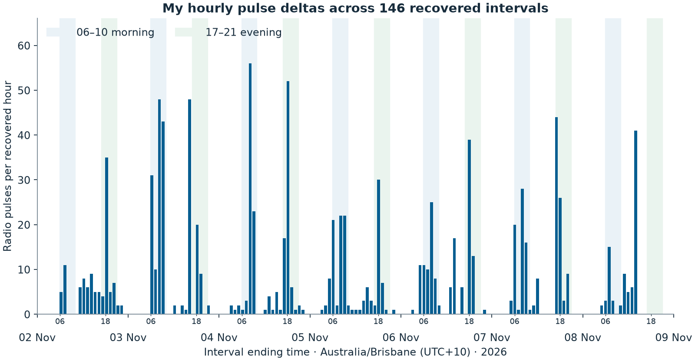
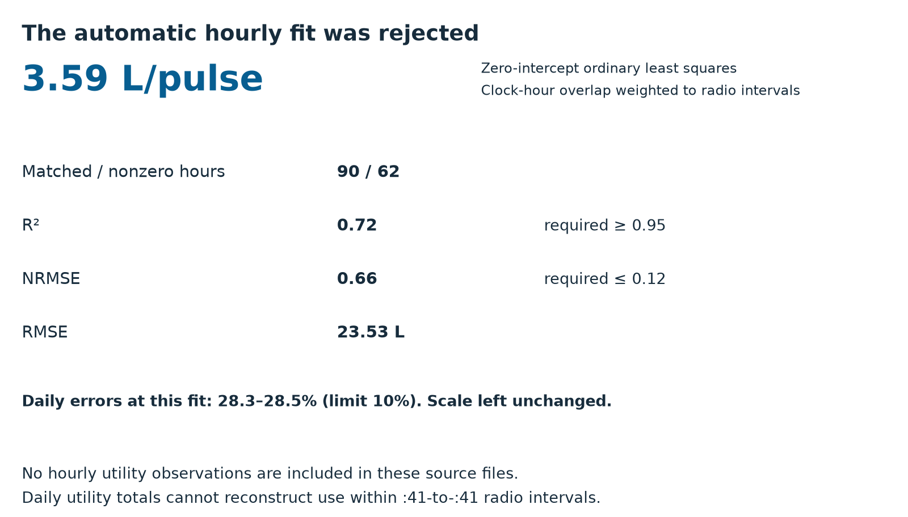
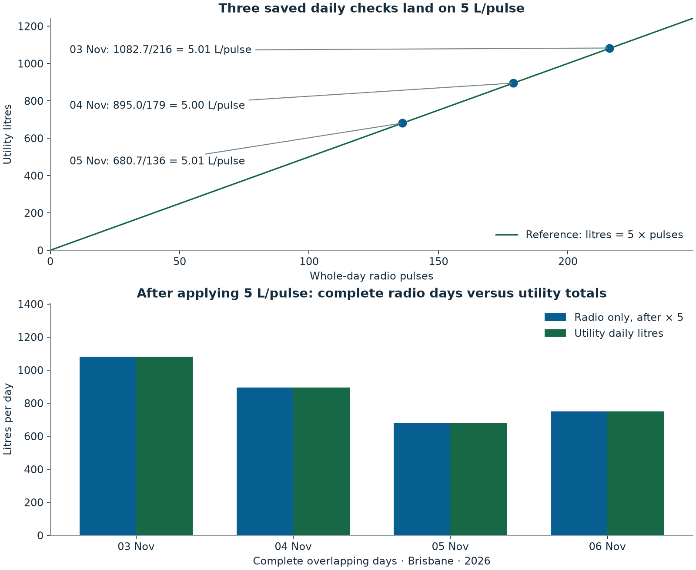

# Decoding Taggle water meters at 922 MHz with an RTL-SDR

My water bill and the cloud portal left me wanting a local view of what I was using, hour by hour. The meter in my yard in Gladstone, QLD, was already sending readings over the air. Could I just read it myself?

**TL;DR:** I used an RTL-SDR Blog V4 and Python to turn a noise-like 922 MHz burst into hourly pulse readings, then checked the litre conversion against my Elster (Honeywell) V100. The unusual part was a 4095-chip DSSS spreading pattern carrying BPSK: despreading it made the bits readable. The result is [ha-taggle](https://github.com/Spicynostalgia/ha-taggle), an MIT-licensed, receive-only decoder sending supported clear readings over MQTT to Home Assistant; encrypted frames stop at IDs and signal diagnostics.

Here's the result from replaying my recording through the production receiver: my transmitter ID, three counters and the signal measurements.


*Figure 1. Reformatted output from a real CLI replay of the worked clear clip: my numeric ID, counters and RF diagnostics. Replay SNR is 30.9 dB versus 30.7 dB archived. Timestamp omitted; scan mode uses no MQTT broker or persistent state.*

I built the decoder with help from AI coding assistants; the [AI disclosure](https://github.com/Spicynostalgia/ha-taggle/wiki/AI-Disclosure) explains their role in the code and signal analysis.

I have field-tested one transmitter, producing 18-byte frames, on my V100; the transmitter model is still unknown. That establishes one working setup, not compatibility across Taggle installations, councils or current transmitters. The worked example is my meter, ID `527814` (`0x80DC6`), shown in full. I also show one frame's clear ID and opaque body, classified as encrypted, unmasked; no other household's clear frame or usage is included.

## Finding the right burst

I started by surveying 915–928 MHz and found my signal near 922 MHz. Picking the strongest peak was not enough to identify my meter: overload, sidelobes or unrelated transmitters could explain the clusters. Here’s the survey above the spectrum of the burst I eventually confirmed:


*Figure 2. Occupancy above the temporal median by at least 6 dB during the available 13.6-minute survey prefix, above the confirmed burst’s spectrum. I hopped frequencies; this is not simultaneous 13 MHz IQ or a meter census.*

The [SP3C datasheet](https://taggle.com/wp-content/uploads/2025/12/Datasheet-SP3C-002.pdf) describes Byron radio, one-way DSSS and generally hourly reporting, without identifying my transmitter. The signal I received uses DSSS/BPSK, not LoRa or LoRaWAN. A chip is one element of the spreading pattern; PN means pseudonoise, a deterministic sequence that looks noise-like.

My research archive holds 20 decoded frames: twelve 18-byte clear, one 21-byte clear and seven 24-byte classified as encrypted. The production 21-byte and encrypted paths have only generated tests as deployment evidence.

## Decoding one frame, step by step

To show how I got from radio samples to water usage, I’ll follow the frame at recording offset 595.33 seconds through the same operations as [`dsss.py`, `coding.py` and `protocol.py`](https://github.com/Spicynostalgia/ha-taggle/tree/main/addon/taggle_rx). The [protocol notes](https://github.com/Spicynostalgia/ha-taggle/blob/main/docs/PROTOCOL.md) define the bit conventions. Indices start at zero; bits are most significant first.

### 1. Raw IQ: keep the noise-like burst

I recorded complex samples because despreading needs both amplitude and phase. The input is unsigned 8-bit interleaved IQ (`cu8`), centred on **922.2 MHz at 2.4 MS/s**. I could see only a faint patch of noise across the passband; there was no readable message yet.

For a live stream at those settings, the documented [Python CLI pipeline](https://github.com/Spicynostalgia/ha-taggle/wiki/Python-CLI) is below. It needs your private `config.json` and an installed RTL-SDR driver; stop any existing receiver before using the USB device. The options before `|` set device, frequency, sample rate and gain.

```sh
rtl_sdr -d 0 -f 922200000 -s 2400000 -g 40 - | taggle-rx --config config.json --input -
```
> **Details for the curious.**
>
> This burst’s archived carrier offset is `−207517.04098 Hz`, putting it near **921.992483 MHz**, about −208 kHz from centre.

Here’s the burst’s power envelope and spectrogram, including the quiet padding:


*Figure 3. My burst has archived despread SNR 30.7 dB. This 1.2-second clip includes quiet padding. Power is averaged over 0.5 ms in uncalibrated ADC units, not dBm.*

And here’s the same burst in inspectrum, with the full receiver passband visible:


*Figure 4. Made with inspectrum from the real burst 06 IQ: the full receiver passband, absolute MHz and time since clip start. The clip begins 594.83 seconds into the recording; the burst starts about half a second later. This 2.4 MHz view does not measure the waveform's full bandwidth.*

### 2. Mix the carrier to baseband

I first needed to find the carrier. The production detector squares the complex BPSK signal: ideally that removes the sign changes and exposes a component at twice the carrier offset. It searches near the expected channel, halves that frequency, then checks a cyclic projection against the generated PN waveform before `recover_dsss` learns and refines its templates. It does not need a per-capture frequency answer or a saved waveform from my meter.

I then needed to remove the carrier offset so its rapid rotation would not cancel the correlation. The opposite rotation moves the carrier to zero, ready for correlation.
> **Details for the curious.**
>
> After subtracting the complex mean, `recover_dsss` multiplies sample `n` by `exp(−j·2π·f_offset·n/2400000)`. For the archived decode, `f_offset = −207517.04098 Hz`. Acquisition refits this value on replay, so a new run need not reproduce every RF diagnostic digit.

### 3. Despread the repeating pattern

The useful clue was the repeating spreading pattern. Correlating with it let the wanted signal add coherently while unrelated noise largely cancelled; the faint burst became a symbol stream. Here’s the recovered pattern lined up against the regenerated PN prediction:


*Figure 5. Real capture template versus regenerated, filtered PN prediction. The peak is normalised to one; this is a partial-band correlation, not evidence of sampling every chip.*
> **Details for the curious.**
>
> Each symbol carries a **4095-chip PN sequence at about 4.8 Mchip/s**. This frame’s fitted code period is `2046.6294635` ADC samples: `2400000 / 2046.6294635 ≈ 1172.66` symbols/s and about `4.802 Mchip/s`.
>
> In the decoder, the fold cuts the recording into symbol-length rows and interpolates each onto a common 2048-point grid. Aligning those rows reveals the same waveform, with its sign and phase changing between symbols. Templates learned from alternate rows are correlated against the other rows; this avoids measuring each row against a template trained on itself. Timing refinement follows clock drift.
>
> At 2.4 MS/s I retain only part of the RF bandwidth, about half a complex sample per chip. Interpolation does not recover missing bandwidth. The theoretical full-code processing gain is `10·log10(4095) ≈ 36.1 dB`: why a burst buried below the broadband noise can become a strong symbol stream.
>
> Rectangular BPSK chips would give an expected unfiltered first-null-to-first-null width of about `2 × 4.802 = 9.6 MHz`. That is an expectation under a pulse-shape assumption, not a measurement of this transmitter's occupied bandwidth. RF rates and absolute frequencies here use the nominal ADC clock.
>
> The measured median despread correlation SNR for my burst is **30.682 dB**, about 31 dB. The ideal 36 dB is not a measured gain for this partial-band receiver; I cannot subtract it to claim an exact pre-despread SNR.
>
> The sequence recovered during earlier analysis is degree-12, with forward polynomial `x^12 + x^9 + x^6 + x^5 + x^2 + x + 1` (`0x1267`). That polynomial is now a receiver constant; this post replays the recovered protocol rather than deriving the polynomial. Starting at state 1, output its least significant bit, shift right, and insert the parity of `state & 0x267` at bit 11; one maps to minus one. The production receiver generates it algebraically, without per-meter captured bits.

### 4. Track BPSK phase and choose polarity

Despreading gave me symbols, but I still needed to track the remaining phase rotation to turn the two BPSK signs into stable bits. A second-order Costas loop steadied the two signs, and the constant preamble supplied the polarity reference. Here’s what changed in the BPSK projections:


*Figure 6. Same amplitude scale throughout. “Before” already includes coarse carrier removal and despreading; “after” adds residual carrier and phase tracking.*
> **Details for the curious.**
>
> The second-order Costas loop corrects residual phase and frequency, then reads a negative real component as one. The phase detector squares the derotated complex symbol, so it cannot distinguish phases π apart; choosing the other branch swaps every bit.
>
> The constant preamble supplies the polarity reference. The implementation takes the first symbol as the positive branch, making the preamble zero under the chosen convention; it does not feed assumed payload bits into tracking. The decoder checks the 104-symbol preamble, permitting at most four ones, then independently checks framing and CRCs.

With that done, I could inspect the despread symbols in Universal Radio Hacker (URH). Here’s its PSK view, with the preamble before the coded bits:


*Figure 7. Made with Universal Radio Hacker from the real IQ via the decoder’s despread symbol stream, expanded to 20 samples per symbol. This is a PSK view after despreading, not demodulation of raw wideband IQ. The 104 constant symbols precede the coded bits; nothing is blurred.*

### 5. Separate preamble and coded frame

With the symbols aligned, I could separate the preamble: it establishes reception rather than carrying frame bytes. Removing that preamble left 288 coded bits to decode.
> **Details for the curious.**
>
> This burst has **104 preamble symbols + 288 coded bits = 392 symbols**, lasting about `392 × 2046.6294635 / 2400000 = 0.3343 seconds`. Rate-1/2 decoding yields 144 bits, or **18 bytes**, including sync, checksums and tail. The 21- and 24-byte formats instead have 336 and 384 coded bits, totalling 440 and 488 symbols with the same preamble.

### 6. Undo the convolutional code

To recover the bytes, I had the decoder process pairs of coded bits together because each input bit influences several transmitted pairs. Viterbi decoding recovered the bytes, and re-encoding them matched all 288 captured coded bits with **`fec_errors = 0`**. Here’s that check alongside the framing and CRC results I’ll work through next:


*Figure 8. Viterbi explicitly rerun on real captured bits: zero corrections, sync and zero tail verified, both CRC-8 checks passing.*
> **Details for the curious.**
>
> The encoder is **rate 1/2, constraint length 7**, with 64 states. It starts at zero, shifts left, inserts the newest input at bit zero and emits parity through masks **`0x6d`, then `0x4f`** (octal 155 and 117). In that bit convention the polynomials are `1 + D² + D³ + D⁵ + D⁶` and `1 + D + D² + D³ + D⁶`.
>
> The archived `raw_coded_bits_hex` for this frame is:
>
> `e8e7df2ceb736ddce2ed6ade8627eb953e73ad2567826d6d2564ca6add2564feea9c2bb0`
>
> Starting at zero state, its first eight pairs are `11 10 10 00 11 10 01 11`; the decoded bits are `1 1 0 0 0 0 0 0`, giving sync byte `C0`. Viterbi finds the lowest-error path through the possible states, with zero initial and terminal states. Production tries exact inversion first, then Viterbi if needed, rejecting more than twelve corrected coded bits.

### 7. Check both CRCs

That exact match was encouraging, but I still needed independent framing checks: a winning Viterbi path alone does not establish a valid frame. Both checks passed: header CRC `E4`, frame CRC `5D`. CRCs detect errors; they do not authenticate a transmitter.
> **Details for the curious.**
>
> Both CRC-8s use polynomial **`0x07`** (`x⁸ + x² + x + 1`), **initial value zero, no reflection and xorout zero**.
>
> For the header, I checked the CRC over the **20 ID bits `[8:28]`**: bytes 1–2 (`80 DC`) and the high nibble `6` of byte 3. The result is **`E4`**, matching the received low nibble `E` of byte 3 and high nibble `4` of byte 4. Processing ID plus header CRC, `[8:36]`, gives residue **`00`**, as required by the code.
>
> The frame CRC covers **`[8:128]`**, whole bytes **1–15** (`80 DC 6E 4F 1A C0 D3 01 B4 9A 1B 48 F1 B4 8A`). It computes **`5D`**, matching byte **16**, received **`5D`**. Byte 0 sync and byte 17 zero tail are excluded.

### 8. Read the fields across byte boundaries

At this point I had a complete frame, `C080DC6E4F1AC0D301B49A1B48F1B48A5D00`. Several fields cross byte boundaries, so reading whole bytes as counters would give the wrong answer. Here’s the layout, with the flag nibbles kept separate:


*Figure 9. My frame, ID and counters shown in full. Nibble positions keep the flags out of counter arithmetic.*

**Details for the curious — byte and nibble positions.**

| Byte | Hex | Meaning in this frame |
| --- | --- | --- |
| 0 | C0 | Sync/header marker |
| 1 | 80 | First eight ID bits |
| 2 | DC | Next eight ID bits |
| 3 | 6E | `6` finishes ID `80DC6`; `E` starts header CRC |
| 4 | 4F | `4` finishes CRC `E4`; format nibble `F`, meaning unknown |
| 5 | 1A | Unknown nibble `1`; `A` starts hourly sequence |
| 6 | C0 | `C` finishes sequence `AC` = 172; unknown nibble `0` |
| 7 | D3 | Unknown byte |
| 8 | 01 | Unknown nibble `0`; newest counter flag `1` |
| 9 | B4 | Newest counter high byte |
| 10 | 9A | Newest counter low byte: `B49A` = 46234 |
| 11 | 1B | Previous flag `1`; `B` starts previous counter |
| 12 | 48 | Middle two nibbles of previous counter |
| 13 | F1 | `F` finishes `B48F` = 46223; oldest flag `1` |
| 14 | B4 | Oldest counter high byte |
| 15 | 8A | Oldest counter low byte: `B48A` = 46218 |
| 16 | 5D | Frame CRC |
| 17 | 00 | Zero tail, flushing encoder state |

The ID is `0x80DC6 = 527814`. Counter flags occupy nibbles 17, 22 and 27; their meanings remain unknown. They are separate from the three 16-bit counters. I have left unknown fields unknown: a datasheet mentioning battery or tamper reporting does not identify those fields here.

### 9. Turn counter differences into litres

The counters finally became useful when I subtracted adjacent values: each reports accumulated pulses rather than that hour’s usage. Newest first, the differences are **46234−46223 = 11 pulses** and **46223−46218 = 5 pulses**. My [tested V100’s readings match 5 L/pulse](https://github.com/Spicynostalgia/ha-taggle/wiki/Calibration), so these intervals represent **55 L and 25 L**. That was the payoff: readings I could relate to water used at home.

Calibrate your own pulse size against the dial before converting.

> **Details for the curious.**
>
> I compute differences modulo **65536** to handle counter wrap. The hourly sequence wraps modulo 256. Three counters can recover all intervals across one missed hourly reception when sequence and elapsed time agree. After longer gaps, the receiver still recovers the newest two intervals, but older hours remain missing; absolute-reading calibration may need another dial reading. Inconsistent sequences invalidate the previous baseline.
>
> Its arbitrary starting offset means `46234 × 5` is not the dial reading. Hourly pulses cannot supply instantaneous flow or immediate leak alarms.

## How I got 5 litres per pulse

The multiplication in that last step needed checking. The radio gave me pulses; it did not tell me how much water each pulse meant. I wanted to know whether 5 litres really matched my meter, across normal use over hours and days.

I started with the hourly pulse deltas. The saved history has 146 recovered intervals, and plotting them in Brisbane time let me see the morning and evening usage pattern. Those are radio intervals ending around :41, rather than neat clock hours. Here’s the history, with morning and evening periods shaded:



*Figure 10. My 146 recovered hourly deltas, positioned at their actual ending times in Brisbane (UTC+10). Shading marks 06–10 and 17–21; missing intervals are not filled with invented zeroes.*

The first automatic hourly fit said about **3.6 L/pulse**: more precisely, **3.586**, using ordinary least squares through zero. It had 90 matched hours, 62 with nonzero usage, but **R² was 0.72 and NRMSE was 0.66**. The receiver rejected it and left the scale unchanged.

Its daily checks were roughly 28% out at that factor, too. I could not use that result just because it produced a number.

Hourly matching was the awkward part. My utility totals here are daily; they do not say when water was used within each day, so I cannot split them reliably into radio hours. My transmissions land at :41, not on the hour; a missed hour can shift which pulses get matched to which interval.

The saved fit used clock-hour overlap weighting, but that cannot establish the actual timing of water use. These files contain the fit summary, not hourly utility observations. Here’s the stored result and its acceptance thresholds:



*Figure 11. The saved automatic fit failed its R², NRMSE and daily-error checks. No hourly utility series is supplied; this panel reports the stored result rather than reconstructing observations.*

I then compared whole days. For 3, 4 and 5 November, the saved daily checks gave about **5.0 L/pulse three days running**. That was much more convincing than trying to force the hourly boundaries together.

The later Energy snapshot also lets me compare radio litres after applying 5 L/pulse with utility totals on complete overlapping days. Here are the three saved checks above that later comparison:



*Figure 12. Upper: saved calibration checks, with ratios calculated from the displayed litres rounded to 0.1 L. Lower: the later Energy snapshot’s separately reported totals for 3–6 November. Only complete radio days with utility overlap are included; partial days and utility-only backfill are excluded.*

I had another check from 3 November 2026: two utility meter readings 24 hours apart spanned **585 L over 116 radio pulses**, or **5.04 L/pulse**. The two dial photos I took in between agreed within a pulse.

The [V100 specification](https://cdn.shopify.com/s/files/1/0556/0283/9744/files/V100_PSM_T_SML001_SpecSheet.pdf) lists **5 L/pulse for the 5 black + 3 red register**. As a separate cross-check, [davidjb’s Taggle cloud configuration](https://gist.github.com/davidjb/faffe4a8ce14dea58b9b9b3cee862aae) also converts pulses to litres by multiplying by five.

For your own meter, take aligned dial readings just after transmissions, keep their timestamps, and compare the volume change with recovered pulses. Check for missing intervals or resets, then validate the factor over several independent days. The [wiki’s Calibration guide](https://github.com/Spicynostalgia/ha-taggle/wiki/Calibration) walks through that process; my result does not set your pulse size.

## Where decoding stops: encrypted frames

I could apply the same radio decoding and outer checks to burst 08, in the clip labelled 1406.47 seconds, but this is where reading the message stopped. Its full 24-byte frame is:

```text
C0BB3BEAF5FA2EE84A43CFD6713761AD97925F7B24D16A00
```

The opaque body, bits 36–175, is `5FA2EE84A43CFD6713761AD97925F7B24D1`. The decoder classifies a 24-byte frame as encrypted based on its length. I show the body unmasked without interpreting it as counters or assigning cryptographic subfields. Here’s the frame layout, with the clear header separate from the opaque body:


*Figure 13. Burst 08: full ID and outer checks alongside the opaque body, classified as encrypted. RF statistics come from reception, not decrypted fields. No usage is readable.*

**Details for the curious — outer checks and RF measurements.**

| Observation | My clear frame | Encrypted burst 08 |
| --- | --- | --- |
| Sync/header | C0 | C0 |
| Clear ID | 527814 / 0x80DC6 | 766910 / 0xBB3BE |
| Length / total symbols | 18 bytes / 392 | 24 bytes / 488 |
| Header CRC: computed = received | E4 = E4; residue 00 | AF = AF; residue 00 |
| Frame CRC: computed = received | 5D = 5D | 6A = 6A |
| Tail / FEC errors | 00 / 0 | 00 / 0 |
| Archived despread SNR | 30.7 dB | 22.1 dB |
| Carrier offset | −207517.04 Hz | −205089.44 Hz |
| Code period | 2046.62946 samples | 2046.62410 samples |
| Body | Sequence, counters, unknown fields | Opaque body, classified as encrypted; usage unreadable |

Here’s encrypted burst 08 in inspectrum; it still looks like a faint radio burst:


*Figure 14. Made with inspectrum from real burst 08 IQ: opaque body, classified as encrypted. The clip starts 1405.97 seconds into the recording; the orange box marks a roughly 0.45-second window, while the 488-symbol frame lasts about 0.416 seconds. Despreading recovers the faint burst at about 22 dB SNR.*

And here are its despread symbols in URH. Recovering coded bits gets me to the opaque body, without revealing water usage:


*Figure 15. Made with Universal Radio Hacker from real IQ via the decoder’s despread symbol stream, at 20 samples per symbol: clear framing and opaque body, classified as encrypted. Preamble and coded bits are unblurred; demodulation does not reveal the body's meaning.*

The [SP3C](https://taggle.com/wp-content/uploads/2025/12/Datasheet-SP3C-002.pdf) and [Cockatoo](https://myriota.lbcdn.io/uploads/Datasheet-Cockatoo-002.pdf) sheets specify AES-128 for Byron telemetry; the [V200HT sheet](https://taggle.com/wp-content/uploads/2023/05/Datasheet-Honeywell-V200HT-V4.pdf) describes AES-encrypted meter data. I have kept the archive’s encrypted classification. An opaque body and its length do not establish transmitter model, cipher mode, key handling or which bits are cryptographic overhead. I have not reverse-engineered those details.
> **Details for the curious.**
>
> AES-128 has `2^128`, approximately `3.4 × 10^38`, possible keys. Even `10^18` complete trials/s would take about `1.1 × 10^13` years to exhaust them, averaging `5.4 × 10^12` years for a uniformly random key. This hypothetical ignores overhead; it is not feasible hardware.
>
> Likely meter fields give no known-plaintext shortcut to an AES key. A passive receiver has no request interface to choose messages from a one-way transmitter. Keys belong with the utility’s authorised infrastructure; I have neither keys nor evidence of a weakness.

This encrypted frame belongs to a neighbour’s meter. **The project does not attempt decryption or key search, and will not accept contributions that do.** I stop at clear framing and RF diagnostics. Production output logs no ciphertext.

## Reproducing the figures

For the eight radio-analysis matplotlib figures, I used the read-only research archive and decoder code. [The generator](https://github.com/Spicynostalgia/ha-taggle/blob/main/docs/blog/make_figures.py) reads the first 1.2 seconds of `burst06_595.33s.cu8`, replays the production CLI and checks the result against the archive. It separately validates burst 08’s outer framing. Exact reproduction requires my original private dataset, including `analysis/bins.csv` and the selected archive records; another authorised capture needs changes to the generator. [FIGURES.md](https://github.com/Spicynostalgia/ha-taggle/blob/main/docs/blog/FIGURES.md) lists the dependencies and inputs.

The four inspectrum/URH images are supplied, annotated views from real IQ. The generator hashes those existing PNGs; it does not recreate their GUI sessions or annotations. URH receives despread symbols, not raw RF; the reproduction guide records the visible display settings and the limits of the supplied exports.

The three calibration figures use a [separate generator](https://github.com/Spicynostalgia/ha-taggle/blob/main/docs/blog/make_calibration_figures.py) with `--data-dir` pointing to my read-only calibration snapshots. It plots the radio history, saved daily checks and complete Energy overlap days, and reports the rejected hourly fit without inventing hourly utility data. Both generators save rendered labels and provenance for checking.

I keep the source IQ and full archive private. For a check without IQ, [verify_bits.py](https://github.com/Spicynostalgia/ha-taggle/blob/main/docs/blog/verify_bits.py) runs the two approved on-air bitstreams through FEC, framing, CRCs and clear-counter checks. That verifies the bits-to-fields steps, not RF acquisition, timing or the tool screenshots. Publication permits exactly these two IDs and their selected frames, including their coded bits; the privacy check rejects other recorded IDs and frame dumps. All fifteen images are unmasked.

## What's next / open questions

The unknown flag fields are still unknown; I’d like evidence for what they mean before giving them names. The 21-byte clear format needs a production field test, and I’d like to find out which other councils’ installations can produce usable readings. My archive and generated tests are starting points, not confirmation of another household’s setup.

If you try your own meter, [report your result](https://github.com/Spicynostalgia/ha-taggle/issues/new?template=compatibility.yml): council, receiver, software version, and whether you got usage, an ID without usage, or nothing. Frame length can be unknown. Keep IDs, recordings and private logs out of the report; the [sharing guide](https://github.com/Spicynostalgia/ha-taggle/wiki/Reporting-Compatibility) explains what to include.

## Fork it for your own meter

If you want to try this with your own meter, start with my MIT-licensed [repository](https://github.com/Spicynostalgia/ha-taggle), wiki [Quick start / Getting started](https://github.com/Spicynostalgia/ha-taggle/wiki/Getting-Started) and [Python CLI installation](https://github.com/Spicynostalgia/ha-taggle/wiki/Python-CLI#install). In your private `config.json`, set `meter_ids` to your confirmed ID, or `[]` while scanning for it. Set `"neighbourhood": false` and retain `"log_all_meters": false` for this own-meter scope. Neighbourhood processing defaults to on: setting `meter_ids` alone still lets normal reception keep salted-identifier histories and derive usage statistics from other heard clear frames.

The working default is centre **922.2 MHz**, sample rate **2.4 MS/s**, with a target carrier near **921.995 MHz**. Accepted centres are **921.700–922.490 MHz**, and acquisition searches **±100 kHz** about that fixed target. Changing `frequency` moves the SDR centre; it does not retarget the decoder across the 915–928 MHz survey band or select another region's channel plan.

The documented scan listens for 65 minutes as an example waiting period for an hourly transmission, not a reception guarantee. Stop the normal receiver first. Scan output can include other heard IDs, even with neighbourhood processing off; keep it private. Success means a CRC-valid ID you confirm as your own, rather than the strongest waterfall peak. Stop an ongoing scan with **Ctrl+C**; once your ID is confirmed and saved in `meter_ids`, start normal reception without `--scan`:

```sh
taggle-rx --config config.json --scan 65
taggle-rx --config config.json
```

Calibrate `litres_per_count` against your dial. Configure `mqtt` for your broker and Home Assistant discovery or another MQTT consumer; that choice does not extend RF compatibility. RF reception can hear other meters in the passband; the configuration above limits normal history and usage processing to your configured meter. Confirm ownership before using readings, keep recordings and logs private, and redact photos before sharing compatibility results.
