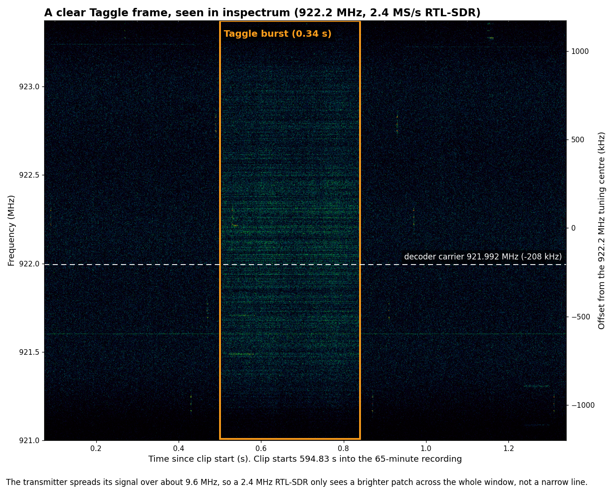
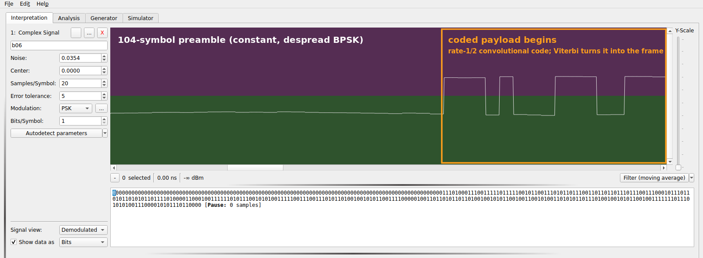
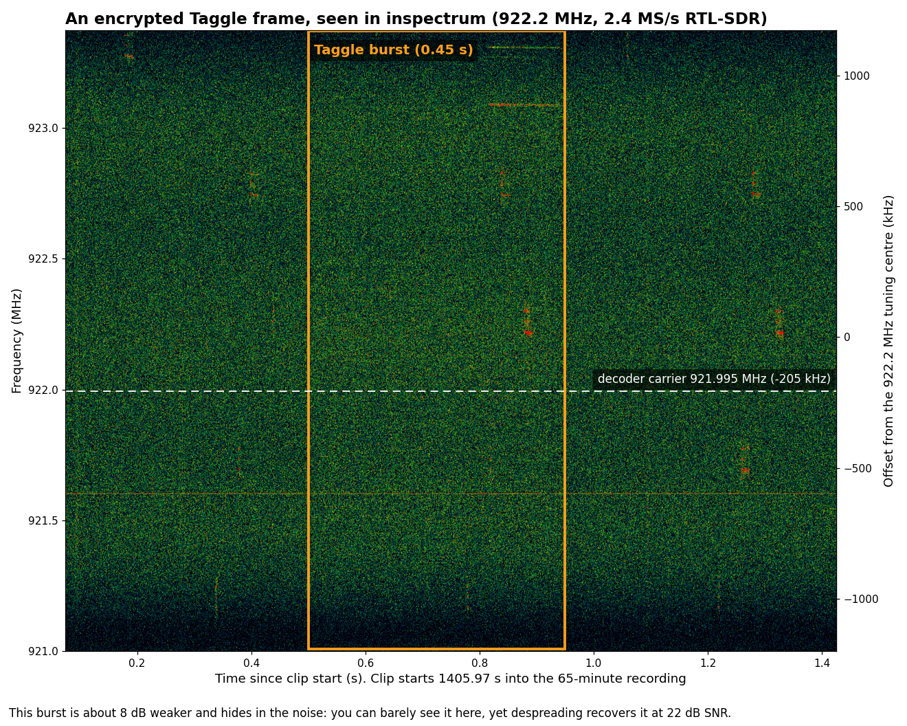

# Decoding Taggle water meters at 922 MHz with an RTL-SDR

We used an RTL-SDR Blog V4 to get hourly water readings from our own meter in Gladstone, QLD, without a cloud portal. We built [ha-taggle](https://github.com/Spicynostalgia/ha-taggle), an MIT-licensed, receive-only decoder that sends supported clear readings over MQTT to Home Assistant. We also received encrypted frames whose usage we cannot read.

We have field-tested one transmitter, producing 18-byte frames. Yours may differ. The owner confirmed an Elster (Honeywell) V100 mechanical meter; the transmitter model is unknown. This does not establish compatibility across Taggle installations, councils or current transmitters. Our worked example is Dan’s own meter, ID `527814` (`0x80DC6`), shown in full with his permission. We also show one encrypted frame’s clear ID and ciphertext unmasked. No other household’s clear frame or usage is included.

## Finding the right burst

We found our signal near 922 MHz after surveying 915–928 MHz. Overload, sidelobes or unrelated transmitters could explain clusters; the strongest peak did not identify our meter.


*Figure 1. Occupancy above the temporal median by at least 6 dB during the available 13.6-minute survey prefix, above the confirmed burst’s spectrum. We hopped frequencies; this is not simultaneous 13 MHz IQ or a meter census.*

The [SP3C datasheet](https://taggle.com/wp-content/uploads/2025/12/Datasheet-SP3C-002.pdf) describes Byron radio, one-way DSSS and generally hourly reporting, without identifying our transmitter. Our signal uses DSSS/BPSK, not LoRa or LoRaWAN.

The archive holds 20 decoded frames: twelve 18-byte clear, one 21-byte clear and seven 24-byte classified as encrypted. The production 21-byte and encrypted paths have only generated tests as deployment evidence.

## Decoding one frame, step by step

We follow the frame at recording offset 595.33 seconds through the same operations as [`dsss.py`, `coding.py` and `protocol.py`](https://github.com/Spicynostalgia/ha-taggle/tree/main/addon/taggle_rx). The [protocol notes](https://github.com/Spicynostalgia/ha-taggle/blob/main/docs/PROTOCOL.md) define the bit conventions. Indices start at zero; bits are most significant first.

### 1. Raw IQ: keep the noise-like burst

We record complex samples because despreading needs both amplitude and phase. The input is unsigned 8-bit interleaved IQ (`cu8`), centred on **922.2 MHz at 2.4 MS/s**. This burst’s archived carrier offset is `−207517.04098 Hz`, putting it near **921.992483 MHz**, about −208 kHz from centre. It looks like a faint patch of noise across the passband in the waterfall below.


*Figure 2. Dan’s burst has archived despread SNR 30.7 dB. This 1.2-second clip includes quiet padding. Power is averaged over 0.5 ms in uncalibrated ADC units, not dBm.*



*Figure 3. Made with inspectrum from the real burst 06 IQ: the full receiver passband, absolute MHz and time since clip start. The clip begins 594.83 seconds into the recording; the burst starts about half a second later.*

### 2. Mix the carrier to baseband

We remove the carrier offset so its rapid rotation does not cancel the correlation. After subtracting the complex mean, `recover_dsss` multiplies sample `n` by `exp(−j·2π·f_offset·n/2400000)`. For the archived decode, `f_offset = −207517.04098 Hz`; the opposite rotation moves that carrier to zero. Acquisition refits this value on replay, so a new run need not reproduce every RF diagnostic digit.

### 3. Despread the repeating pattern

We correlate with the spreading pattern so the wanted signal adds coherently while unrelated noise largely cancels. Each symbol carries a **4095-chip PN sequence at about 4.8 Mchip/s**. This frame’s fitted code period is `2046.6294635` ADC samples: `2400000 / 2046.6294635 ≈ 1172.66` symbols/s and about `4.802 Mchip/s`.

The fold cuts the recording into symbol-length rows and interpolates each onto a common 2048-point grid. Aligning those rows reveals the same waveform, with its sign and phase changing between symbols. Templates learned from alternate rows are correlated against the other rows; this avoids measuring each row against a template trained on itself. Timing refinement follows clock drift.

At 2.4 MS/s we retain only part of the RF bandwidth, about half a complex sample per chip. Interpolation does not recover missing bandwidth. The theoretical full-code processing gain is `10·log10(4095) ≈ 36.1 dB`: why a burst buried below the broadband noise can become a strong symbol stream. Our measured median despread correlation SNR is **30.682 dB**, about 31 dB. The ideal 36 dB is not a measured gain for this partial-band receiver; we cannot subtract it to claim an exact pre-despread SNR.

The degree-12 sequence uses forward polynomial `x^12 + x^9 + x^6 + x^5 + x^2 + x + 1` (`0x1267`). Starting at state 1, output its least significant bit, shift right, and insert the parity of `state & 0x267` at bit 11; one maps to minus one. The production receiver generates it algebraically, without per-meter captured bits.


*Figure 4. Real capture template versus regenerated, filtered PN prediction. The peak is normalised to one; this is a partial-band correlation, not evidence of sampling every chip.*

### 4. Track BPSK phase and choose polarity

We track the remaining phase rotation so the two BPSK signs become stable bits. The second-order Costas loop corrects residual phase and frequency, then reads a negative real component as one. Its squared phase error cannot distinguish phases π apart: choosing the other branch swaps every bit.

The constant preamble supplies the polarity reference. The implementation takes the first symbol as the positive branch, making the preamble zero under the chosen convention; it does not feed assumed payload bits into tracking. The decoder checks the 104-symbol preamble, permitting at most four ones, then independently checks framing and CRCs.


*Figure 5. Same amplitude scale throughout. “Before” already includes coarse carrier removal and despreading; “after” adds residual carrier and phase tracking.*



*Figure 6. Made with Universal Radio Hacker from the real IQ via the decoder’s despread symbol stream, expanded to 20 samples per symbol. This is a PSK view after despreading, not demodulation of raw wideband IQ. The 104 constant symbols precede the coded bits; nothing is blurred.*

### 5. Separate preamble and coded frame

We remove the preamble because it establishes reception rather than carrying frame bytes. This burst has **104 preamble symbols + 288 coded bits = 392 symbols**, lasting about `392 × 2046.6294635 / 2400000 = 0.3343 seconds`. Rate-1/2 decoding yields 144 bits, or **18 bytes**, including sync, checksums and tail. The 21- and 24-byte formats instead have 336 and 384 coded bits, totalling 440 and 488 symbols with the same preamble.

### 6. Undo the convolutional code

We decode pairs of coded bits together because each input bit influences several transmitted pairs. The encoder is **rate 1/2, constraint length 7**, with 64 states. It starts at zero, shifts left, inserts the newest input at bit zero and emits parity through masks **`0x6d`, then `0x4f`** (octal 155 and 117). In that bit convention the polynomials are `1 + D² + D³ + D⁵ + D⁶` and `1 + D + D² + D³ + D⁶`.

The archived `raw_coded_bits_hex` for this frame is:

```text
e8e7df2ceb736ddce2ed6ade8627eb953e73ad2567826d6d2564ca6add2564feea9c2bb0
```

Starting at zero state, its first eight pairs are `11 10 10 00 11 10 01 11`; the decoded bits are `1 1 0 0 0 0 0 0`, giving sync byte `C0`. Viterbi finds the lowest-error path through the possible states, with zero initial and terminal states. Re-encoding its output reproduces all 288 captured coded bits: **`fec_errors = 0`**. Production tries exact inversion first, then Viterbi if needed, rejecting more than twelve corrected coded bits.


*Figure 7. Viterbi explicitly rerun on real captured bits: zero corrections, sync and zero tail verified, both CRC-8 checks passing.*

### 7. Check both CRCs

We check independent framing constraints because a winning Viterbi path alone does not establish a valid frame. Both CRC-8s use polynomial **`0x07`** (`x⁸ + x² + x + 1`), **initial value zero, no reflection and xorout zero**.

For the header, compute over the **20 ID bits `[8:28]`**: bytes 1–2 (`80 DC`) and the high nibble `6` of byte 3. The result is **`E4`**, matching the received low nibble `E` of byte 3 and high nibble `4` of byte 4. Processing ID plus header CRC, `[8:36]`, gives residue **`00`**, as required by the code.

The frame CRC covers **`[8:128]`**, whole bytes **1–15** (`80 DC 6E 4F 1A C0 D3 01 B4 9A 1B 48 F1 B4 8A`). It computes **`5D`**, matching byte **16**, received **`5D`**. Byte 0 sync and byte 17 zero tail are excluded. CRCs detect errors; they do not authenticate a transmitter.

### 8. Read the fields across byte boundaries

We use bit and nibble positions because several fields straddle bytes. The full result is `C080DC6E4F1AC0D301B49A1B48F1B48A5D00`:

| Byte | Hex | Meaning in this frame |
| --- | --- | --- |
| 0 | C0 | Sync/header marker |
| 1 | 80 | First eight ID bits |
| 2 | DC | Next eight ID bits |
| 3 | 6E | `6` finishes ID `80DC6`; `E` starts header CRC |
| 4 | 4F | `4` finishes CRC `E4`; format nibble `F`, meaning unknown |
| 5 | 1A | Unknown nibble `1`; `A` starts hourly sequence |
| 6 | C0 | `C` finishes sequence `AC` = 172; unknown nibble `0` |
| 7 | D3 | Unknown byte |
| 8 | 01 | Unknown nibble `0`; newest counter flag `1` |
| 9 | B4 | Newest counter high byte |
| 10 | 9A | Newest counter low byte: `B49A` = 46234 |
| 11 | 1B | Previous flag `1`; `B` starts previous counter |
| 12 | 48 | Middle two nibbles of previous counter |
| 13 | F1 | `F` finishes `B48F` = 46223; oldest flag `1` |
| 14 | B4 | Oldest counter high byte |
| 15 | 8A | Oldest counter low byte: `B48A` = 46218 |
| 16 | 5D | Frame CRC |
| 17 | 00 | Zero tail, flushing encoder state |

The ID is `0x80DC6 = 527814`. Counter flags occupy nibbles 17, 22 and 27; their meanings remain unknown. They are separate from the three 16-bit counters. Unknown fields must stay unknown: a datasheet mentioning battery or tamper reporting does not identify those fields here.


*Figure 8. Dan’s own frame, ID and counters shown in full with permission. Nibble positions keep the flags out of counter arithmetic.*

### 9. Turn counter differences into litres

We subtract adjacent counters because each reports accumulated pulses rather than that hour’s usage. Newest first, the differences are **46234−46223 = 11 pulses** and **46223−46218 = 5 pulses**. The [tested V100’s readings match 5 L/pulse](https://github.com/Spicynostalgia/ha-taggle/wiki/Calibration), so these intervals represent **55 L and 25 L**. Calibrate your own pulse size against the dial before converting.

Compute differences modulo **65536** to handle counter wrap. The hourly sequence wraps modulo 256; three counters preserve two intervals and can bridge one missed reception when sequence and elapsed time agree. Longer gaps or inconsistent sequences require a new baseline. Its arbitrary starting offset means `46234 × 5` is not the dial reading. Hourly pulses cannot supply instantaneous flow or immediate leak alarms.


*Figure 9. Real CLI replay of the same clip: Dan’s ID, counters and RF diagnostics. Replay SNR is 30.9 dB versus 30.7 dB archived. Timestamp omitted; scan mode uses no MQTT broker or persistent state.*

## Where decoding stops: encrypted frames

The same radio and outer checks work on burst 08, in the clip labelled 1406.47 seconds. Its full 24-byte frame is:

```text
C0BB3BEAF5FA2EE84A43CFD6713761AD97925F7B24D16A00
```

| Observation | Dan’s clear frame | Encrypted burst 08 |
| --- | --- | --- |
| Sync/header | C0 | C0 |
| Clear ID | 527814 / 0x80DC6 | 766910 / 0xBB3BE |
| Length / total symbols | 18 bytes / 392 | 24 bytes / 488 |
| Header CRC: computed = received | E4 = E4; residue 00 | AF = AF; residue 00 |
| Frame CRC: computed = received | 5D = 5D | 6A = 6A |
| Tail / FEC errors | 00 / 0 | 00 / 0 |
| Archived despread SNR | 30.7 dB | 22.1 dB |
| Carrier offset | −207517.04 Hz | −205089.44 Hz |
| Code period | 2046.62946 samples | 2046.62410 samples |
| Body | Sequence, counters, unknown fields | Opaque ciphertext; usage unreadable |

The encrypted format’s body, bits 36–175, is `5FA2EE84A43CFD6713761AD97925F7B24D1`. We show it unmasked without interpreting it as counters or assigning cryptographic subfields.


*Figure 10. Burst 08: full ID, ciphertext and outer checks. RF statistics come from reception, not decrypted fields. No usage is readable.*



*Figure 11. Made with inspectrum from real burst 08 IQ, showing the full receiver passband. The clip starts 1405.97 seconds into the recording; despreading recovers the faint burst at about 22 dB SNR.*


*Figure 12. Made with Universal Radio Hacker from real IQ via the decoder’s despread symbol stream, at 20 samples per symbol. Preamble and coded bits are unblurred. Demodulating ciphertext does not reveal its meaning.*

The [SP3C](https://taggle.com/wp-content/uploads/2025/12/Datasheet-SP3C-002.pdf) and [Cockatoo](https://myriota.lbcdn.io/uploads/Datasheet-Cockatoo-002.pdf) sheets specify AES-128 for Byron telemetry; the [V200HT sheet](https://taggle.com/wp-content/uploads/2023/05/Datasheet-Honeywell-V200HT-V4.pdf) describes AES-encrypted meter data. We retain the archive’s encrypted classification. An opaque body and its length do not establish transmitter model, cipher mode, key handling or which bits are cryptographic overhead. We have not reverse-engineered those details.

AES-128 has `2^128`, approximately `3.4 × 10^38`, possible keys. Even `10^18` complete trials/s would take about `1.1 × 10^13` years to exhaust them, averaging `5.4 × 10^12` years for a uniformly random key. This hypothetical ignores overhead; it is not feasible hardware.

Likely meter fields give no known-plaintext shortcut to an AES key. A passive receiver has no request interface to choose messages from a one-way transmitter. Keys belong with the utility’s authorised infrastructure; we have neither keys nor evidence of a weakness.

This encrypted frame belongs to another household. **The project does not attempt decryption or key search, and will not accept contributions that do.** We stop at clear framing and RF diagnostics. Production output logs no ciphertext.

## Reproducing the figures

The eight matplotlib figures use the read-only research archive and decoder code. [The generator](https://github.com/Spicynostalgia/ha-taggle/blob/main/docs/blog/make_figures.py) reads the first 1.2 seconds of `burst06_595.33s.cu8`, replays the production CLI and checks the result against the archive. It separately validates encrypted burst 08’s outer framing. The four inspectrum/URH images supplied for this post come from real IQ; URH receives despread symbols, not raw RF.

Source IQ and the full archive remain private. Reproduction needs authorised recordings and matching analysis inputs. Publication permits exactly these two IDs and their selected frames, including their coded bits; the privacy check rejects other recorded IDs and frame dumps. All twelve images are unmasked.

## Fork it for your own meter

Start with the MIT-licensed [repository](https://github.com/Spicynostalgia/ha-taggle) and wiki [Quick start / Getting started](https://github.com/Spicynostalgia/ha-taggle/wiki/Getting-Started). Set `meter_ids` privately. Set `frequency` to an SDR centre retaining the supported channel, within the implementation’s centre-frequency range and acquisition target; do not copy another region’s channel plan.

Calibrate `litres_per_count` against your dial. Configure `mqtt` for your broker and Home Assistant discovery or another MQTT consumer; that choice does not extend RF compatibility. Keep 2.4 MS/s, allow an hourly transmission opportunity and confirm ownership before using readings. Receive only your own meter, keep recordings and logs private, and redact photos before sharing compatibility results.
